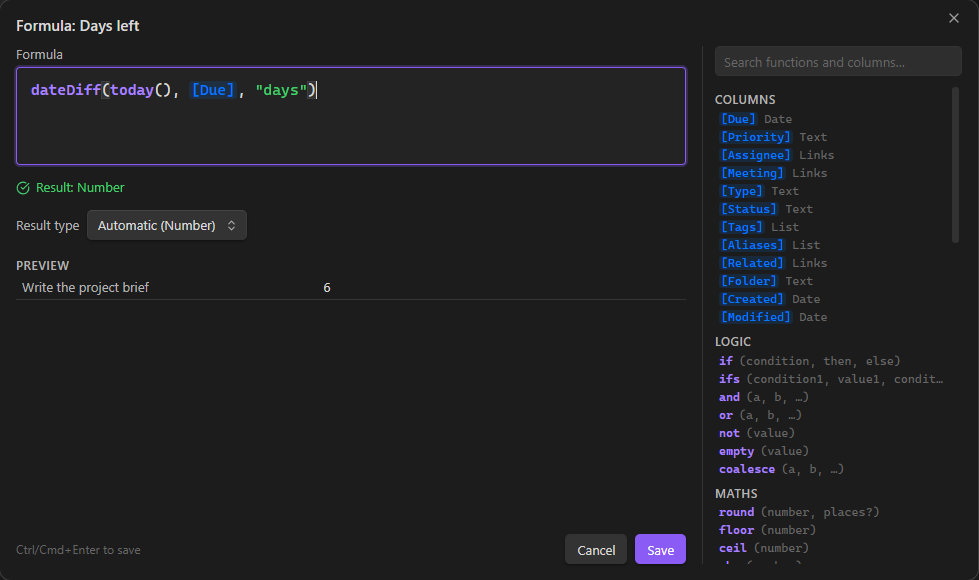
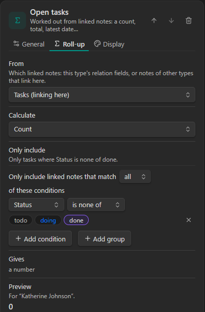

# 4. Roll-ups and formulas

Some values shouldn't be typed in at all: they follow from others. **Calculated fields** are worked out whenever they're shown and never stored, so they're always up to date.

- A **formula** calculates from the note's own fields.
- A **roll-up** summarises the notes linked to it.

## A formula: days left

Give tasks a **Days left** field: how many days until the due date.

1. Open the Task type's **Fields** tab, click **Add field** and choose **Formula** (*worked out from this note*).
2. Label it `Days left`.
3. Open its **Formula** tab and click **Edit formula…**.
4. Type:

   ```
   dateDiff(today(), [Due], "days")
   ```



The editor helps as you type:

- **Fields** are written in square brackets, by label: `[Due]`. The list on the right inserts them for you.
- **Functions** are listed by category, each with a description and an example. `dateDiff(start, end, "days")` counts whole days between two dates, and `today()` is today.
- The **preview** under the formula shows its result on one of your tasks, and its type (a number).
- A mistake — an unknown field, a missing bracket — is underlined, with the reason.

Click **Save**, then save the type. Every task now has a Days left value; overdue tasks have a negative one.

::: tip More formulas
Formulas can do a lot more: `if([Priority] = "High", "🔥", "")`, `round([Spent] / [Budget] * 100)`, `concat([Code], "-", [Number])`. See [Formulas](/reference/formulas) for every function.
:::

## A roll-up: open tasks

Now give people an **Open tasks** count: how many tasks assigned to them aren't done.

1. Open the Person type's **Fields** tab, **Add field** and choose **Roll-up** (*worked out from linked notes*).
2. Label it `Open tasks`, and open its **Roll-up** tab.
3. **From:** *Tasks (linking here)* — the tasks whose Assignee is this person. A roll-up can follow the note's own link fields, or links pointing at it from another type.
4. **Show:** *Count*.
5. **Only the linked notes that match:** click **Add a condition…**, then **Add condition**, and set it to **Status — is none of — done**.



Save the type. Grace's form now shows **Open tasks: 1**, and the number changes as soon as a task changes.

Roll-ups can also **sum** or **average** a number (a project's total spend), find the **earliest** or **latest** date (the next milestone), list the linked notes' names, or give the **% done** by status.

## What you've learnt

- Calculated fields are never stored; they're worked out from the note, or from its linked notes, when shown.
- Formulas refer to fields as `[Label]`, and the editor previews the result.
- Roll-ups follow links in either direction, and can count, total or list just the linked notes that match.

Next: [Views](./views).
