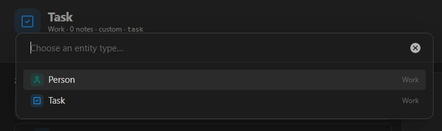
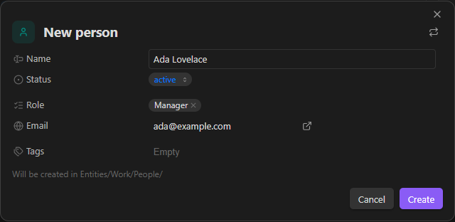
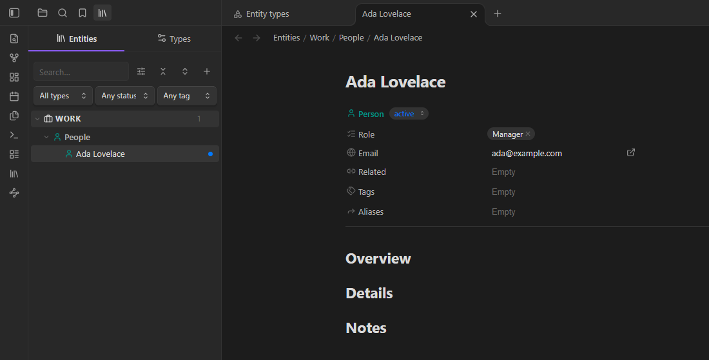
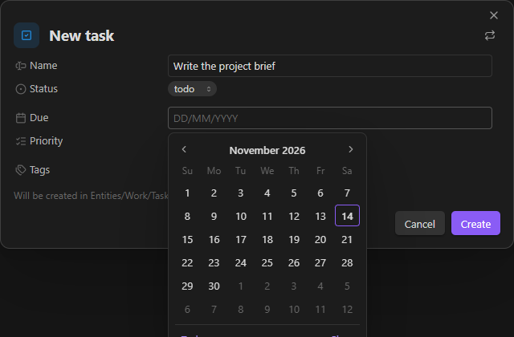
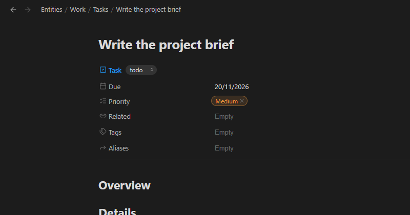

# 2. Creating notes

With types in place, you can create entities. There are several ways in; here you'll use two.

## From the Entity Browser

1. In the Entity Browser, switch to the **Entities** tab, click **+** and choose **New entity**.
2. Pick **Person** from the list of types.



The **create dialog** opens, built from the Person type: a name, a status, and the fields marked *in create dialog*.

3. Type `Ada Lovelace` as the name and set the status to **active**.
4. Click **Choose…** beside Role and pick **Manager**. Choices show as pills; type to filter them, or use the arrow keys and Enter.
5. Type `ada@example.com` in Email.



The line at the bottom says where the note will go. Click **Create**.

## The note and its form

The new note opens. Where Obsidian usually shows a Properties block, there's a **properties form** built from the type:



- The top row shows the type and a **status** dropdown.
- Each field is edited with the right control: a choice picker for Role, a link for Email.
- Values are checked as they go in. A date that doesn't exist, or a choice that isn't on the list, isn't saved — the form tells you why instead.

Behind the form it's still plain frontmatter. Switch to Source mode to see it:

```yaml
---
entity: person
status: active
role: Manager
email: ada@example.com
related: []
tags: []
---
```

The headings underneath come from the type's **template**, which you can edit like any note.

## From the command palette

Make a few more people the same way — say **Grace Hopper** (Developer), **Alan Turing** (Developer) and **Katherine Johnson** (Tester).

Then create a task from the keyboard:

1. Press <kbd>Ctrl/Cmd</kbd>+<kbd>P</kbd> and run **Obsidian Entities: Create entity**.
2. Choose **Task**, and name it `Write the project brief`.
3. Click in **Due**. A calendar opens under the field; pick a date next week, or type one.



Priority already says **Medium** — that's the default you set — and the status starts at **todo**, the first of the type's statuses. Click **Create**.



::: tip Other ways to create entities
- Each type has its own command (**Create Task**), which you can give a hotkey.
- **Convert current note to entity** turns an ordinary note into one.
- **Ctrl/Cmd+Enter** creates the note from any field in the dialog.
- Link fields offer **Create "…"** when you type a name that doesn't exist yet — you'll see them in the next part.
:::

## What you've learnt

- The create dialog asks for the fields that matter and shows where the note will go.
- Entity notes get a properties form that only lets valid values in.
- Defaults fill themselves in, and new notes start at the first status.

Next: [Linking notes](./linking-notes).
