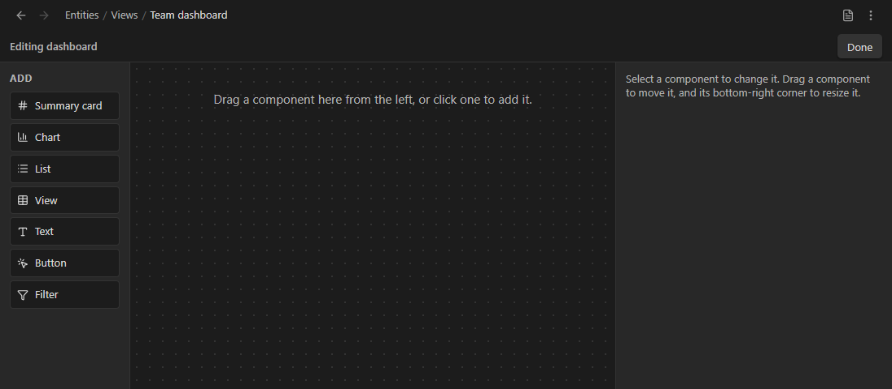
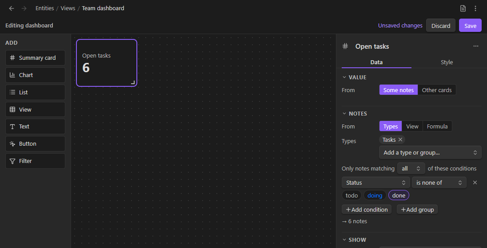
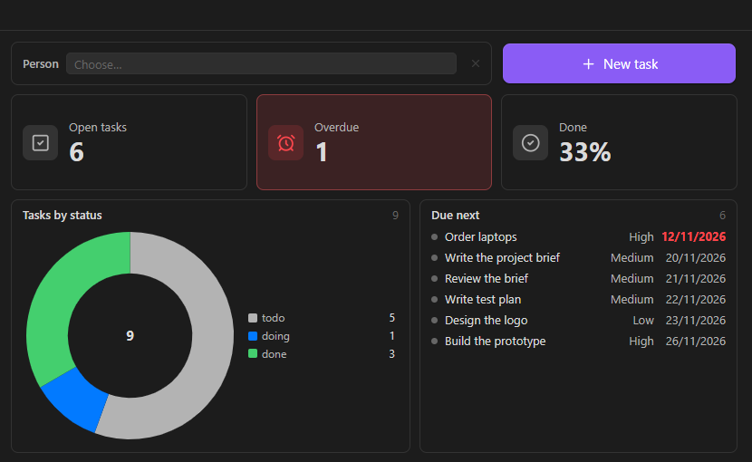
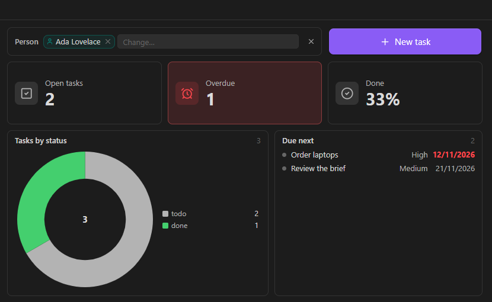

# 7. A dashboard

A **dashboard** puts the numbers, charts and lists you care about on one page. You'll build a **Team dashboard** and then make it follow one person at a time.

## Create it

In the Entity Browser's **Entities** tab, click **+**, choose **New dashboard** and name it `Team dashboard`. It opens in edit mode:

- **Add** (left) lists the components. Click one to add it, or drag it onto the grid.
- **The grid** (middle) is where they go. Drag a component to move it, and its bottom-right corner to resize it.
- **Settings** (right) shows the selected component's options, on a **Data** tab and a **Style** tab.

## A card: open tasks

1. Click **Summary card**. A card appears, counting every entity.
2. In its settings, under **Notes**, click **Add a type or group…** and choose **Tasks**.
3. Click **Add condition** and set it to **Status — is none of — done**. The result line underneath shows how many notes match.
4. Click the title at the top of the settings (*Count*) and rename it `Open tasks`.

Click **Save** at the top right. Changes aren't kept until you do; **Discard** throws them away.

## More components

Add a few more the same way:

| Component | Settings |
|---|---|
| **Summary card** "Overdue" | Tasks; Status is none of *done*; Due is before *today*. On **Style → Conditional styling**, add a rule *Value > 0* with a red fill. |
| **Summary card** "Done" | Tasks; **Show** the field *Status*, summarised as *% done*. |
| **Chart** "Tasks by status" | Tasks; a **Donut** by *Status*. Statuses keep their colours. |
| **List** "Due next" | Tasks; Status is none of *done*; fields *Priority* and *Due*; sorted by Due; at most 6. |
| **Button** "New task" | Action: create a new *Task*. |

Arrange them, click **Save**, then **Done** to leave edit mode:

Click a card, or a slice of the chart, to open the notes behind it as a table.

## Follow one person

Now make the dashboard show one person's work at a time.

1. Click **Edit**, and add a **Filter**. Make it a **Note** filter for **People**, titled `Person`.
2. Select the **Open tasks** card and add a condition: **Assignee — links to any of —** then choose the **filter button** next to the value, so it reads *[Person]*.
3. Do the same for the other cards, the chart and the list.
4. Save, and leave edit mode.

Pick **Ada Lovelace** in the filter, and every part follows:

A condition that uses a filter is left out while nothing is picked, so clearing the filter (×) shows the whole team again. What you pick is remembered for next time.

::: tip Embed it in a note
Put `![[Team dashboard]]` in a person's note — or in the Person **template**, so every new person gets it. Embedded in a note, a filter for that note's type starts on that note: each person's note shows their own work.
:::

## What you've learnt

- Dashboards are built from components on a grid, and saved as notes.
- Cards, charts and lists each choose their notes with types and conditions, like a view.
- Conditional styling changes a component's look based on its value.
- Filters make one dashboard serve every person, project or status.

Next: [Next steps](./next-steps).
