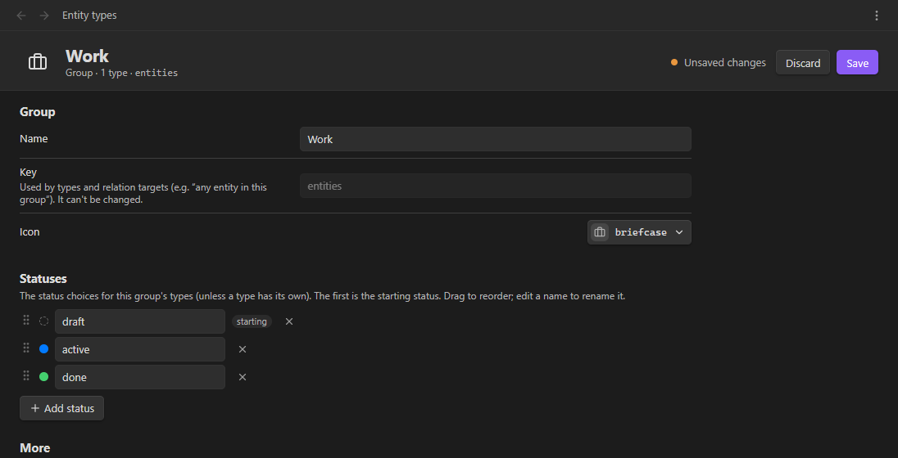
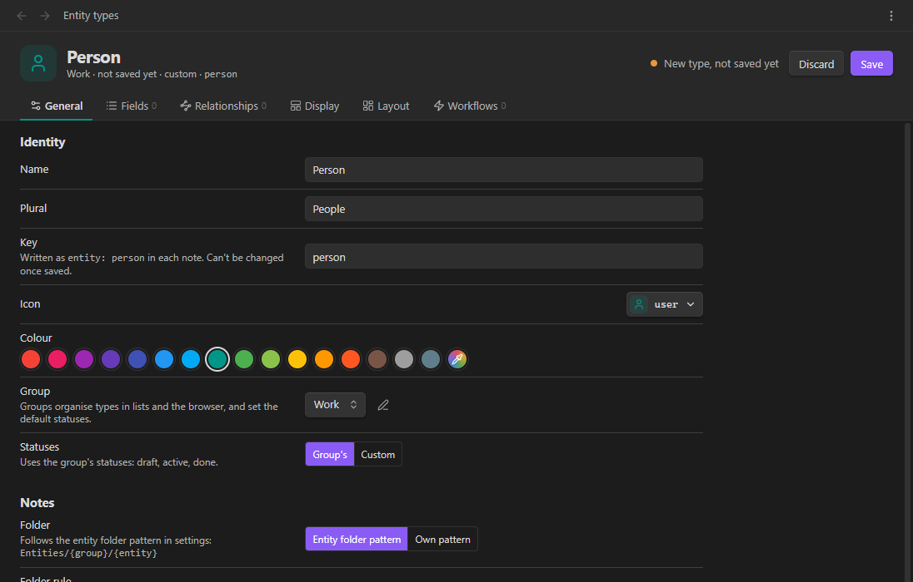
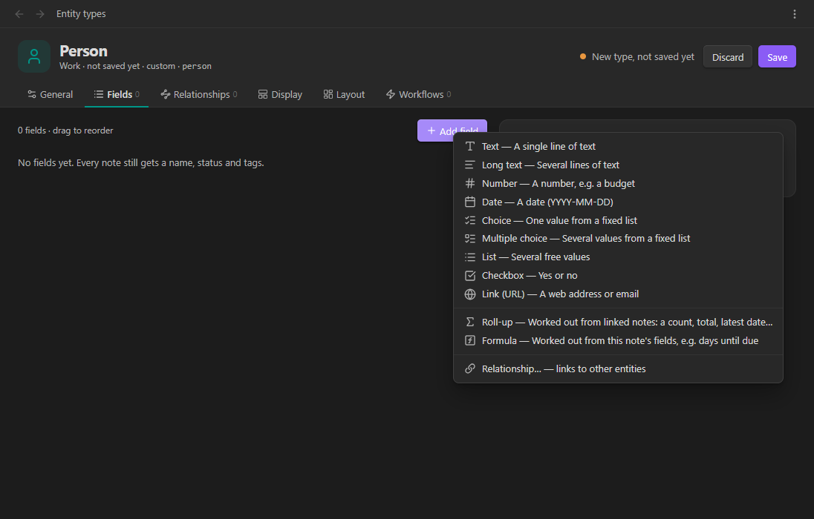
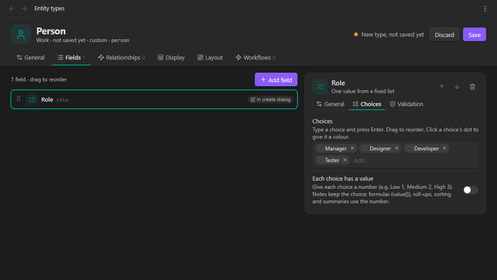
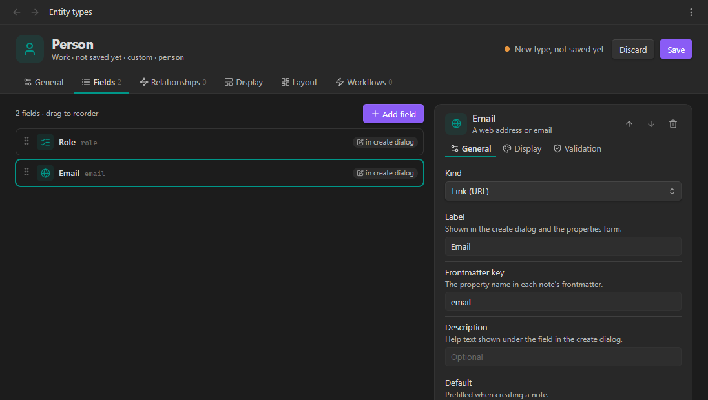
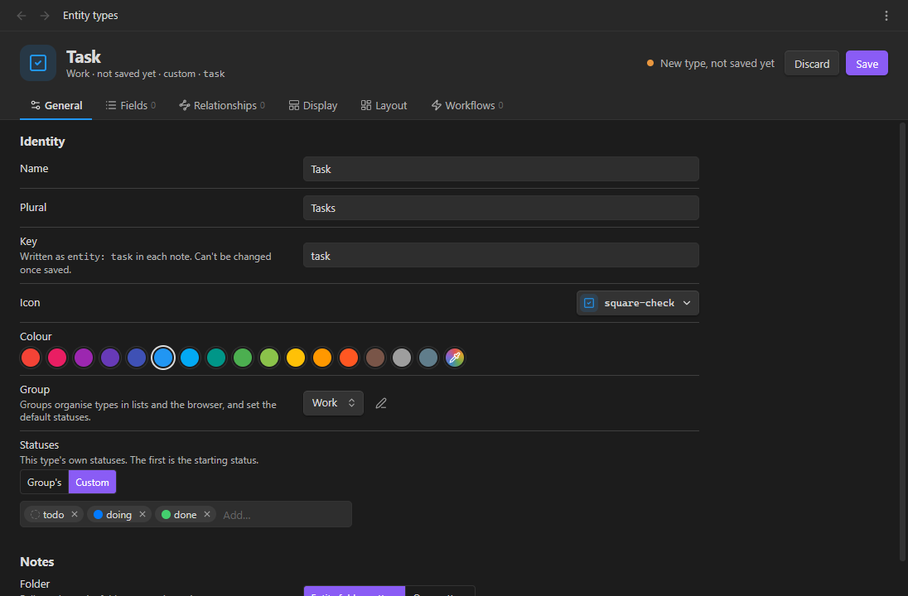
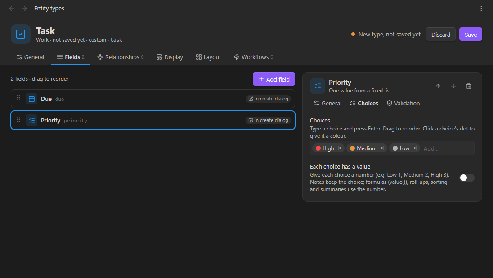

# 1. Your first types

A **type** is a kind of note. In this part you'll rename the starting group, then create a **Person** type and a **Task** type.

## Open the Entity Browser

Click the **Entity browser** icon in the left ribbon. The browser opens in the left sidebar with two tabs:

- **Entities** lists your notes, views and dashboards;
- **Types** lists your groups, types and workflows.

Switch to **Types**. You'll see one group, **Entities**, with no types in it yet.

## Rename the group

Types live in groups, and the group's name becomes part of each note's folder (`Entities/<group>/<type>/`). "Entities/Entities/…" doesn't read well, so give the group a better name.

1. Click the **Entities** group. The group editor opens.
2. Change **Name** to `Work`, and pick an icon if you like (click the icon box and search, e.g. *briefcase*).
3. Leave **Statuses** as they are — *draft, active, done* — and click **Save**.

## Create the Person type

1. Click **+** at the top of the Types tab and choose **New entity type**. The type editor opens on its **General** tab.
2. Type `Person` in **Name**. The **Key** (`person`, what's written in each note's frontmatter) fills in for you. Set **Plural** to `People`.
3. Click the **icon** box and search for `user`, then pick a **colour** from the swatches.

Notice the line under **Folder**: Person notes will go in `Entities/Work/People/`.

### Add fields

Open the **Fields** tab and click **Add field**. A menu lists every kind of field, with a line saying what each is for.

1. Choose **Choice** (*one value from a fixed list*). The new field opens in the panel on the right.
2. Type `Role` as its **Label**.
3. Open the field's **Choices** tab and add the choices one at a time, pressing Enter after each: `Manager`, `Designer`, `Developer`, `Tester`.

4. Click **Add field** again, choose **Link (URL)** (*a web address or email*) and label it `Email`.
5. Click **Save** at the top right.

::: tip Show in create dialog
New fields are marked **in create dialog**, so they're asked for when you create a note. Turn that off on a field's **General** tab for fields you'd rather fill in later.
:::

## Create the Task type

Start another type the same way (**+ → New entity type**): name `Task`, plural `Tasks`, the `square-check` icon and a blue colour.

### Its own statuses

Tasks need their own statuses rather than the group's *draft, active, done*.

1. Under **Statuses**, choose **Custom**.
2. Remove the three copied statuses with their **×**, then type `todo`, `doing` and `done`, pressing Enter after each.
3. Click a status's dot to give it a colour — `doing` blue, say, and `done` green.

::: tip Put the finished status last
The plugin treats the **last** status as done when it works out progress. Keep `done` at the end.
:::

### Its fields

On the **Fields** tab, add:

| Field | Kind | Settings |
|---|---|---|
| Due | **Date** | — |
| Priority | **Choice** | Choices `High`, `Medium`, `Low` |

Then make Priority more useful:

- **Colours:** on Priority's **Choices** tab, click each choice's dot: High red, Medium orange, Low grey. Choices show as coloured pills everywhere — forms, tables, boards, charts.
- **A default:** on its **General** tab, set **Default** to *Medium*. New tasks start at Medium.

Click **Save**. Both types now appear under **Work** in the Types tab.

## What you've learnt

- Types live in groups; the group and plural name decide the folder.
- Fields are added from **Fields → Add field**, and each kind has its own settings tab.
- Types can use their group's statuses or their own, and choices and statuses can be coloured.

Next: [Creating notes](./creating-notes).
