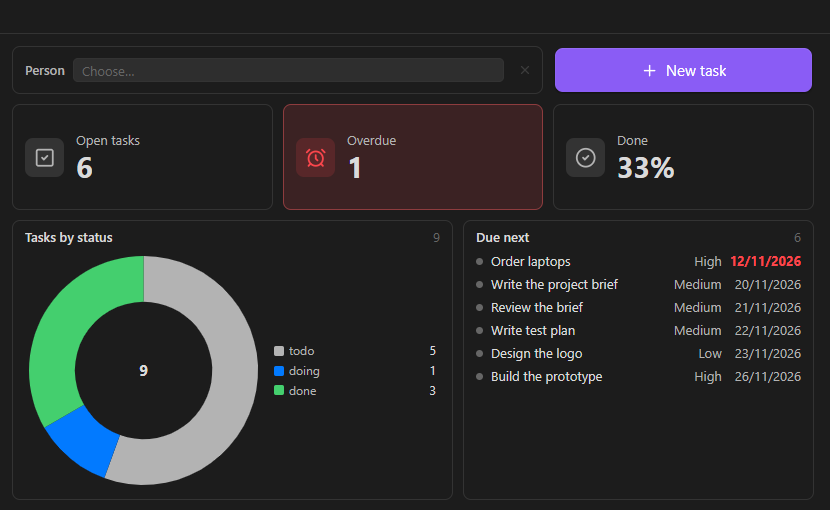

# What you'll build

This tutorial builds a small **team task tracker** from an empty vault. By the end you'll have:

- three types — **Person**, **Task** and **Meeting** — with choices, dates and coloured statuses;
- tasks linked to the people doing them and the meetings they came from;
- a **Days left** formula on tasks and an **Open tasks** roll-up on people;
- an **All tasks** view as a table and a board, with overdue tasks in red;
- a workflow that dates a task when it's marked done;
- a **Team dashboard** with cards, a chart, a list, a button and a person filter.

Every step uses the plugin's own windows; there's no YAML or JSON to write. Allow about half an hour.

## Before you start

- [Install the plugin](/guide/installation) in a vault — a new, empty one is best, so you can experiment freely.
- When **Start from a pack** opens, choose **Start empty**. (If you've already closed it, that's fine: you'll have one empty group called *Entities*.)

## The parts

1. [Your first types](./first-types) — a group, a Person type and a Task type.
2. [Creating notes](./creating-notes) — the create dialog and the properties form.
3. [Linking notes](./linking-notes) — relationships, and seeing links from both ends.
4. [Roll-ups and formulas](./calculated-fields) — fields that work themselves out.
5. [Views](./views) — a table you can sort, highlight and turn into a board.
6. [A workflow](./workflows) — automation without code.
7. [A dashboard](./dashboards) — the overview, with a filter.

Then [Next steps](./next-steps) points you at what to explore after that.
