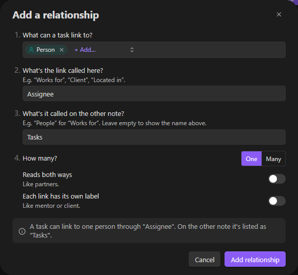
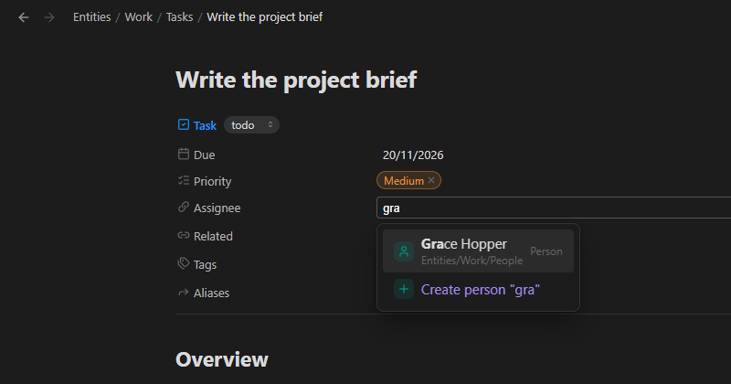
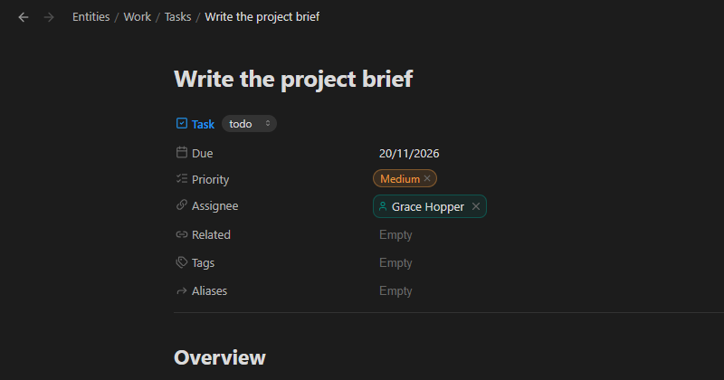
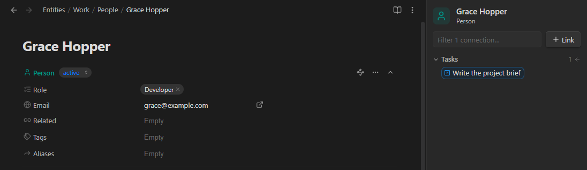

# 3. Linking notes

Tasks are done by people and come out of meetings. In this part you'll add **relationships** — link fields between types — and see how each link shows up at both ends.

## Add an Assignee relationship

1. Open the Task type: on the Entity Browser's **Types** tab, click **Task**.
2. Open the **Relationships** tab and click **Add relationship**.

A short wizard asks four questions:

1. **What does a task link to?** Choose **Person**. (A field can link to several types, a whole group, or any entity.)
2. **What's the link called on a task?** `Assignee`.
3. **What should a person call the other side?** `Tasks`. This is the **inverse** label: Grace's note will list her tasks under *Tasks*, even though only the task stores the link.
4. **How many people per task?** **One**.

A summary at the bottom says what you've set up. Click **Add relationship**, then **Save**.

## Link a task to a person

Open **Write the project brief**. Its form now has an **Assignee** field.

1. Click in Assignee and start typing `gra`.
2. Only people are offered — the field links to Person — with **Create "…"** at the end, should you need someone new.

3. Choose **Grace Hopper**.

The link shows as a coloured **chip** in the Person colour. Click it to open Grace's note; right-click it for more, including **Remove link**.

In the note's frontmatter it's an ordinary wikilink — `assignee: "[[Grace Hopper]]"` — so Obsidian's backlinks, graph and renames all keep working.

## See it from the other side

Open **Grace Hopper** and click the **Connections** button at the top right of her form (or the **Side panel** ribbon icon). The side panel lists her connections, grouped by relationship:

*Tasks* shows **Write the project brief**, with an arrow saying the link is stored on the other note. From here you can open it, remove the link, or use **+ Link** to add another.

## Add a Meeting type

Tasks often come out of meetings. Add one more type to link them to:

1. Create a **Meeting** type (purple, the `calendar-days` icon) with its own statuses: `planned`, `held`, `cancelled`.
2. Give it fields:
   - **Date** — a **Date** field. Make it required (on its **General** tab): every meeting needs a date.
   - **Agenda** — a **List** field, for one item per line.
3. On its **Relationships** tab, add **Attendees**: links to **Person**, inverse label `Meetings`, and **Several** per meeting.
4. Save it.

Then give Task a **Meeting** relationship: links to **Meeting**, inverse label `Actions`, one per task. Now a meeting lists the tasks that came out of it under *Actions*.

::: tip Create a few things to work with
Before moving on, create a couple of meetings (*Project kick-off* last week, *Weekly check-in* next week) and half a dozen tasks with different due dates, priorities and assignees, some linked to a meeting. Make one overdue and mark a couple **done**. The next parts are more interesting with something to look at.
:::

## What you've learnt

- A relationship is a link field. Only one note stores the link; the other shows it under the **inverse** label.
- Link fields only offer the types they're allowed to link to, and can create the note you're linking to.
- The **Connections** panel shows every link to and from a note.

Next: [Roll-ups and formulas](./calculated-fields).
