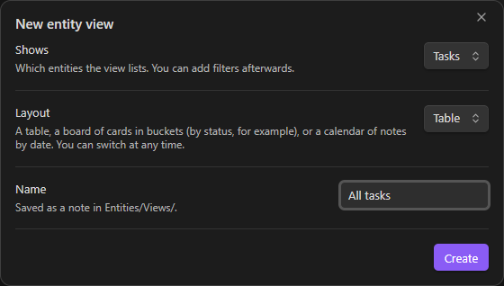
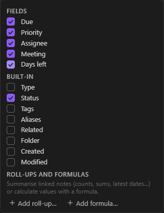
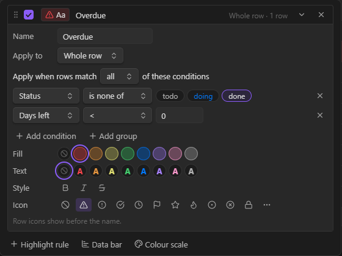
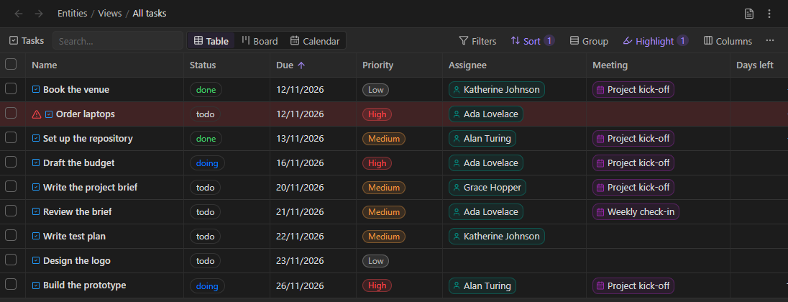
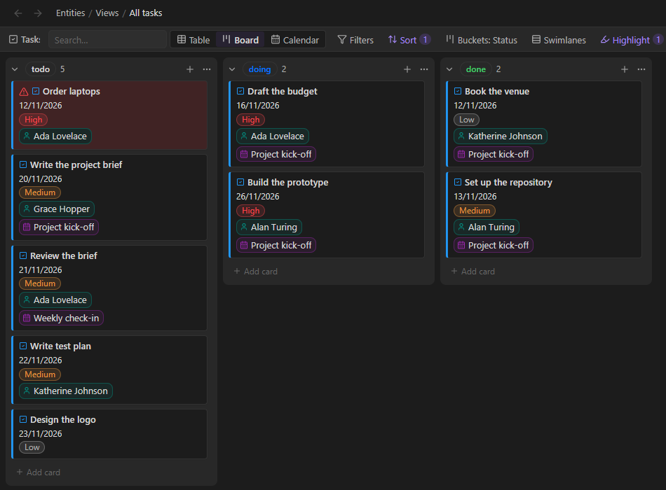

# 5. Views

A **view** shows many entities at once: a table, a board of cards, or a calendar. Each view is saved as a note, so it syncs with your vault and can be opened, linked to and embedded like any other.

## Create a table

1. In the Entity Browser's **Entities** tab, click **+** and choose **New view**.
2. **Shows:** *Tasks*. **Layout:** *Table*. **Name:** `All tasks`.

3. Click **Create**.

The view opens with every task, one per row, and is listed in the browser under **Tasks**.

## Edit in place

Most cells can be edited right in the table. Click a status, a priority or a due date to change it; click a person to open their note. Changes are written straight to the notes.

Select rows with the checkboxes to change several at once.

## Columns

Click **Columns** in the toolbar to choose which fields show. Tick **Days left** to add your formula.

Drag column headers to reorder them, and their edges to resize. A column can also be a roll-up or formula of the view's own, without adding a field to the type.

## Sort

Click **Sort → Add sort level** and choose **Due**, ascending. The soonest tasks come first. Add more levels to break ties.

Next to Sort, **Filters** narrows the rows (e.g. *Status is none of done*) and **Group** splits them into sections (by Assignee, say) with totals for each.

## Highlight overdue tasks

**Highlight** colours rows or cells that match conditions.

1. Click **Highlight → Highlight rule**.
2. **Name** it `Overdue`, and leave **Apply to** as *Whole row*.
3. Set the conditions:
   - **Status — is none of — done**;
   - **Add condition: Days left — < — 0**.
4. Choose a red **Fill** and the warning-triangle **Icon**.

Overdue, unfinished tasks now stand out in red:

::: tip Data bars and colour scales
Highlight can also draw **data bars** in a number column, or colour a column on a **scale** (green to red). Try a scale on Days left.
:::

## The same view as a board

Click **Board** in the toolbar. The same tasks become cards in columns, one per status — with the same highlights:

Drag a card to another column to change its status. **Buckets** can be any choice or single link instead (by Priority, by Assignee), **Swimlanes** add rows, and **Card fields** chooses what each card shows.

**Calendar** puts the tasks on their due dates; drag them to reschedule.

The layout you leave the view in is saved with it. Switch back to **Table** before moving on.

## What you've learnt

- Views are notes listing entities as a table, board or calendar, and one view can switch between them.
- Tables edit in place; boards change a value when you drag a card.
- Columns, sorting, filters, grouping and highlights are all saved with the view.

Next: [A workflow](./workflows).
