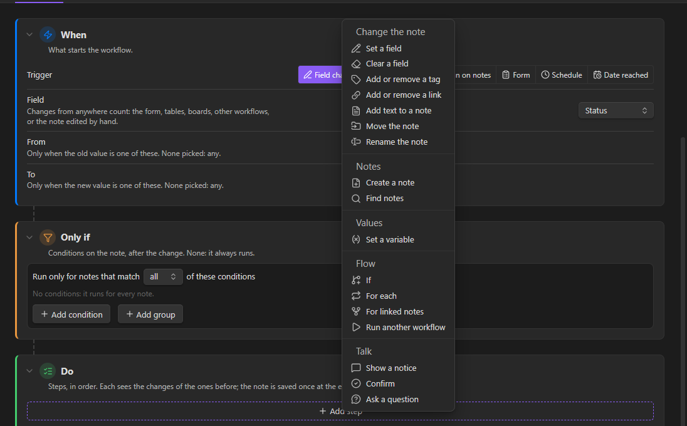
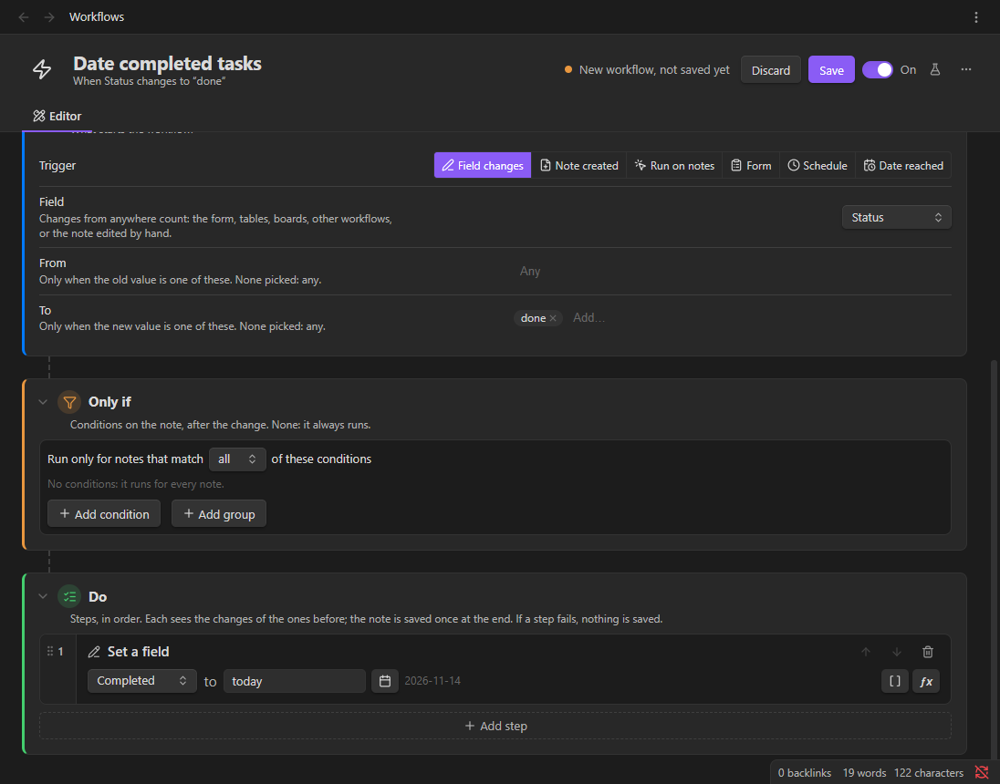

# 6. A workflow

A **workflow** does something for you when something happens. Here you'll make one that records the date a task is finished.

## Add a Completed field

First the task needs somewhere to put the date. Add a **Date** field to Task called `Completed`, untick **in create dialog** (nobody fills it in by hand), and save.

## Create the workflow

1. On the Entity Browser's **Types** tab, right-click **Task** and choose **New workflow for tasks**.

The Workflows view opens on a new workflow. It reads top to bottom: what it is, **When** it runs, **Only if** conditions, and what it should **Do**.

2. **Name:** `Date completed tasks`. **Applies to** is already *Task*.
3. **When:** the trigger is already **Field changes** on **Status**. Click in **To** and pick **done**.

The heading now reads *When Status changes to "done"*.

4. Leave **Only if** empty: it should run for every task.
5. Under **Do**, click **Add step**. The menu lists everything a workflow can do:

6. Choose **Set a field**. Set the field to **Completed**, and the value to `today`.

7. Click **Save**. The switch next to it is **On**.

## Try it

Open **All tasks**, click the status of a task that's *doing*, and change it to **done**. Open the task: **Completed** has today's date.

Every run is recorded. The Workflows view's log shows what each run changed, and **Undo last workflow run** in the command palette puts it back.

::: tip Other triggers
The same editor makes workflows that run **when a note is created**, from a **button** on notes (*Run on notes*), from a **form** you fill in, **on a schedule**, or **on a date** (three days before a task is due, say). [Workflow recipes](/guides/workflow-recipes) has worked examples.
:::

## What you've learnt

- A workflow is a trigger, optional conditions, and steps.
- **Field changes** workflows run however the field is changed: the form, a table, a board, another workflow.
- Runs are logged, and can be undone.

Next: [A dashboard](./dashboards).
