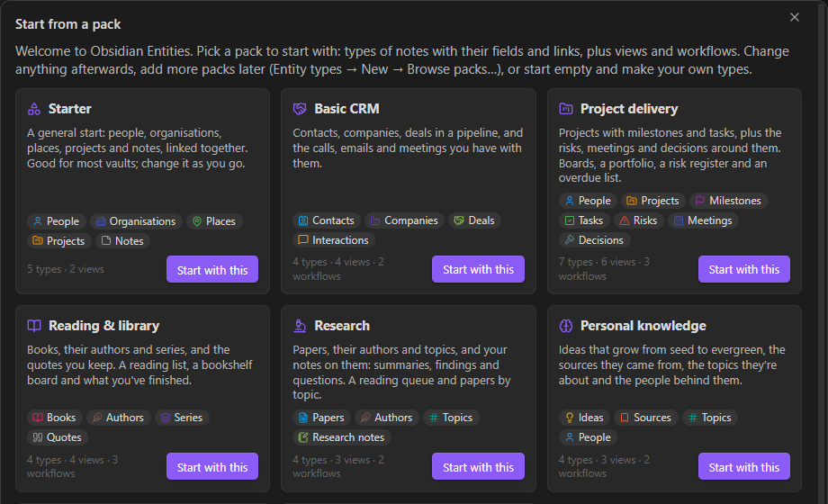

# Installation

::: info Not in the community plugin directory yet
Obsidian Entities isn't listed in Obsidian's community plugins yet, so it's installed by hand or with BRAT.
:::

Obsidian Entities works on Obsidian 1.5 or later, on desktop and mobile.

## With BRAT

[BRAT](https://github.com/TfTHacker/obsidian42-brat) installs plugins straight from GitHub and keeps them up to date.

1. Install and enable **BRAT** from Obsidian's community plugins.
2. Run **BRAT: Add a beta plugin for testing** from the command palette.
3. Enter `twakeham/obs-entity` and choose **Add plugin**.
4. Enable **Obsidian Entities** under **Settings → Community plugins**.

## By hand

1. Download `main.js`, `manifest.json` and `styles.css` from the [latest release](https://github.com/twakeham/obs-entity/releases).
2. In your vault, create the folder `.obsidian/plugins/obs-entities/` and put the three files in it.
3. Restart Obsidian, or reload its plugins.
4. Enable **Obsidian Entities** under **Settings → Community plugins**.

## The first time it runs

In a vault with no entity types yet, a **Start from a pack** window opens.

- **Pick a pack** to get a working set of types, views and workflows straight away. See [Start from a pack](/guides/packs).
- **Start empty** to design your own types. The [Getting started](/getting-started/) tutorial begins here.

Either way you can add packs later: in the Entity Browser, right-click **Entities** and choose **Browse packs…**.

## Two ribbon icons

The plugin adds two icons to the left ribbon:

- **Entity browser** — your entities, views and dashboards, and (on its **Types** tab) your types and workflows.
- **Side panel** — the open note's connections.

Settings → Obsidian Entities → **Ribbon** has switches for more icons (Create entity, Entity types, Workflows). Everything is also a command.
