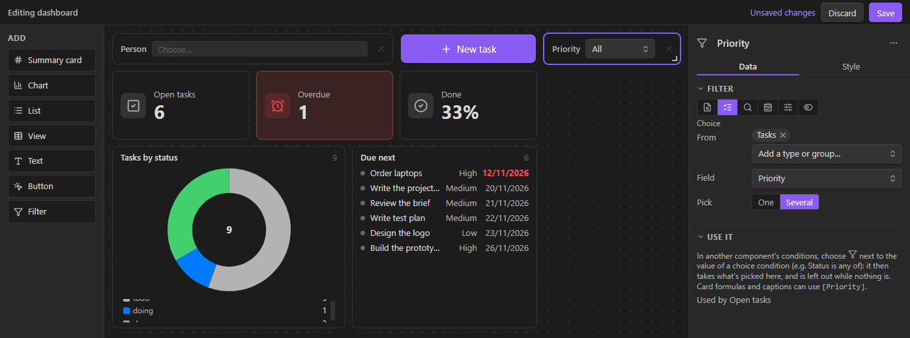
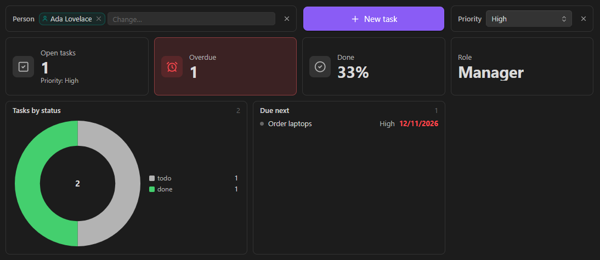
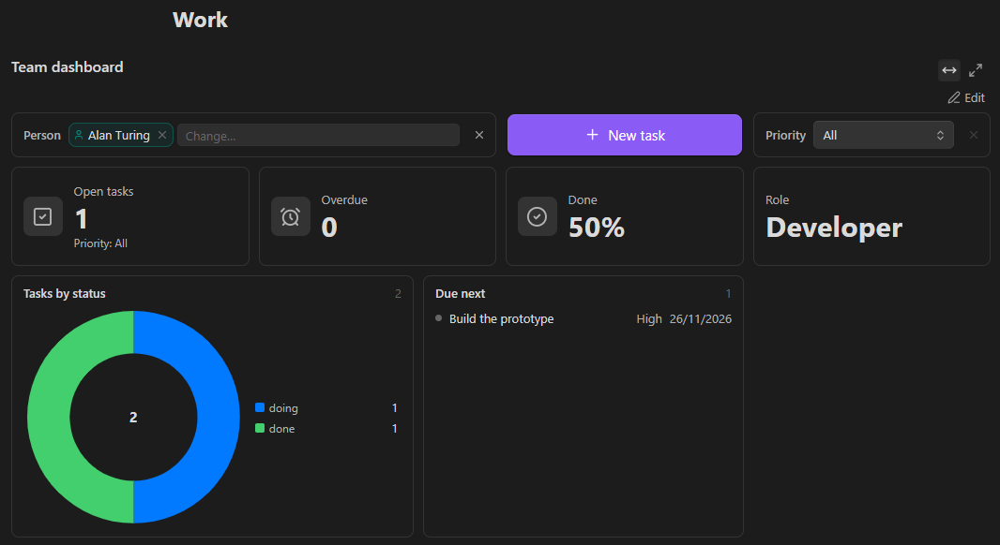

# A dashboard that follows a note

One dashboard for every person, meeting or project: pick one in a filter, or embed the dashboard in its note and it starts there.

In [Getting started](/getting-started/dashboards#follow-one-person) you gave the *Team dashboard* a **Person** filter. This guide takes it further: a second filter, filters in captions and formulas, and the dashboard embedded in every Person note so each person sees their own work.

## How filters work

A **Filter** component is something to pick. On its own it does nothing: each component that should follow it uses it explicitly, in a condition, a formula or a caption. While nothing is picked, the conditions that use it are left out, so the dashboard shows everything.

The control decides what you pick, and which conditions it fits:

| Control | In the tracker | Fits a condition like |
|---|---|---|
| **Note** | A person, a meeting | Assignee **links to any of** |
| **Choice** | A priority, a status | Priority **is any of** |
| **Search** | Some text | Name **contains** |
| **Dates** | This week, next 30 days… | Due **is between** |
| **Number** | A range, from and to | Days left **is between** |
| **Yes / no** | Yes, no or either | A checkbox field **is** |

See [Filter controls](/reference/dashboards#filter-controls) for each control's settings.

## Add a Priority filter

1. Open *Team dashboard* and click **Edit**.
2. Click **Filter** in the **Add** panel. Drag the new filter to the top right, next to **New task**, and narrow it to fit.
3. In its settings, click the title and rename it `Priority`.
4. Under **Filter**, click the **Choice** control. Set **From** to **Tasks**, **Field** to **Priority** (it starts on Status), and **Pick** to **Several**.



5. Select the **Open tasks** card. Under **Only notes matching**, click **Add condition** and set it to **Priority — is any of —**, then click the **filter button** next to the value. The value becomes a *Priority* pill.
6. Do the same for **Overdue**, the **Tasks by status** chart and the **Due next** list.
7. Click **Save**. The dashboard leaves edit mode.

Pick *High* in the filter: every part now shows only high-priority tasks, and still follows the Person filter too. Pick *Medium* as well to see both. The filter's **Use it** section, in edit mode, lists the components that use it ("Used by Open tasks, Overdue, …"), which is a quick check that you haven't missed one.

::: tip Which filter button?
The filter button only shows next to values a filter fits. A Choice filter fits any choice condition, so it also appears beside **Status — is none of**; make sure you use it on the Priority condition. When two filters fit (two Note filters, say), the button opens a menu to choose one.
:::

## Show what's picked in a caption

A caption can say what the card is counting.

1. Click **Edit** and select **Open tasks**.
2. On the **Style** tab, under **Card**, set **Caption** to `Priority: [Priority]`.

The caption reads *Priority: High*, or *Priority: All* while nothing is picked. A filter's title in square brackets shows what's picked in it; a card's title shows that card's value. Button descriptions work the same way. See [Captions](/reference/dashboards#captions).

## Use a filter in a formula

In a formula, a filter is its value: a Note filter gives the note as a link, so you can read its fields with `prop()`. Add a card that shows the chosen person's role:

1. In edit mode, add a **Summary card** and title it `Role`.
2. Under **Value**, set **From** to **Other cards**.
3. Under **Show**, type:

   ```
   if(empty([Person]), "Whole team", prop([Person], "Role"))
   ```

4. Save.

Pick *Ada Lovelace* and the card says *Manager*; clear the filter and it says *Whole team*. The `if(empty(…))` matters: with nothing picked, `[Person]` is empty.



Formulas see the other filters too: a Choice filter gives the choice (or a list, with **Several**), Dates gives `[from, to]`, and so on. See [Formulas in dashboards](/reference/formulas#formulas-in-dashboards).

## Embed it in every Person note

1. Open the Person template: on the **Types** tab, click **Person**, then **Open template** on the **General** tab.
2. Add:

   ```markdown
   ## Work

   ![[Team dashboard|wide]]
   ```

3. Paste the same lines into the people you already have. (A template only shapes notes created after you change it.)

Open *Alan Turing*: the dashboard's **Person** filter starts on *Alan Turing*, and every component follows. Embedded in a note, a **Note** filter for that note's type starts on that note. The Priority filter isn't a Note filter, so it starts with nothing picked.



`|wide` spreads the dashboard across the pane, as the note's normal width is often too narrow for the grid (below 600 pixels, components stack one above the other). The **Full width** button at the top right of the embed switches it on and off. The embed's **Edit** button opens the dashboard in a new tab.

::: warning Notes of must name the type
The filter starts on the note only if its **Notes of** includes that note's type or group. A Note filter left on **Every type** doesn't.
:::

## One dashboard for meetings too

A dashboard can have several Note filters, and each one starts on the notes of its own type. Add a **Meeting** filter, and the *Team dashboard* follows meetings as well as people:

1. Add a **Filter**, title it `Meeting`, and make it a **Note** filter with **Notes of** set to **Meetings**.
2. On each component, add **Meeting — links to any of —** and choose the **filter button**. Two filters now fit a link condition, so pick **Meeting** from the menu.
3. Save, and add `![[Team dashboard|wide]]` to the Meeting template and to *Project kick-off*.

In *Project kick-off*, the Meeting filter starts on the meeting and Person is empty: you see everyone's actions from that meeting. In a person's note it's the other way round. If you track projects, it's the same recipe: a **Project** filter, *Project links to any of [Project]* conditions, and the dashboard in the Project template gives you one dashboard for every project.

## What's remembered

What you pick is kept **on this device**, never in the note, so other devices and other people keep their own choices.

| Where | What it starts on |
|---|---|
| The dashboard on its own | What you last picked there. |
| Embedded in a note | What you last picked in *that note*. The first time, a Note filter for the note's type starts on the note. |
| After you clear a filter in a note | Nothing: it stays cleared in that note. |

So if you pick *Grace Hopper* while looking at Alan's note, Alan's note keeps showing Grace's work until you change it back. See [What's remembered](/reference/dashboards#what-s-remembered).

## Style the filters

A filter's **Style** tab changes how it looks, not what it does:

- **Values as:** a Choice filter shows its values as **Pills** while they fit, else a **Drop-down**. Choose one to fix it, or **List** for a tick box per value.
- **Plain** drops the box and border, and turning **Title** off leaves just the control, for a slim toolbar along the top.
- **Summary** adds a line saying what's picked, such as "2 of 3: High, Medium".

See [Filter style](/reference/dashboards#filter-style) for every option.

## In the block

The editor writes all this into the dashboard's `entity-view` block. A condition uses a filter by its **id** in braces; formulas and captions use its **title**:

```yaml
  - id: filter2
    kind: filter
    title: Priority
    at: [9, 0, 3, 1]
    control: choice
    types: [task]
    field: priority
    multiple: true
  - id: card1
    kind: card
    title: Open tasks
    source:
      types: [task]
      filters:
        all:
          - { field: status, op: none-of, value: [done] }
          - { field: assignee, op: links-any, value: ["{filter1}"] }
          - { field: priority, op: any-of, value: ["{filter2}"] }
    value: { agg: count }
    layout: { caption: "Priority: [Priority]" }
```

Here `filter1` is the Person filter. The editor numbers ids by kind (`filter1`, `filter2`…); you can rename one in the block, as long as you change the conditions that use it. See [The dashboard block](/reference/dashboards#the-dashboard-block).

## See also

- [Dashboards: Filters](/reference/dashboards#filters), [Using a filter](/reference/dashboards#using-a-filter) and [Embedding in a note](/reference/dashboards#embedding-in-a-note)
- [Formulas in dashboards](/reference/formulas#formulas-in-dashboards)
- [Views inside notes](/guides/views-in-notes): a single table that follows the note it's in
- [Types: Template](/reference/types#template)
