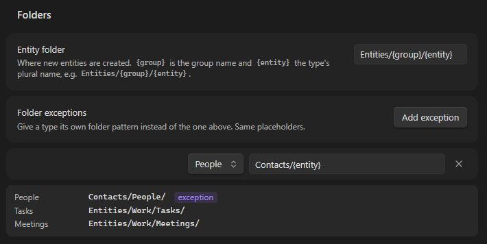
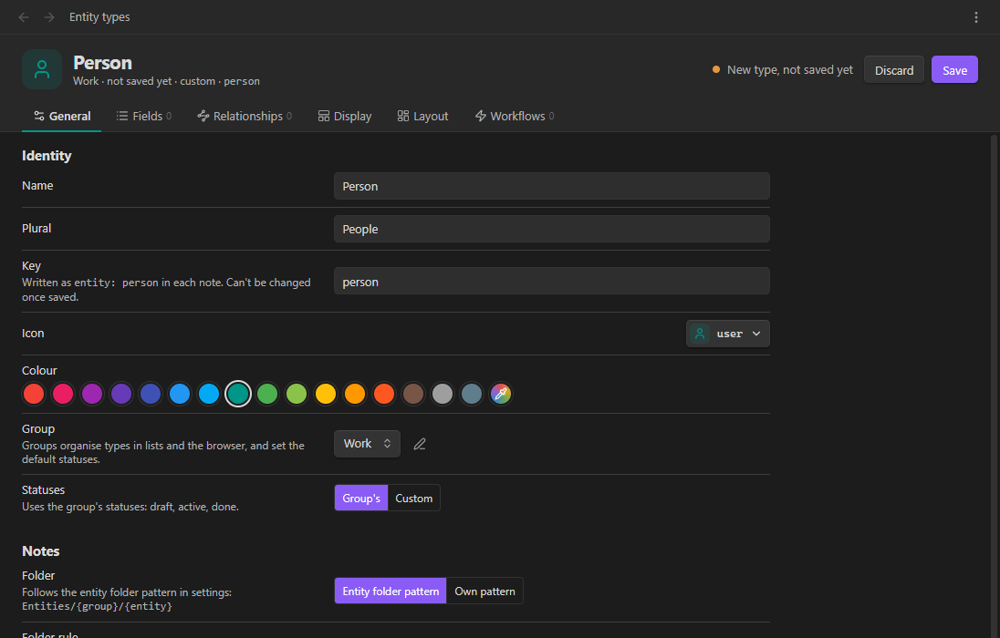
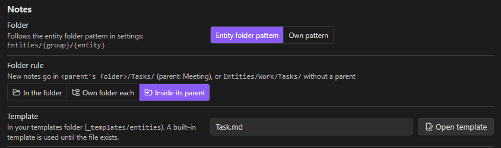
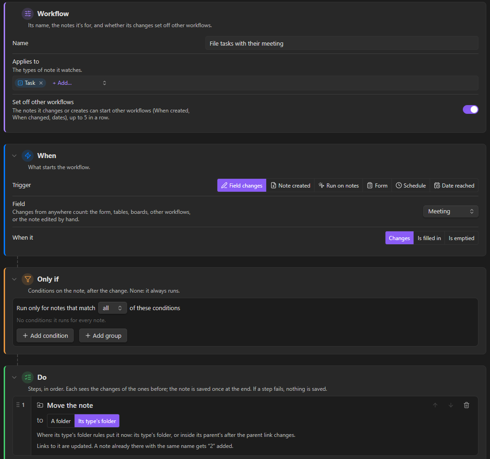

# Organise notes in folders

Decide where new notes are filed: the entity folder pattern, a folder of its own for one type, and folder rules that give each note a folder or file it inside its parent's.

Three settings decide where a new note goes:

| Setting | Where it is | What it decides |
|---|---|---|
| **Entity folder** | **Settings → Obsidian Entities → Folders** | The folder pattern for every type |
| **Folder exceptions** | The same place, or **Own pattern** on a type's **General** tab | A different pattern for one type |
| **Folder rule** | A type's **General** tab | Whether notes share the folder, get a folder each, or go inside their parent's |

You don't have to work it out: the last line of the create dialog always says where the note will go, such as *Will be created in Entities/Work/Tasks/*.

## Change the entity folder pattern

The **Entity folder** setting is a pattern with two placeholders:

| Placeholder | Becomes | In the tracker |
|---|---|---|
| `{group}` | the group's name | *Work* |
| `{entity}` | the type's plural name | *People*, *Tasks*, *Meetings* |

The starting pattern, `Entities/{group}/{entity}`, is why tasks are in `Entities/Work/Tasks/`. To change it:

1. Open **Settings → Obsidian Entities**.
2. Under **Folders**, edit **Entity folder**.
3. Check the preview under the folder settings. It lists every type and where its new notes will go.

| Pattern | A new task goes in |
|---|---|
| `Entities/{group}/{entity}` (the default) | `Entities/Work/Tasks/` |
| `{group}/{entity}` | `Work/Tasks/` |
| `{entity}` | `Tasks/` |
| `Tracker/{entity}` | `Tracker/Tasks/` |
| empty | the top of the vault |

- Only `{group}` and `{entity}` work. Anything else in braces is flagged under the box.
- Folders that already exist are matched whatever their case, so `entities/{group}/{entity}` still files notes in your `Entities/` folder.
- `{entity}` follows the type's **Plural**, and `{group}` the group's **Name**. Renaming either changes the folder for new notes.

## Give one type a folder of its own

Sometimes one type belongs elsewhere: people in a shared `Contacts` folder, say, while the rest of the tracker stays in `Entities/`. Give it an exception:

1. In **Settings → Obsidian Entities**, under **Folder exceptions**, click **Add exception**.
2. Choose **People** in the new row's dropdown.
3. Type its pattern: `Contacts/{entity}`. New people now go in `Contacts/People/`, and the preview marks People as an *exception*.

You can do the same from the type: on Person's **General** tab, set **Folder** to **Own pattern** and type the pattern there. It's the same setting, so it shows up in both places.

The pattern uses the same placeholders. Leave it empty to put the type's notes at the top of the vault. To go back to the main pattern, click the row's **×** (**Remove exception**), or set **Folder** back to **Entity folder pattern**.

## Give each note its own folder

Some notes collect things: a meeting has minutes, slides and photos; a project has its documents. Give each such note a folder of its own, so its files can sit beside it.

1. Open the Meeting type's **General** tab.
2. Under **Notes**, set **Folder rule** to **Own folder each**. The line underneath says *New notes go in Entities/Work/Meetings/&lt;name&gt;/*.
3. Click **Save**.

A new meeting called *Weekly check-in* is now created as `Entities/Work/Meetings/Weekly check-in/Weekly check-in.md`.

If the type has parent fields (below) and a parent is set, the note's folder goes inside its parent's folder instead: a sub-project's folder inside its project's.

## File notes inside their parent

**Inside its parent** files a note in a folder next to its parent note. It follows the type's **parent fields**, so set one of those first. In the tracker, tasks can live with the meeting they came out of:

1. Open the Task type's **Display** tab. Under **Hierarchy**, add **Meeting** to **Parent fields**.
2. Open its **General** tab and set **Folder rule** to **Inside its parent**. The line underneath reads *New notes go in &lt;parent's folder&gt;/Tasks/ (parent: Meeting), or Entities/Work/Tasks/ without a parent*.
3. Click **Save**.

With Meeting set to **Own folder each** as above, tasks now go here:

| A new task… | Goes in |
|---|---|
| linked to *Weekly check-in* | `Entities/Work/Meetings/Weekly check-in/Tasks/` |
| with no meeting | `Entities/Work/Tasks/`, as before |

**Parent's folder** means the folder the parent note is in. That's why **Inside its parent** works best when the parent type has **Own folder each**. If meetings all shared `Entities/Work/Meetings/`, every meeting's tasks would share `Entities/Work/Meetings/Tasks/`.

Parent fields do more than file notes:

- The Entity Browser now lists each meeting's tasks inside it.
- Right-click a meeting in the browser and choose **New task here**: the Meeting link is filled in, and the task is filed in the meeting's folder.
- With **Prefill links from the active note** on (it is to start with), creating a task while a meeting is open does the same.

With several parent fields, the first one that's filled in wins. Put them in order on the **Display** tab.

## Move notes when their parent changes

The folder is chosen once, when the note is created. Change a task's Meeting later and the task stays where it is. To have tasks follow their meeting, add a workflow:

1. On the Entity Browser's **Types** tab, right-click **Task** and choose **New workflow for tasks**.
2. **Name:** `File tasks with their meeting`.
3. **When:** **Field changes**. Set **Field** to **Meeting**, and **When it** to **Changes**.
4. Under **Do**, click **Add step** and choose **Move the note**. Set it to **Its type's folder**.
5. Click **Save**.

Now, when a task's Meeting changes, the task moves into the new meeting's `Tasks` folder. Clear its Meeting and it goes back to `Entities/Work/Tasks/`. Each move is in the Workflows view's log, and **Undo last workflow run** moves it back.

::: tip Keep links working
Moves update links to the note as Obsidian's **Settings → Files and links → Automatically update internal links** says. Turn it on, so Obsidian doesn't stop to ask on every move.
:::

## Tidy up after changing a folder setting

Changing the entity folder, an exception or a folder rule only affects **new** notes. Existing notes stay where they are, and nothing offers to move them. They're still entities: a note is an entity because of its frontmatter, wherever it lives.

To bring existing notes into line:

- **Move them yourself.** In a table such as **All tasks**, select the rows, then choose **⋯ → Move to folder…** (see [Bulk edits](/reference/tables#bulk-edits)). Moving notes in Obsidian's file explorer works too.
- **Send each to its type's folder.** Make a workflow with the **Run on notes** trigger and one **Move the note** step set to **Its type's folder**, as above. Then select notes in a view and run it from **Run…** in the selection bar. Each goes where its type's folder rules put it now, inside its parent's folder where that applies.
- **After changing a note's type,** the notice offers **Move to …/** when the new type's folder is elsewhere.

::: info Updating existing notes
The **Updating existing notes** dialog, when you save a type, is about field keys, deleted fields and renamed statuses. Folder changes never move notes for you. See [Types and groups](/reference/types#updating-existing-notes).
:::

## See also

- [Settings: Folders](/reference/settings#folders): the entity folder, exceptions and the preview
- [Types and groups: Notes](/reference/types#notes): the Folder and Folder rule options
- [Types and groups: Parent fields](/reference/types#parent-fields)
- [Steps: Move the note](/reference/steps#move-the-note) and [Triggers: When a field changes](/reference/triggers#when-a-field-changes)
- [Smart defaults](/guides/defaults): filling in new notes
