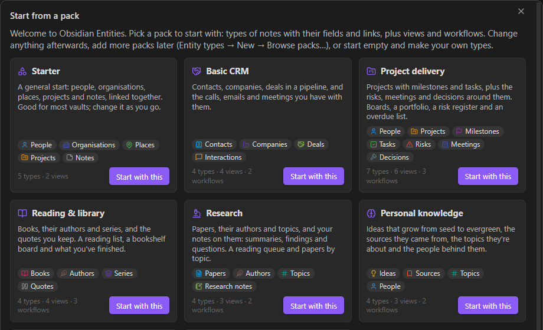

# Start from a pack

Install a ready-made set of types, views and workflows from the gallery, then make it your own.

A **pack** gives you working types with their fields and links, plus view notes, dashboards and workflows that use them. It's the quickest way to start a CRM, a reading list or a campaign, and a good way to see how a bigger setup is built. Packs never include notes: you add those.

For every detail of what installing does, see [Packs and apps](/reference/packs).

## Pick a pack on first run

The first time the plugin runs in a vault, it opens **Start from a pack**.

1. Read the cards. Each shows what the pack is for, its types, and how many views and workflows it has.
2. Click **Start with this** on the one you want. The pack is installed, the window closes and the Entity Browser opens.

If you'd rather design your own types, click **Start empty** (or just close the window). You get one empty group, **Entities**, which is where the [Getting started](/getting-started/) tutorial begins.

The picker only opens once per vault. You can still add any pack later.

## Add a pack later

1. Open the Entity Browser and switch to its **Types** tab.
2. Right-click the **Entities** heading at the top and choose **Browse packs…**.
3. In the **Entity packs** window, click **Install** on a pack.

<!-- SHOT file="guides/packs-entities-menu.png" vault="Entities Tutorial" alt="The Entities heading's right-click menu, with Browse packs…, Import pack… and the app options" how="Open the Entity Browser (left ribbon), switch to the Types tab, right-click the Entities heading at the top of the tab so its menu shows New entity type, New group, Browse packs…, Import pack…, Copy all types as a pack, Import app… and Export as an app…. Crop to the browser sidebar and the open menu." -->

A notice says what was added. The button changes to **Installed**, and the window stays open so you can add another.

**Browse packs…** is also in **Settings → Obsidian Entities → Entity types**, and on the Entity types view when no type is open.

<!-- SHOT file="guides/packs-gallery.png" vault="Entities Tutorial" alt="The Entity packs window, with a card for each pack and its Install button" how="In the Entity Browser's Types tab, right-click the Entities heading and choose Browse packs…. Don't install anything. Make the window large enough to show at least the first two rows of cards (Starter, Basic CRM, Project delivery, Reading & library) with their type chips, counts and Install buttons. Crop to the modal." -->

## Which pack?

| Pack | Good for | Types |
|---|---|---|
| **Starter** | A general vault: people, organisations, places and projects, linked together. | Person, Organisation, Place, Project, Note |
| **Basic CRM** | Contacts, companies and a deal pipeline, with a log of calls and emails. | Contact, Company, Deal, Interaction |
| **Project delivery** | Projects with milestones and tasks, and the risks, meetings and decisions around them. | Person, Project, Milestone, Task, Risk, Meeting, Decision |
| **Reading & library** | Books, authors and series, the quotes you keep, and what you've finished. | Book, Author, Series, Quote |
| **Research** | Papers, their authors and topics, and your notes on them. | Paper, Author, Topic, Research note |
| **Personal knowledge** | Ideas that grow from seed to evergreen, and where they came from. | Idea, Source, Topic, Person |
| **Home & assets** | What you own, room by room, and warranties with a reminder before they run out. | Item, Room, Warranty, Supplier |
| **TTRPG campaign** | Running a tabletop campaign: sessions, characters, quests, places and lore. | Campaign, Session, Player character, NPC, Faction, Location, Quest, Item, Creature, Encounter, Lore |

The views and workflows each pack brings are listed in [The packs](/reference/packs#the-packs).

::: tip See what the plugin can do
**TTRPG campaign** is the showcase pack. It uses almost every feature: form layouts with tabs, boards with swimlanes, a calendar, a dashboard with a filter, templates with views inside them, and sixteen workflows. Install it in a spare vault and take it apart.
:::

## What a pack installs

Installing a pack adds, beside what you already have:

- its **types**, in its own **groups**;
- its **views** and **dashboards**, as notes in your views folder (`Entities/Views` to start with);
- its **templates**, if it has any, in your templates folder;
- its **workflows**, **switched off**.

Nothing of yours is replaced. If something in the pack clashes with what you have, the pack's copy is the one that changes.

## When a name or key is already taken

Say you've built the tracker from Getting started (**Person**, **Task** and **Meeting** in your **Work** group), and you want Project delivery's projects, risks and decisions as well. Install **Project delivery** from **Browse packs…**. The notice reads:

*Installed Project delivery: 6 types, 6 views and 3 workflows (switched off). Keys already taken: task → task_2, meeting → meeting_2.*

Here's what happened:

| In the pack | What you get | Why |
|---|---|---|
| **Person** | Your own Person, untouched | Person is a **shared** type. You already have one, so the pack uses yours, and its links to people point at it. |
| **Task**, **Meeting** | New types with the keys `task_2` and `meeting_2` | You already use `task` and `meeting`. The pack's views, workflows and links follow the new keys, so they show and act on the pack's tasks, not yours. |
| **Project**, **Milestone**, **Risk**, **Decision** | New types, keys as they are | Nothing clashed. |
| The **Team** group | Not added | Only Person used it, and Person was skipped. |
| The **Delivery** and **Governance** groups | Added | They're new. |

So you now have two types called *Task*: yours under **Work**, and the pack's under **Delivery**. That's fine, but confusing; the next sections show how to tidy it up.

<!-- SHOT file="guides/packs-after-install.png" vault="Entities Tutorial" alt="The Types tab after installing Project delivery, with the Work, Delivery and Governance groups and two Task types" how="Use a throwaway COPY of the Entities Tutorial vault (installing changes the vault). In it, right-click the Entities heading on the Entity Browser's Types tab, choose Browse packs…, and click Install on Project delivery. Close the window. Expand the Work, Delivery and Governance groups so Person, Task and Meeting show under Work, Project, Milestone and Task under Delivery, and Risk, Meeting and Decision under Governance. Crop to the browser sidebar." -->

A few more things can clash:

- **Search shortcuts.** A shortcut another type already uses (such as `t` for tasks in **Find entity**) is left off the pack's type.
- **View notes.** If you already have a note with a view's name, the new one is numbered: *Overdue 2*.
- **Templates.** A template file that exists with different text is kept; the pack's is saved numbered (*Task 2.md*) and its type uses that.

See [What installing does](/reference/packs#what-installing-does) for the full rules.

## Turn on the pack's workflows

A pack's workflows come in switched off, so nothing happens behind your back. Look each one over before you turn it on.

1. On the Entity Browser's **Types** tab, find the **Workflows** heading. The pack's workflows are listed under it by what starts them: Project delivery's are *Record when a task is done* (**When changed**), *Log a meeting* (**Forms**) and *Tag overdue tasks* (**Scheduled**).
2. Click *Record when a task is done*. The editor opens. Its heading reads *When Status changes to "done"*, and its one step sets **Completed** to today.
3. To see what it would do, create a pack task, then click the flask (**Try on a note…**) and pick it. Nothing is saved.
4. Happy? Flip the **On** / **Off** switch in the header to **On**. It takes effect straight away; there's nothing to save.

Repeat for the others. Some kinds need one more thing:

- **Scheduled and date workflows**, like *Tag overdue tasks*, only run on devices where **Run scheduled workflows on this device** is on (**Settings → Obsidian Entities**). With a synced vault, turn it on for one device only. See [Scheduled workflows on each device](/reference/workflows#scheduled-workflows-on-each-device).
- **Forms**, like *Log a meeting*, are started rather than triggered. Once it's on, run **Fill in a form…** (or its own command, **Workflow: Log a meeting**) from the command palette, or right-click the workflow and choose **Fill in the form…**.

::: tip Turn them all on at once?
There's no single switch for a pack's workflows; each is turned on in its own editor, or with **Enable** on its right-click menu. That's deliberate: a workflow that changes notes should be one you've read.
:::

## Make it your own

A pack is just a starting point. Everything it installed is yours to change, exactly like types you made yourself.

### Rename a type

A type's key can't change once it's saved, but its name and plural can, and the pack's views and workflows keep working because they use the key.

1. On the **Types** tab, click the pack's **Task** under **Delivery**.
2. On the **General** tab, change **Name** to `Delivery task` and **Plural** to `Delivery tasks`. The key stays `task_2`.
3. Click **Save**.

New notes now go to `Entities/Delivery/Delivery tasks/`, and the *Task board* and *Overdue* views carry on as before. Rename the view notes too if you like: they're ordinary notes. Do the same for the pack's **Meeting** (*Project meeting*, say).

### Add a field

Say you want a budget on projects.

1. Open **Project**, go to **Fields**, click **Add field** and choose **Number**.
2. Label it `Budget`, and on its **Display** tab choose **Currency**.
3. Click **Save**.

To see it in a view, open *Project portfolio*, click **Columns** and tick **Budget**. See [Fields](/reference/fields) and [Tables](/reference/tables#columns).

### Remove a type you don't need

If you don't keep a decision log, remove **Decision**:

1. Delete its view note, *Decision log*, like any other note.
2. Open **Decision** and check its **Workflows** tab. Project delivery has none for it, but other packs might: delete those in the Workflows view.
3. On the **General** tab, under **More**, click **Delete type** and confirm.

Deleting a type never touches notes. Any *Decision* notes you'd made keep their content and frontmatter, but aren't entities until a type with that key exists again. Links from other types that could only point at the deleted type are freed to link to anything, so check them. See [Deleting a type](/reference/types#deleting-a-type).

Once a group has no types left, you can delete it from the group editor's **More** section.

::: info There's no "uninstall"
To take a whole pack out, delete its types, view notes and workflows the same way. Once none of its types are left, the gallery offers **Install** again. If you delete Starter types, the plugin remembers, so an update won't add them back; installing **Starter** from the gallery brings them back.
:::

## See also

- [Packs and apps](/reference/packs): every rule, the pack format, and import errors
- [Share your setup](/guides/sharing): copy your own types as a pack, or your whole setup as an app
- [Workflows](/reference/workflows): the editor, test runs and switching workflows on
- [Types and groups](/reference/types): renaming, keys and deleting
