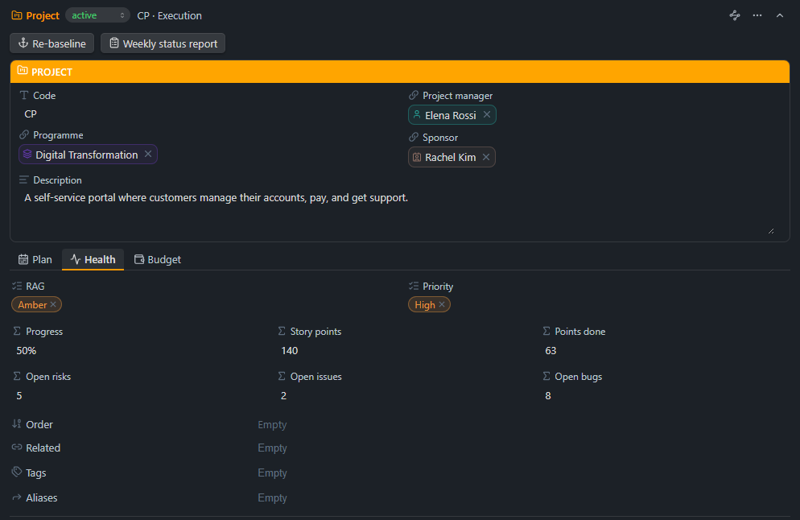
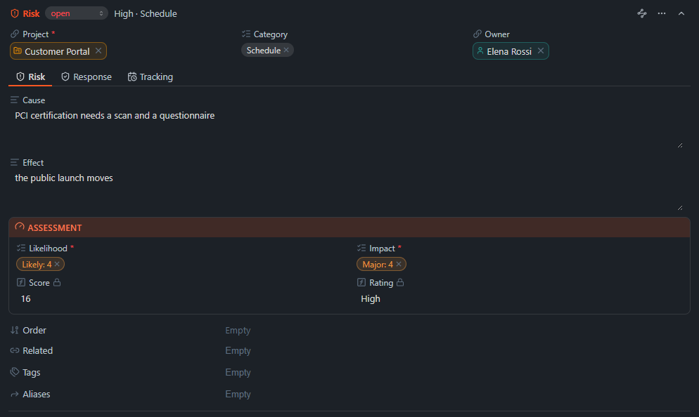
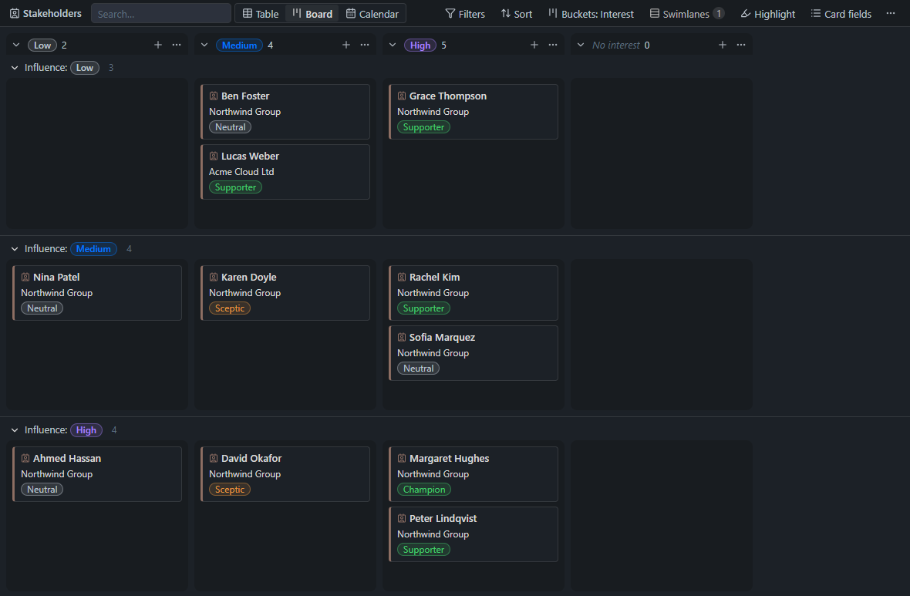
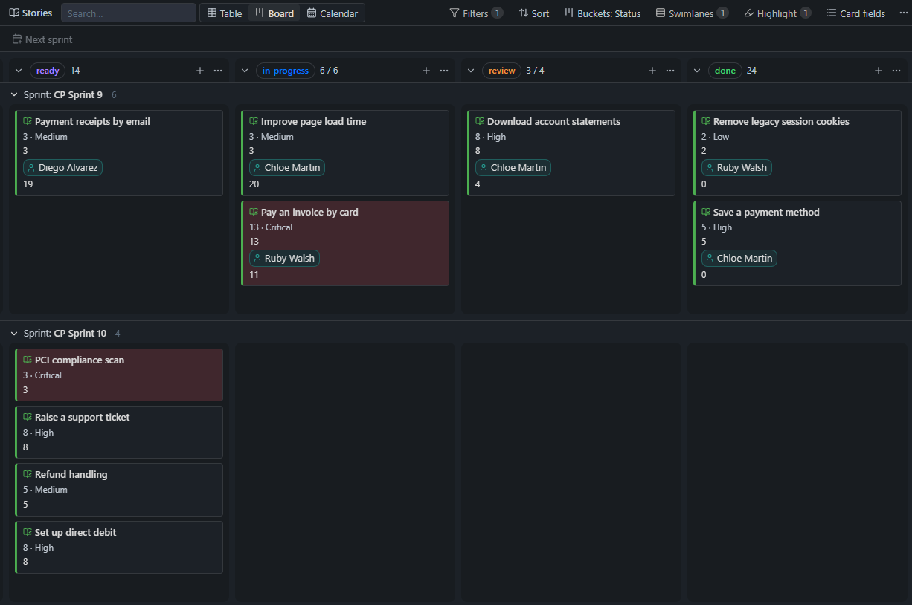
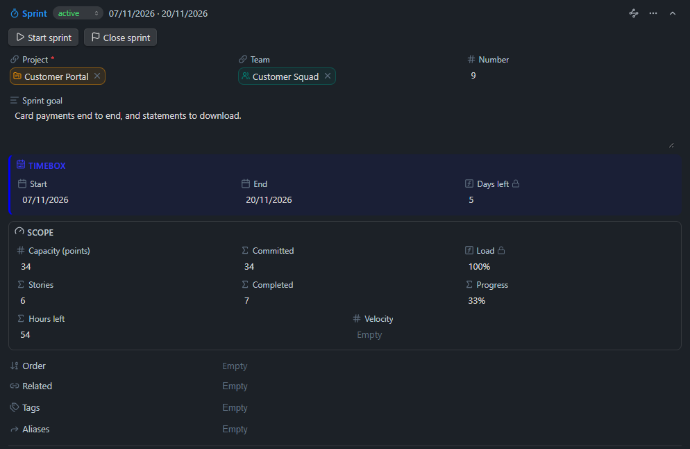
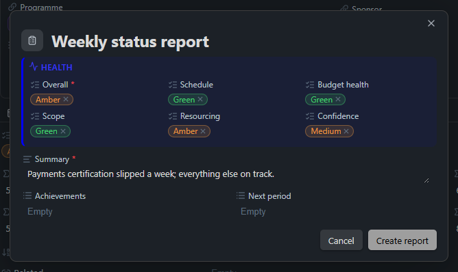

# Tour: project management

This is a tour of a complete project management setup: a portfolio of programmes and projects, a backlog with sprints, a full RAID log, governance and the people behind it all. It runs a made-up portfolio of six projects, such as *Customer Portal*, *CRM Replacement* and *Cloud Migration*.

It's a worked example, not something to download. Read it to see how the parts fit together, then build the pieces you need in your own vault. Each section links to the guide or reference page that shows you how.


::: tip Start small
The gallery's **Project delivery** pack is a quick way in. It has Person, Project, Milestone, Task, Risk, Meeting and Decision, with a portfolio table, a task board, a risk register and a decision log. Install it, then grow it towards this setup one type at a time. Its fields aren't named exactly as they are here. See [Start from a pack](/guides/packs).
:::

## The types

There are 22 types in five groups:

| Group | Types | What they're for |
|---|---|---|
| **Portfolio** | Programme, Project, Milestone, Release, Budget line, Status report | What's being delivered, by when, and for how much. |
| **Delivery** | Sprint, Epic, Story, Task, Bug | The work itself. |
| **RAID** | Risk, Assumption, Issue, Dependency, Decision | The RAID log. |
| **Governance** | Action, Change request, Meeting | How decisions get made and followed up. |
| **People** | Person, Team, Stakeholder | Who does the work, and who cares about it. |

Every type has its own statuses, and its finished state comes last: a story goes *backlog → ready → in-progress → review → done*, an action goes *open → in-progress → cancelled → done*, and a project ends *… → on-hold → cancelled → closed*. That matters for roll-ups: **% done** counts the notes in their type's last status, so a cancelled action or project never counts as done. See [% done and the last status](/reference/rollups#done-and-the-last-status).

### How they link

Almost everything belongs to a project. Each type in the Portfolio, Delivery, RAID and Governance groups (apart from Programme and Project) has a **Project** field, and it's the type's parent field. A project's parent is its **Programme**. So in the Entity Browser, a programme holds its projects, and each project holds its sprints, stories, risks and the rest.

The links are only stored at one end. The other end shows them under the **inverse label**:

| On a… | Field | Links to | Which shows it as |
|---|---|---|---|
| Project | **Programme** | Programme | *Projects* |
| Project | **Project manager**, **Sponsor**, **Delivery team** | Person, Stakeholder, Team | *Manages projects*, *Sponsors projects*, *Delivers* |
| Story | **Epic**, **Sprint**, **Release** | Epic, Sprint, Release | *Stories* |
| Epic | **Target release** | Release | *Epics* |
| Task | **Story**, **Sprint** | Story, Sprint | *Tasks* |
| Bug | **Story**, **Found in**, **Fixed in** | Story, Release | *Bugs*, *Bugs found*, *Bugs fixed* |
| Story, Task, Bug | **Assignee** | Person | *Assigned stories*, *Assigned tasks*, *Assigned bugs* |
| Sprint | **Team** | Team | *Sprints* |
| Person | **Team** | Team | *Members* |
| Risk | **Became issue** | Issue | *From risk* |
| Dependency | **Other project**, **Milestone** | Project, Milestone | *Depended on by*, *Dependencies* |
| Decision | **Meeting**, **Supersedes** | Meeting, Decision | *Decisions*, *Superseded by* |
| Action | **From meeting**, **About** | Meeting; Risk, Issue, Decision or Change request | *Actions* |
| Change request | **Decision** | Decision | *Change requests* |
| Stakeholder | **Projects** (several) | Project | *Stakeholders* |

A few links can point at more than one type. An action's **Owner** can be a person or a stakeholder, and so can a decision's **Decided by** and a meeting's **Attendees**.

Notes are filed by these links too. Programmes and projects get a folder each, and the rest go inside their project's folder, in a folder per type: the *Customer Portal* risks are in `…/Customer Portal/Risks/`. People, teams and stakeholders each have a plain folder under `Entities/People/`.

**Build it yourself:** [Your first types](/getting-started/first-types), [Linking notes](/getting-started/linking-notes), [Relationships](/reference/relationships#inverse-labels), [Parent fields](/reference/types#parent-fields) and [Organise notes in folders](/guides/folders).

## Calculated fields

Most of the numbers you'd want on a status report are worked out, not typed. Below, formulas are shown as the formula editor shows them, with field labels.

### Roll-ups

| Type | Field | Calculation |
|---|---|---|
| Programme | **Projects**, **Total budget**, **Projects at red**, **Progress** | Count, sum of Budget, count where RAG is *Red*, and **% done** of its projects. |
| Project | **Spent** | Sum of **Actual** on its budget lines. |
| Project | **Progress**, **Story points**, **Points done** | **% done** of its stories, and the sum of their Points (all, and done only). |
| Project | **Open risks**, **Open issues**, **Open bugs** | Counts, leaving out the closed statuses of each. |
| Project | **Next milestone** | The earliest **Due** of its milestones that aren't *achieved* or *missed*, shown as *in 6 weeks*. |
| Sprint | **Committed**, **Completed**, **Stories**, **Progress** | The points of its stories (all, and done), their count and **% done**. |
| Story, Sprint, Person | **Hours left** | Sum of the **Remaining (h)** of their tasks. |
| Person | **Open tasks**, **Open points**, **Open actions**, **Open bugs**, **Risks owned** | What's assigned to or owned by them and not finished. |
| Team | **Size**, **Capacity (h/week)**, **Average velocity** | Its members, their capacity, and the average **Velocity** of its sprints. |
| Meeting | **Actions**, **Open actions**, **Decisions** | What came out of it. |

Roll-ups can total a formula: **Remaining (h)** is a formula on each task, and **Hours left** adds it up for a story, a sprint or a person.

### Formulas

**Budget used** on a project:

```
if([Budget] > 0, round([Spent] / [Budget] * 100), 0)
```

The `if()` avoids dividing by zero when no budget is set. It's shown as a percentage. A sprint's **Load** (`[Committed]` against `[Capacity (points)]`) and a person's **Load** (`[Hours left]` against `[Capacity (h/week)]`) work the same way.

**Slippage (days)** compares the planned end with the end first agreed:

```
if(empty([Baseline end]), 0, dateDiff([Baseline end], [Planned end], "days"))
```

Milestones do the same with **Baseline** and **Due**, and have **Days to go**: `dateDiff(today(), [Due], "days")`.

**Remaining (h)** on a task:

```
if([Status] = "done", 0, max(0, [Estimate (h)] - [Logged (h)]))
```

Tasks and actions also have an **Overdue** formula that's true when the due date has passed and the note isn't finished. Bugs and issues have an **Age (days)**: `dateDiff([Reported], coalesce([Fixed on], today()), "days")`, which stops counting once the bug is fixed.

### Risk scores

A risk's **Likelihood** (*Rare* to *Almost certain*) and **Impact** (*Negligible* to *Severe*) are choices with values from 1 to 5, and their pills show the value: *Possible: 3*. The **Score** multiplies them:

```
value([Likelihood]) * value([Impact])
```

and **Rating** turns the score into a word:

```
ifs([Score] >= 15, "High", [Score] >= 8, "Medium", [Score] >= 1, "Low", "")
```

Other types use valued choices too. RAG is *Green* 1, *Amber* 2, *Red* 3, so a status report's **Worst** is `max(value([Schedule]), value([Budget]), value([Scope]), value([Resourcing]))`. A stakeholder's **Approach** places them on a power/interest grid:

```
ifs(and(value([Influence]) = 3, value([Interest]) = 3), "Manage closely", value([Influence]) = 3, "Keep satisfied", value([Interest]) = 3, "Keep informed", "Monitor")
```

**Build it yourself:** [Roll-ups and formulas](/getting-started/calculated-fields), [Choices with values](/reference/fields#choices-with-values), [Roll-ups](/reference/rollups) and [Formulas](/reference/formulas).

## Defaults and checks

New notes fill in what they can, and refuse values that don't fit:

- A sprint's **Team** comes from its project's **Delivery team**, its **Number** counts up, and its **End** is two weeks after today.
- A story takes its **Project** and **Release** from its epic. A task takes its **Project** and **Sprint** from its story. An action takes its **Project** from its meeting.
- A change request's **Reference** numbers itself: *CR-001*, *CR-002*…
- A risk's **Next review** is two weeks out; an issue's **Target resolution** one week; an assumption's **Validate by** three weeks.
- A project's **Code** must be 2 to 5 capital letters and unique. A release's **Version** must look like *1.4* or *1.4.2*. Story **Points** are whole numbers up to 21. End dates must come after start dates.

**Build it yourself:** [Smart defaults](/guides/defaults) and [Validate what goes in](/guides/validation).

## Forms

The bigger types have custom form layouts, so a note with 20 fields still reads well.

| Type | Layout |
|---|---|
| Project | A **Project** frame with a solid orange header (code, programme, manager, sponsor, description), then tabs: **Plan** (dates, delivery method, phase, slippage, next milestone), **Health** (RAG, progress, open risks, issues and bugs) and **Budget**. |
| Story | Project, epic and kind in a row, then tabs: **Story** (*As a… I want… so that…* and acceptance criteria), **Planning** and **Work** (tasks and hours). |
| Bug | Project, severity and environment, then tabs: **Report** and **Fix**. |
| Risk | Project, category and owner, then tabs: **Risk** (cause, effect and an **Assessment** frame with the score), **Response** and **Tracking**. |
| Sprint | A **Timebox** frame (start, end, days left) and a **Scope** frame (capacity, committed, load, progress, velocity). |
| Status report | A **Health** frame holding the five RAG ratings and **Confidence**. |
| Change request | An **Impact** frame, and a **Decision** frame you can collapse. |
| Decision | An **Options** frame for the options considered. |
| Stakeholder | An **Analysis** frame (influence, interest, attitude and approach), then tabs: **Engagement** and **Projects**. |

Some details worth copying:

- Formulas such as **Score**, **Budget used** and **Slippage (days)** sit in read-only slots, next to the fields they come from.
- Tabs and frames that only matter later are left out of the create dialog: the story's **Work** tab, the risk's **Tracking** tab and the change request's **Decision** frame. Creating a note asks only what you know at the start.





**Build it yourself:** [Design a form](/guides/form-layouts) and [Form layouts](/reference/form-layouts#in-the-create-dialog).

## Views

The 33 view and dashboard notes are in `Entities/Views/`. The tables are what you'd expect: **Portfolio**, **Product backlog**, **Risk register**, **Issue log**, **Decision log**, **Budget**, **Status reports** and more. A few use highlights well:

- **Portfolio** groups projects by programme, with a data bar on **Progress**, a green–yellow–red colour scale on **Budget used** (0, 80 and 110), red **Slippage (days)** above zero, and closed projects struck through.
- **Risk register** colours **Score** on a scale from 1 to 20, and flags a **Next review** date that has passed.
- **RAID log** shows the whole RAID group in one table (`types: ["@raid"]`), grouped by type, with finished items greyed out.
- **Team workload** groups people by team, with a bar on **Load** and a flame on anyone over 100%.
- **Stakeholder register** groups by the **Approach** formula.

### Boards

| Board | Buckets | Swimlanes | Notes |
|---|---|---|---|
| **Sprint board** | Status | Sprint | Stories that have a sprint. Card fields Points, Assignee and Hours left. Limits of 6 *in-progress* and 4 *review*. Critical stories in red. |
| **Task board** | Status | Assignee | Overdue dates in bold red, blocked tasks in red with a lock. |
| **Risk heat map** | Likelihood | Impact | Open risks, as small cards showing Score and Project. |
| **Stakeholder map** | Interest | Influence | Small cards showing Organisation and Attitude. |
| **Change requests** | Status | | |

The **Risk heat map** colours each card by its score with three row rules: *Score ≥ 15* red, *Score ≥ 8* orange, and a last rule with no conditions that makes the rest green. The first matching rule wins, so the order does the work.


The **Stakeholder map** is the power/interest grid as a board. Its buckets are put in *Low, Medium, High* order, so interest increases to the right. Dragging a card to another bucket or swimlane changes the stakeholder's Interest or Influence, and their **Approach** follows.



The **Sprint board** and **Product backlog** show their workflows as a toolbar: select some stories and click **Next sprint** to move them on.



### Calendars

**Roadmap** puts milestones on their **Due** date, releases on their **Release date**, and sprints as bars from **Start** to **End**. **Calendar** shows meetings, actions by **Due** and milestones.

**Build it yourself:** [Views](/getting-started/views), [Boards](/reference/boards#swimlanes), [Calendars](/reference/calendars) and [Highlights](/reference/filters#highlights).

## Dashboards

There are five dashboards. Each has **Note** filters at the top that make it follow a programme, project, sprint or person:

| Dashboard | Follows | Embedded in |
|---|---|---|
| **Portfolio dashboard** | a **Programme** | — |
| **Project dashboard** | a **Project** | the Project template |
| **Sprint dashboard** | a **Sprint** | the Sprint template, under *Sprint goal* |
| **My work** | a **Person** | the Person template |
| **RAID dashboard** | a **Project** and an **Owner** | — |

Every card, chart and list on them has a condition such as **Project — links to any of — [Project]**. With nothing picked, those conditions are ignored, so the dashboard shows everything. Embedded in a note, the filter starts on that note: every project note opens on its own dashboard, because the Project template begins with `![[Project dashboard]]`.


Some of the components:

- **Budget used** is a card formula over two other cards, `if([Budget] > 0, round([Spent] / [Budget] * 100), 0)`, and turns red above 90%. On the Portfolio dashboard it's orange above 75% too.
- **Points completed** is a line chart of done stories' points by **Done on**, by week: a burn-up. The *Story done: date it* workflow below fills in **Done on**.
- The Sprint dashboard's **Progress** card is `if([Committed] > 0, round([Completed] / [Committed] * 100), 0)`, and turns green with a party popper at 100%.
- **Blocked or overdue tasks** combines conditions: tasks in the sprint that aren't done, and are *blocked* **or** past their due date.
- **Raise a risk** and **Log a decision** buttons run the form workflows of those names.

Each dashboard is listed in the Entity Browser where you'd look for it: the Project dashboard under Projects, the Sprint dashboard under Sprints, My work under People, and the RAID dashboard under the RAID group.

The templates hold views of their own, filtered to *this note*. A project lists its **Milestones**, **Epics** and **Sprints**; a story its **Tasks**; a meeting its **Actions** and **Decisions**.

**Build it yourself:** [A dashboard](/getting-started/dashboards), [A dashboard that follows a note](/guides/dashboard-filters), [Card formulas](/reference/dashboards#card-formulas) and [Views inside notes](/guides/views-in-notes).

## Workflows

There are 24 workflows. Most are small; a few run a whole routine.

### Dating things

Six workflows set a date when a status changes, so you never have to type it: *Story done: date it* (**Done on**), *Bug fixed*, *Issue resolved*, *Action done*, *Milestone achieved* and *Assumption checked* (when it becomes *valid* or *invalid*). *Change rejected: date it* sets **Decided** the same way.

### The sprint cycle

**Start sprint** is a button on sprints that are *planned*. It asks *Start this sprint today?*, sets the status to *active* and **Start** to today, moves the sprint's stories from *backlog* to *ready*, and reports the stories, points and capacity.

**Close sprint** is a button on *active* or *review* sprints. It asks first, warning that unfinished stories go back to the backlog:

1. It sets **Velocity** to the sprint's **Completed** points. Velocity is a plain number, so it stays fixed once the sprint closes, and the team's **Average velocity** averages it.
2. For each story in the sprint that isn't *done*, it clears **Sprint**, sets the status back to *backlog*, and counts it in a variable, *Carried over*.
3. It closes the sprint and adds a line under its **## Review** heading: *closed with velocity 21; 2 stories back to the backlog*.

**Next sprint** is a button on stories. It finds every *planned* sprint, sorted by **Start**, keeps the first in the story's own project, and moves the story to it. If there isn't one, it says so.



**Log time** is a button on tasks. It asks *Hours spent on…?*, adds the answer to **Logged (h)**, moves a *todo* task to *in-progress*, and tells you how many hours are left.

### RAID and change

**Risk occurred: raise an issue** runs when a risk's status becomes *occurred*. It creates an issue named after the risk with *(occurred)* added, copies the project and owner, sets the description to `concat("Risk occurred: ", [Effect])` and the priority to *High*, and links the risk's **Became issue** to it. The issue opens in a new tab. If the issue already exists, it's linked rather than made twice.

**Raise a risk** and **Log a decision** are forms that start on their own. Each has its own command and ribbon icon, sits on the toolbars of the RAID log and the Risk register or Decision log, and has a button on the dashboards. *Raise a risk* asks for the project, a title, the cause and effect, likelihood, impact and owner, then reports the score.

**Change approved: log it on the project** runs when a change request is *approved*. It sets **Decided** to today, then adds a line under the project's **## Change log** heading with the cost and schedule impact. **Re-baseline**, a button on projects, copies **Planned end** into **Baseline end** (so slippage starts from zero) and logs that under the same heading. The Project template provides the heading.

### Reporting

**Write a status report** is a form on project notes, titled *Weekly status report*. It asks for the RAG ratings, a summary, achievements, next steps and confidence, then creates a status report linked to the project, named from its code and date (*CP status 2026-11-08*), and sets the project's **RAG** to the overall rating. Its health rating is labelled **Budget health** rather than *Budget*, because a form on project notes can't reuse the label of a project field.



**Weekly status report due** runs every Friday at 09:00 on *active* projects, tags each one `report-due` and shows a reminder.

### Reminders and triage

| Workflow | Runs | What it does |
|---|---|---|
| **Action overdue** | 1 day after **Due**, for open or in-progress actions | Tags it `overdue`. **Action closed: untag** removes the tag when it's done or cancelled. |
| **Milestone due soon** | 7 days before **Due** | Tags it `due-soon`. |
| **Milestone missed** | 1 day after **Due**, if still *planned* or *at-risk* | Sets the status to *missed*. |
| **Triage new production bugs** | When a bug is created | If its **Environment** is *Production*, sets **Priority** to *High* and tags it `production`. |
| **Add action** | Button on meetings | Asks *What needs doing?*, creates an action owned by the chair, and adds `- [ ] [[action]]` under the meeting's **## Minutes**. |

::: info Switched off
The four workflows that run on their own, on a schedule or a date (*Weekly status report due*, *Action overdue*, *Milestone due soon* and *Milestone missed*), are switched off in this vault. Turn them on when you're ready, on the device that should run them. See [Switching workflows on and off](/reference/workflows#switching-workflows-on-and-off).
:::

**Build it yourself:** [Workflows](/getting-started/workflows), [Workflow recipes](/guides/workflow-recipes), [Triggers](/reference/triggers) and [Steps](/reference/steps#for-linked-notes).

## Rebuilding it

You don't need all of it. A sensible order:

1. **Projects and people.** Start from the **Project delivery** pack, or make Person, Team and Project yourself. Add a Programme if you run more than a handful of projects.
2. **The work.** Add Story and Sprint (or just Task, for Kanban), each with a **Project** field set as its parent field.
3. **The RAID log.** Risk first, with valued Likelihood and Impact choices and the Score formula. Then the risk register and the heat map.
4. **The numbers.** Roll-ups on Project and Person, then the formulas that use them.
5. **Dashboards.** Build one for a project with a **Project** filter, then embed it in the Project template.
6. **Workflows.** The *date it* ones first; they're one step each. Then the sprint cycle and the forms.

When it works, keep a copy of your types as a pack, or share the whole setup as an app. See [Share your setup](/guides/sharing).

## See also

- [Start from a pack](/guides/packs)
- [Design a form](/guides/form-layouts)
- [A dashboard that follows a note](/guides/dashboard-filters)
- [Workflow recipes](/guides/workflow-recipes)
- [Roll-ups](/reference/rollups) and [Formulas](/reference/formulas)
- [Boards](/reference/boards) and [Dashboards](/reference/dashboards)
