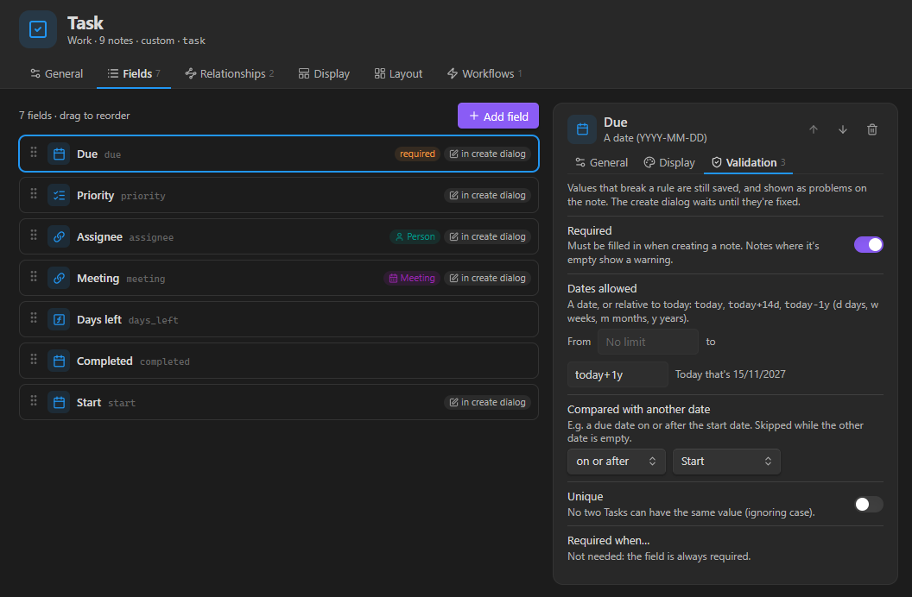
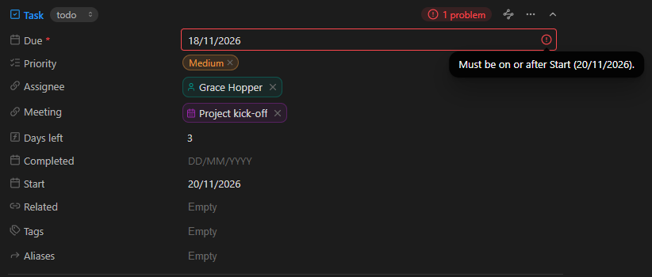
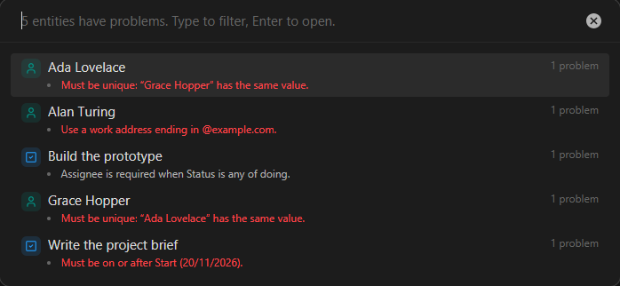

# Validate what goes in

Make fields required, set limits, patterns and unique values, and find and fix the notes that break them.

Each field can say what a good value looks like. You set this on the field's **Validation** tab, and the plugin checks every note against it. This guide adds rules to the tracker from [Getting started](/getting-started/). For every rule, see [Fields → Validation](/reference/fields#validation).

## How rules behave

Rules are there to help, not to get in the way:

- **A saved note is never blocked.** A value that breaks a rule is still saved. It's flagged as a problem so you can fix it when it suits you.
- **The create dialog is stricter.** It won't create a note until its values keep to the rules.
- **Empty values break no rules**, except **Required** and **Required when…**.
- **Existing notes aren't changed** when you add a rule. They're checked straight away, and any that break it are flagged.

To find the tab: open a type, go to **Fields**, select a field and open its **Validation** tab. Which rules it offers depends on the kind of field. The tab shows how many are set.

## Make a field required

Every task should have a due date.

1. Open the **Task** type, then **Fields → Due → Validation**.
2. Turn on **Required**, and click **Save**.

Now:

- Due has a `*` in the create dialog and the properties form.
- The create dialog won't create a task without one. Clicking **Create** shows *Required: Due*, and outlines the field.
- Existing tasks with no due date show a warning: *Due is required.*

::: tip Give it a default
A required field is less of a chore with a sensible default. Set Due's **Default** to *Relative to today*, `today+7d`, and new tasks start a week out. See [Smart defaults](/guides/defaults).
:::

## Required only sometimes

A task that's being worked on should have someone working on it, but a *todo* task may not have an owner yet. Make **Assignee** required only while the status is *doing*:

1. On the Task type, open **Fields → Assignee → Validation**.
2. Under **Required when…**, click **Add a condition…**, then **Add condition**.
3. Set it to **Status — is any of — doing**.
4. The line under the label now reads *Required when Status is any of doing.* Click **Save**.

Assignee gets its `*` only while the condition holds. In the create dialog, pick *doing* as the status and Assignee becomes required; if it isn't on show, it's asked for in a **Required** frame. A *doing* task with no assignee shows a warning: *Assignee is required when Status is any of doing.*

Conditions can test the type's fields, **Status** and **Tags**, and you can ask for **all** or **any** of them. On a field that's always **Required**, **Required when…** just says it isn't needed.

## Limit numbers and dates

### A range for numbers

Add a **Number** field to Task called `Estimate`, for hours of work. Then, on its **Validation** tab:

1. Set **Range** to `1` to `40`. Leave either box empty for no limit.
2. Turn on **Whole numbers only**.

An estimate of *60* is flagged *Must be between 1 and 40.*, and *2.5* is flagged *Must be a whole number.*

### Dates allowed

A due date more than a year away is probably a typing mistake. On Due's **Validation** tab, under **Dates allowed**, leave **From** empty and set **to** `today+1y`.

Bounds can be a fixed date (`2026-01-01`) or relative to today: `today`, `today+14d`, `today-2w`, `today+1m`, `today+1y`. The editor shows the date a relative bound gives today. A due date too far out is flagged *Must be on or before today + 1 year (15/11/2027).*

::: warning Bounds relative to today move
A relative bound is worked out on the day the note is checked. If you set Due's earliest date to `today`, every task becomes a problem the day after it's due. Use relative bounds for limits that should move, like "not more than a year ahead".
:::

## Compare two dates

A task shouldn't be due before it starts.

1. Add a **Date** field to Task called `Start`.
2. Open **Due → Validation**. Under **Compared with another date**, choose *Start* in the box that says **Not compared**.
3. The other box now reads **on or after**, which is what you want. It can also be **before**, **on or before** or **after**.
4. Click **Save**.

A task due on the 18th that starts on the 20th is flagged on Due: *Must be on or after Start (20/11/2026).* While Start is empty, the rule is skipped.

Put the rule on one of the two dates only, usually the later one. Then the problem shows once, on the field you're most likely to change.

## Check the format with a pattern

Suppose everyone on the team has an address at *example.com*. Check the Person type's **Email**:

1. Open **Person → Fields → Email → Validation**.
2. In **Pattern**, type `@example\.com$`.
3. In **Message when it doesn't match**, type `Use a work address ending in @example.com.`
4. Try it out: type `ada@example.com` in **Test it** and it says **Matches**. Type `ada@gmail.com` and it shows your message.

A pattern is a regular expression. It matches anywhere in the value unless you anchor it: `^` for the start and `$` for the end. Patterns are case-sensitive. Without a message of your own, the problem reads *Doesn't match the pattern …*, which isn't much help to anyone else, so it's worth writing one.

Text, long text and URL fields have patterns. They also have **Length**, a number of characters, at least and at most.

## Keep values unique

No two people should share an email address. On **Email → Validation**, turn on **Unique**.

If Grace's email is the same as Ada's, both notes are flagged: *Must be unique: “Ada Lovelace” has the same value.* Text is compared ignoring case and spaces at either end, so *Ada@Example.com* counts as the same. In the create dialog, typing an email someone already has stops the person being created until you change it.

**Unique** is offered for every stored kind of field except checkboxes.

## Other limits

| Rule | For | Example in the tracker |
|---|---|---|
| **How many items** | lists, multiple choice, relations with many links | A Meeting's **Attendees**: at least `2`. **Agenda**: at most `10`. |
| **Length** | text, long text, URLs | A text field for a short summary: at most `80` characters. |

## How problems are shown

| Where | What you see |
|---|---|
| **Properties form** | The field is outlined in red (a broken rule) or orange (a required field that's empty). Hover over the icon beside it to read the problem. The top row says **1 problem** or **N problems**; click it to go to the first one. |
| **Tables** | The cell is outlined in red or orange. Hover over it to read the problem. |
| **Create dialog** | A broken rule shows as soon as you type the value. Empty required fields are flagged when you click **Create**. Either way, a notice says what's wrong (*Required: Due*, or *Please fix: Due, Email*), a layout's tabs switch to the first problem, and the note isn't created. |

To fix a problem, change the value: pick a later due date, fill in the assignee, correct the email. The outline goes as soon as the value fits. Broken rules have no one-click **Fix** button, because only you know the right value. If the rule itself is wrong, change it on the field's **Validation** tab instead.

If a field is hidden by its form layout's **Show only when…** (see [Design a form](/guides/form-layouts)), it isn't required while it's hidden. Other problems still count: **N problems** shows the hidden part, marked *Normally hidden*, until you fix it.

## Find every note with a problem

After adding rules, check the notes you already have:

1. Press <kbd>Ctrl/Cmd</kbd>+<kbd>P</kbd> and run **Obsidian Entities: Check entities**.
2. A list opens of every entity with problems: its name and type icon, up to three of its problems, and how many there are.
3. Type to filter the list. It matches names, types and the problems themselves, so `unique` lists just the duplicates.
4. Choose a note to open it, then fix it in its properties form.

If nothing needs fixing, a notice says so: *No problems found in 24 entities.*

Check entities lists every kind of problem, not just broken rules: values of the wrong kind, choices that aren't allowed, links to the wrong type, and so on. See [Values that don't fit the type](/reference/notes#values-that-don-t-fit-the-type).

## See also

- [Fields → Validation](/reference/fields#validation): every rule and what it checks
- [Properties form → Problems and Fix](/reference/properties-form#problems-and-fix)
- [Commands](/reference/commands#upkeep): Check entities
- [Design a form](/guides/form-layouts): Show only when… and required fields
- [Smart defaults](/guides/defaults)
