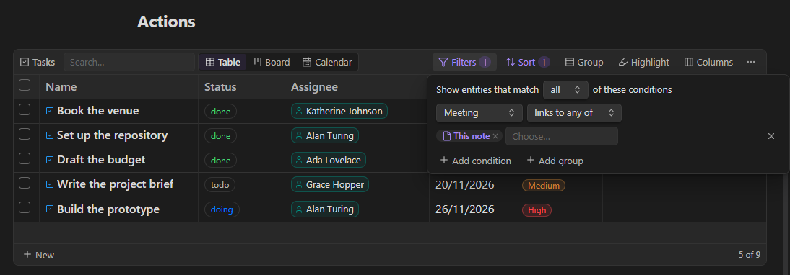
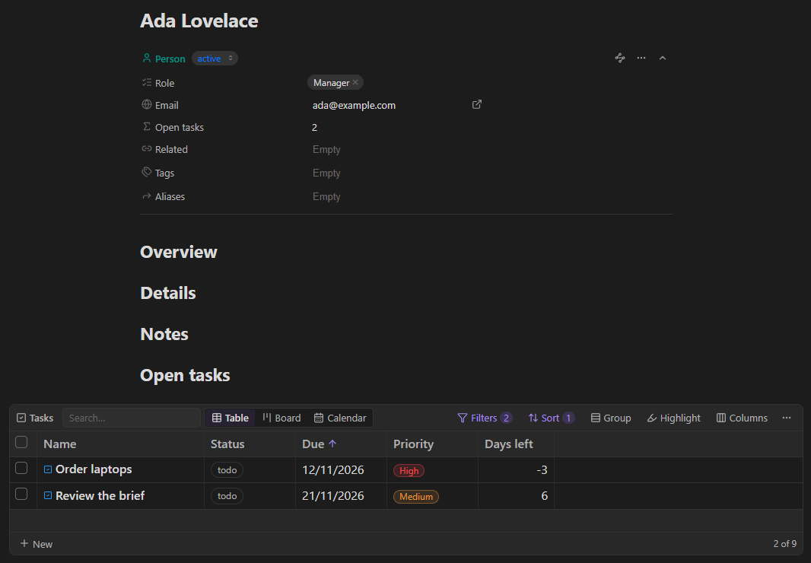

# Views inside notes

Put a live table inside a note, such as a meeting's actions or a person's open tasks, and build it into the type's template so every new note has one.

This guide builds on the tracker from [Getting started](/getting-started/). You'll add a table of actions to one meeting, then give every Person note a table of their open tasks.

## Two ways to put a view in a note

| | A view block in the note | An embedded view note |
|---|---|---|
| **How** | An `entity-view` code block, written in the note itself. | `![[All tasks]]`: a link to a saved view note. |
| **Changes** (columns, sorting…) | Saved into the block in this note only. | Saved into the view note, so every note that embeds it changes too. |
| **Good for** | A one-off, or a template where each note may drift. | One design shared by many notes, which you change in one place. |

Both are live: edit cells in place, tick rows for bulk edits, and switch between **Table**, **Board** and **Calendar**. Both understand **This note** (below).

## A meeting's actions

Tasks link to the meeting they came out of. Show them in the meeting's note:

1. Open *Project kick-off*, and add an `## Actions` heading at the end.
2. Under it, paste this block:

   ````markdown
   ```entity-view
   kind: table
   types: [task]
   columns: [name, status, assignee, due, priority]
   sort: [{ by: due, dir: asc }]
   ```
   ````

3. Move the cursor out of the block (or switch to Reading view). The block becomes a table of every task.
4. Click **Filters → Add condition**, and set it to **Meeting — links to any of**.
5. Click in the **Choose…** box. **This note** is offered first: choose it.

The table now shows just the kick-off's actions. The filter is saved into the block as `value: ["{this}"]`, and the block, which is plain text, can be copied into any other meeting, where it shows that meeting's actions.



A view block directly in a note spans the pane's full width, so wide tables have room. To change the block by hand, choose **⋯ → Edit definition**, which shows the note in Source mode.

::: tip Start from a view you have
Rather than typing a block, open a saved view such as *All tasks* and choose **⋯ → Copy block**. Paste it into the note and adjust it there.
:::

## What "This note" means

**This note** stands for the note the view is shown on:

- for a block written in a note, that note;
- for an embedded view (`![[Person tasks]]`), the note it's embedded in.

It's offered for link columns, with **links to any of** and **links to none of**, in a view's filters, its highlight rules and its roll-up columns' **Only include**. In YAML it's written `"{this}"`, with the quotes.

- **+ New** under the table fills it in. A task created from the kick-off's table already has **Meeting** set to *Project kick-off*. (See [New entities](/reference/tables#new-entities) for which conditions prefill.)
- Opened on its own, a view note has no "this note", so the condition is **ignored** and the **Filters** button turns orange with a ⚠. That's expected for a view meant for embedding.

See [This note](/reference/filters#this-note) for the details.

## Every person's open tasks

Templates are where views in notes pay off: put a block in the Person template, and every new person's note has a table of their tasks from the start.

1. On the Entity Browser's **Types** tab, click **Person**. On the **General** tab, under **Notes**, click **Open template** next to **Template**.

   The template opens: `Person.md` in your templates folder (`_templates/entities` unless you've changed it), created from the built-in template (*Overview*, *Details*, *Notes*) if it didn't exist.

2. Add this to the end of the template:

   ````markdown
   ## Open tasks

   ```entity-view
   kind: table
   types: [task]
   columns: [name, status, due, priority, days_left]
   sort: [{ by: due, dir: asc }]
   filters:
     all:
       - { field: assignee, op: links-any, value: ["{this}"] }
       - { field: status, op: none-of, value: [done] }
   ```
   ````

   `assignee`, `due`, `priority` and `days_left` are the fields' keys, as they appear in a note's frontmatter. (In the template itself the table is empty: no task links to the template.)

3. Create a person (**+ → New entity** in the Entity Browser), say *Margaret Hamilton*. Her note opens with an empty **Open tasks** table.
4. Click **+ New** under it, name the task `Plan the launch` and click **Create**. Its Assignee is already *Margaret Hamilton*, so it appears in her table.

::: warning Templates only shape new notes
A template is used when a note is created. Ada, Alan, Grace and Katherine were created before you changed it, so paste the same `## Open tasks` block into their notes too. Each one shows that person's own tasks.
:::



Because each note has its own copy of the block, you can change one person's table (add a column, group by Priority) without touching the others. The flip side: to change them all later, you edit each note. If you'd rather change them in one place, embed a saved view instead.

## Embed a saved view instead

1. In the Entity Browser's **Entities** tab, click **+ → New view**: **Shows** *Tasks*, **Layout** *Table*, **Name** `Person tasks`.
2. Choose its columns and sorting as you like.
3. Click **Filters** and add **Assignee — links to any of — This note**, and **Status — is none of — done**.

   On the view's own tab the first condition is ignored, so it lists every open task, and the **Filters** button is orange. That's fine.

4. In the Person template (and in existing people's notes), replace the block with:

   ```markdown
   ## Open tasks

   ![[Person tasks]]
   ```

Each person's note now shows their own tasks. Add a column in any of them and it's added in all of them, because it's saved into *Person tasks*.

The embed's display text takes two options, on their own or together:

| Embed | Shows |
|---|---|
| `![[Person tasks]]` | The view at the note's normal width, with its toolbar and footer. |
| `![[Person tasks\|bare]]` | Just the rows: no toolbar or footer. |
| `![[Person tasks\|wide]]` | The view across the pane's full width. |
| `![[Person tasks\|wide bare]]` | Both. |

The **Full width** button at the top right of an embedded view turns `wide` on or off for you.

## Boards and calendars in notes

A view in a note can be a board or a calendar too. Click **Board** or **Calendar** in its toolbar, and the layout is saved with it: into the block, or into the view note. To start as a board, write `kind: board` in the block.

- On a board of the kick-off's actions (by status), drag a card to **done** to finish the task.
- On a calendar of a person's tasks, drag a task to another day to change its due date.

`|bare` keeps a calendar's own navigation, so you can still move between months.

## When it doesn't show what you expect

| You see | Why |
|---|---|
| Every task, and an orange **Filters** button | The view isn't shown on a note: you've opened the view note on its own, or you're looking at an embed in a hover preview. |
| "This entity view can't be shown" | The block isn't valid YAML, or names a type that doesn't exist (`types: [tasks]` rather than `[task]`). Click **Edit definition** to fix it. |
| The template's view in a note made before you changed it | Templates only apply to new notes. Paste the block or embed in yourself. |

## See also

- [Tables: Views in notes](/reference/tables#views-in-notes) and [The view block](/reference/tables#the-view-block): every key a block can have
- [Filters: This note](/reference/filters#this-note) and [Condition YAML](/reference/filters#condition-yaml)
- [Roll-ups: This note](/reference/rollups#this-note-views-only): count linked notes *for this note* in a view's roll-up column
- [Types: Template](/reference/types#template)
- [A dashboard that follows a note](/guides/dashboard-filters): the same idea for a whole dashboard
