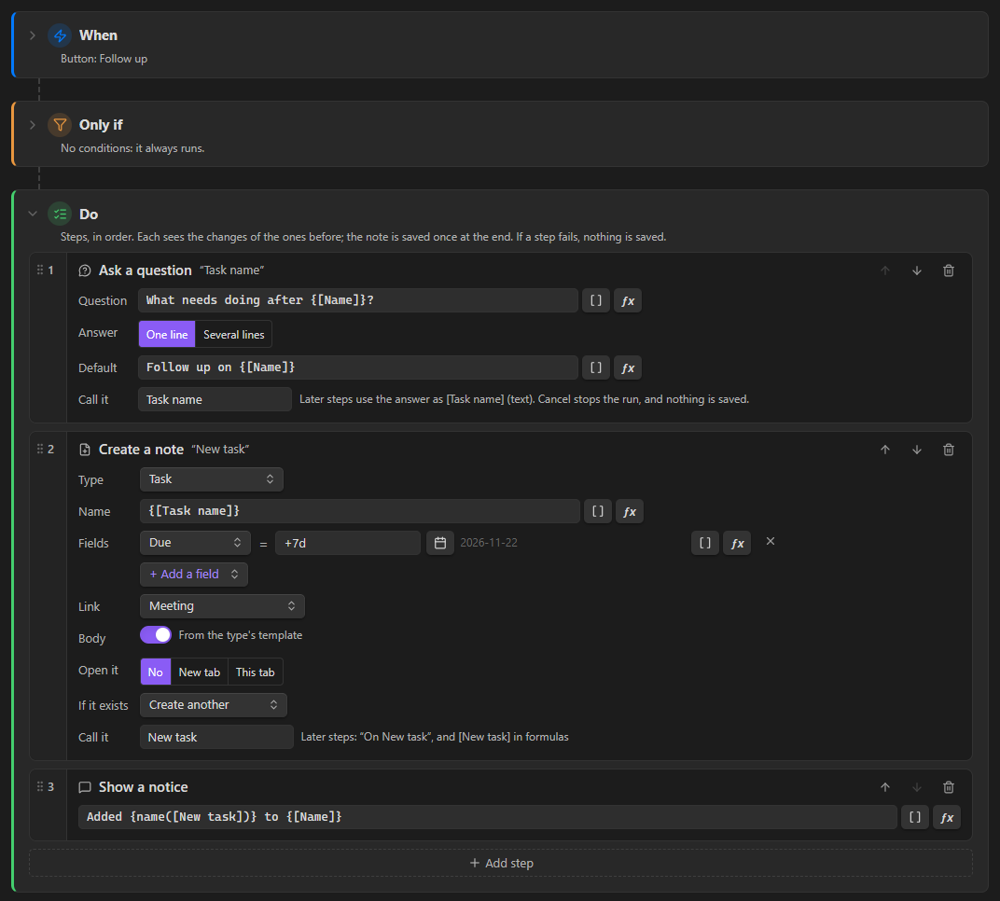
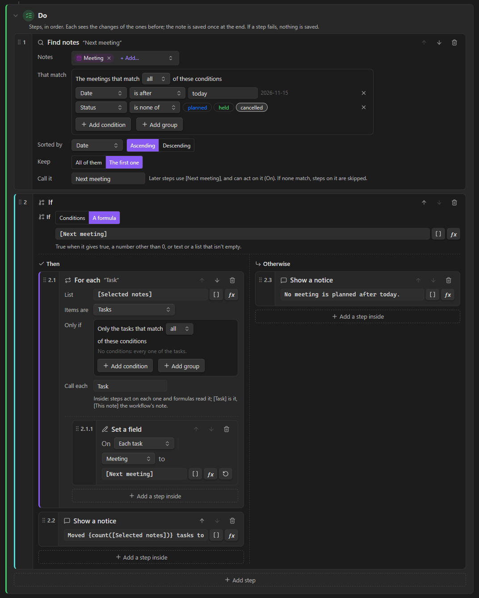
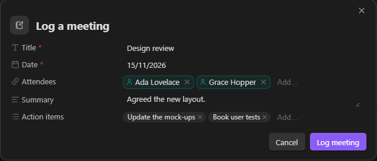
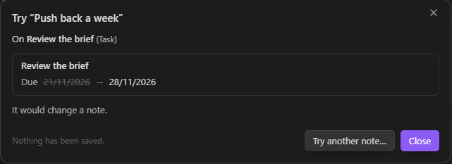

# Workflow recipes

Ready-to-copy workflows for common jobs, built on the tracker from [Getting started](/getting-started/): *Task*, *Person* and *Meeting* in the **Work** group.

Each recipe gives the goal, then the workflow as you fill it in, top to bottom: **Applies to**, **When**, **Only if** and **Do**. Field names and formulas are exact, so you can type them as they are, or change them to suit your own types.

To start a workflow for a type, right-click the type on the Entity Browser's **Types** tab and choose **New workflow for…**. **Applies to** is filled in for you. For a workflow with no type (a form, say), right-click the **Workflows** heading and choose **New workflow**.

::: tip Try it before you save it
The flask in the editor's header, **Try on a note…**, shows what a workflow would do to a note without saving anything. Use it after every few steps. See [Test, check and undo](#test-check-and-undo).
:::

## Stamp a date when work finishes

**Goal:** a task records the day it was finished, and forgets it if it's reopened.

You built the first half in [Getting started](/getting-started/workflows): *Date completed tasks* sets **Completed** to `today` when Status changes to *done*.

### Clear the date when a task is reopened

A task moved back from *done* keeps its old date. A second workflow clears it:

- **Name:** `Clear reopened tasks` · **Applies to:** *Task*
- **When:** **Field changes** · **Field** *Status* · **From** *done* · **To** nothing picked (any)
- **Only if:** nothing
- **Do:**
  1. **Clear a field** · *Completed*

### Or do both in one workflow

**Field changes** workflows can see the value before the change with `old()`, and after it with `new()`. One workflow can then handle both directions. Switch off *Date completed tasks* first, or both will set the date.

- **Name:** `Track completion` · **Applies to:** *Task*
- **When:** **Field changes** · **Field** *Status* · **From** and **To** nothing picked
- **Only if:** nothing
- **Do:**
  1. **If** · **A formula** · `new([Status]) = "done"`
     - **Then:** **Set a field** · *Completed* to `today`
     - **Otherwise:** **If** · **A formula** · `old([Status]) = "done"`
       - **Then:** **Clear a field** · *Completed*

Choose **A formula** at the top of the If card, then type the formula. Steps go under **Then** and **Otherwise** with **Add a step inside**.

::: info Testing old()
A test run of a **Field changes** workflow acts as if the field had just changed to what it is now, so `old([Status])` and `new([Status])` are the same. To see the reopen branch work, change a real task from *done* to *doing*, then check **Recent runs**.
:::

**Variations:** add **Add or remove a tag** · **Remove** `overdue` to the *done* branch, to tidy up after the [reminders](#reminders-on-a-schedule) below. The same pattern stamps a *Started* date when Status changes to *doing* (add a **Date** field called `Started` to Task first).

## Create a follow-up task

**Goal:** a **Follow up** button on a meeting that asks what needs doing, then creates a task linked to the meeting.

- **Name:** `Follow up` · **Applies to:** *Meeting*
- **When:** **Run on notes** · **Button** `Follow up` (with an icon such as *list-plus*) · **On several notes** **Each note**
- **Only if:** nothing
- **Do:**
  1. **Ask a question** · **Question** `What needs doing after {[Name]}?` · **Answer** **One line** · **Default** `Follow up on {[Name]}` · **Call it** `Task name`
  2. **Create a note** · **Type** *Task* · **Name** `{[Task name]}` · **Fields:** *Due* `+7d` · **Link** *Meeting* · **Open it** **No** · **If it exists** **Create another** · **Call it** `New task`
  3. **Show a notice** · `Added {name([New task])} to {[Name]}`

A few things to watch when you build it:

1. In **Create a note**, use **+ Add a field** to add *Due*, and type `+7d` in its date box: a week from the day the button is pressed.
2. **Link** lists the task's fields that can point at this note, under *The new task's field → this note*. Choose **Meeting**, so the new task shows under the meeting's *Actions*.
3. Turn on **Command** under **When** if you'd like a hotkey: it adds **Workflow: Follow up**, which runs on the open meeting.

Open *Weekly check-in* and press **Follow up** in the strip at the top of its form. Type an answer and the new task appears in the meeting's *Actions*. Run on several meetings at once, the question offers **Same answer for the other N notes**.

**Variations:**

- **From a person:** apply it to *Person* instead, and choose **Assignee** under **Link**. The new task is assigned to them.
- **Without the question:** drop step 1 and name the note `{[Name]} follow-up`.
- **From the agenda, automatically:** make it a **Field changes** workflow on Meeting's *Status*, **To** *held*. Under **Do**, add a **For each** with **List** `[Agenda]` (**Items are** **Values**, **Call each** `Item`), and inside it a **Create a note**: *Task*, **Name** `{[Item]}`, **Link** *Meeting*, **Call it** `Agenda task`. Every agenda line becomes a task when the meeting is marked held.

## Push work back a week, or to the next meeting

**Goal:** buttons on the *All tasks* view that reschedule the selected tasks.

### Push back a week

Each selected task gets its own run, which is right when each one is handled on its own.

- **Name:** `Push back a week` · **Applies to:** *Task*
- **When:** **Run on notes** · **Button** `Push back a week` · **On several notes** **Each note**
- **Only if:** **Status — is none of — done**
- **Do:**
  1. **Set a field** · *Due* to the formula `dateAdd(coalesce([Due], today()), 1, "weeks")`

Click **ƒx** next to the value to type a formula. `coalesce()` gives tasks with no due date one a week from today.

To put the button on the view, click **On views** under **When** (it opens the **Views** tab), tick *All tasks*, and **Save**. In *All tasks*, select a few rows, then choose the button from the **Workflows** menu in the toolbar. **⋯ → Show workflow toolbar** shows the view's workflows as a row of buttons instead. The button is also on each task's form, and in the right-click menu of rows and cards.

When it's done, a notice says *"Push back a week" changed 3 notes.*, with **Undo**.

### Move to the next meeting

This one finds the next meeting once, then moves every selected task to it: one run for the whole selection.

- **Name:** `Move to next meeting` · **Applies to:** *Task*
- **When:** **Run on notes** · **Button** `Move to next meeting` · **On several notes** **Once for the selection** · **On views** *All tasks*
- **Only if:** **Status — is none of — done**
- **Do:**
  1. **Find notes** · **Notes** *Meeting* · **That match** **Date — is after — today** and **Status — is none of — cancelled** · **Sorted by** *Date*, **Ascending** · **Keep** **The first one** · **Call it** `Next meeting`
  2. **If** · **A formula** · `[Next meeting]`
     - **Then:**
       - **For each** · **List** `[Selected notes]` · **Items are** *Tasks* · **Call each** `Task`
         - **Set a field** · *Meeting* to the formula `[Next meeting]`
       - **Show a notice** · `Moved {count([Selected notes])} tasks to {name([Next meeting])}`
     - **Otherwise:** **Show a notice** · `No meeting is planned after today.`

With **Once for the selection** there's no single "this note", so steps that change tasks go inside a **For each** over `[Selected notes]` (a new For each starts that way). The If is true only when **Find notes** found a meeting. The whole thing is one entry in the run log, with one **Undo**.

::: tip Each note, or once for the selection?
Choose **Each note** when every note is handled on its own. Choose **Once for the selection** when something should happen once: one search, one new note that links them all, one notice. See [Run on notes](/reference/triggers#each-note-or-once-for-the-selection).
:::

**Variations:** ask by how much, with an **Ask a question** step (**Question** `Push back by how many days?`, **Default** `7`, **Call it** `Days`) and *Due* set to `coalesce([Due], today()) + number([Days])`. To reassign instead, set *Assignee* to a person picked in the value box.

## A form that logs a meeting

**Goal:** one form that records a meeting (when, who came, what was said) and turns its action items into linked tasks.

1. Right-click the **Workflows** heading in the Entity Browser and choose **New workflow**. **Name** it `Log a meeting`, and leave **Applies to** empty, so the form starts on its own.
2. Under **When**, choose **Form**. **Title** `Log a meeting` (with an icon such as *notebook-pen*), **Button** `Log meeting`. Turn on **Command**, and **Ribbon icon** if you'd like one.
3. On the **Form fields** tab, add:

| Label | Kind | Settings |
|---|---|---|
| Title | **Text** | **Required** |
| Date | **Date** | **Required**. **Default:** **Relative to today**, `today` |
| Attendees | **Relation** | **Links to** *Person*, **How many links** **Many** |
| Summary | **Long text** | — |
| Action items | **List** | — |

4. Back on the **Editor** tab, add the steps:

- **Do:**
  1. **Create a note** · **Type** *Meeting* · **Name** `{format([Date], "YYYY-MM-DD")} {[Title]}` · **Fields:** *Date* `[Date]`, *Attendees* `[Attendees]`, *Status* *held* · **Body** switched on, so it reads *From the type's template* · **Open it** **No** · **Call it** `New meeting`
  2. **Add text to a note** · **On** *New meeting* · **Text** `{[Summary]}` · **Where** **Under a heading** · **Heading** `## Notes`
  3. **For each** · **List** `[Action items]` · **Items are** **Values (text, numbers, dates)** · **Call each** `Action`
     - **Create a note** · **Type** *Task* · **Name** `{[Action]}` · **Fields:** *Meeting* `[New meeting]`, *Due* `[Date] + 7` · **Call it** `New task`
  4. **Show a notice** · `Logged {name([New meeting])} with {count([Action items])} tasks`

The answers are named by their labels: `[Date]`, `[Attendees]` and so on. In a field's value box, **[ ]** lists them under **The form's answers**. A form with no note can't use **Link**, so the task is linked to the meeting through its *Meeting* field instead. If *Summary* is left empty, step 2 adds nothing.

Open it with **Fill in a form…** in the command palette, **Workflow: Log a meeting**, or the ribbon icon. **Ctrl/Cmd+Enter** sends it. For one-click access, add a **Button** to the *Team dashboard* with **On click** **Run a workflow** (see [Dashboards](/reference/dashboards#buttons)).

**Variations:** set each task's *Assignee* with a **Relation** field on the form called `Owner` (**How many links** **One**), and *Assignee* `[Owner]` in the task's fields. The *Project delivery* [pack](/guides/packs) has a *Log a meeting* form that also adds a line to the project's note.

## Reminders on a schedule

**Goal:** every Monday morning, tag tasks that are overdue.

- **Name:** `Monday overdue check` · **Applies to:** *Task*
- **When:** **Schedule** · **Every** **Week** · **On** *Monday* · **At** `09:00` · **At most** `50`
- **Only if:** **Status — is none of — done** and **Due — is before — today**
- **Do:**
  1. **Add or remove a tag** · **Add** · `overdue`

A schedule runs once for each task that matches **Only if**, then one notice says how many it ran on, with **Undo**. That's your reminder, so there's no need for a **Show a notice** step: one per task would be a notice each.

If more tasks match than **At most**, it doesn't run at all, and **Recent runs** says why. Raise the limit if your list is longer.

## Reminders before a date

**Goal:** two days before a task is due, flag it and say so.

- **Name:** `Due soon` · **Applies to:** *Task*
- **When:** **Date reached** · **Date field** *Due* · **When** `2` days **Before** · **Check at** `08:00` · **At most** `50`
- **Only if:** **Status — is none of — done**
- **Do:**
  1. **Add or remove a tag** · **Add** · `due-soon`
  2. **Show a notice** · `{[Name]} is due {format([Due], "relative")}`

It checks once a day. Each task runs once when its date is reached, and dates that passed while Obsidian was closed are caught up, once per task. A due date set to the day after tomorrow, after today's check, runs straight away.

**Variations:** **1** day **After** *Due* tags the task `overdue`, a day-by-day alternative to the Monday check. To clear the tags when the work is done, add **Add or remove a tag** · **Remove** steps for `overdue` and `due-soon` to *Date completed tasks*.

::: warning Scheduled workflows and your devices
Scheduled and date workflows run only while Obsidian is open, and only on devices where **Run scheduled workflows on this device** is on (**Settings → Obsidian Entities**). It starts on for desktops and off for phones and tablets. With a synced vault, keep it on for one device, or each device would tag the same tasks. See [Scheduled workflows on each device](/reference/workflows#scheduled-workflows-on-each-device).
:::

## Test, check and undo

Build any recipe step by step, and check it as you go.

### Try it on a note

Click the flask, **Try on a note…**, and pick a note. Nothing is saved. It shows each field before and after, the notes it would create, its notices, or the step that would fail and why. It uses your unsaved edits, so try first and save after. **Try another note…** picks again.

A test run can't stop to ask, so **Confirm** steps count as Yes, **Ask a question** takes its **Default**, and a form uses its fields' defaults. A form with no type is tried with **Try it…**. For scheduled and date workflows, a test run is the way to see what they'd do without waiting.

### Read the run log

Every run is logged: the last 200. A workflow's **Recent runs** tab shows its own runs; right-click the **Workflows** heading in the Entity Browser and choose **Recent runs** for all of them. Each entry shows the note, the fields it changed from → to, the notes it created, the answers given, or why it stopped. See [The run log](/reference/workflows#the-run-log).

### Undo a run

- **Undo** on the notice after a button, form, scheduled or date run;
- **Undo** next to the run in **Recent runs**;
- the **Undo last workflow run** command;
- **Ctrl/Cmd+Z** in the form or table where your edit set the run off.

Undo puts fields back (unless they've been edited since), takes out added text, and moves notes it created to the trash. It only works while Obsidian stays open: after a restart, older runs are still in the log, but without **Undo**.

::: tip Stop everything at once
If a workflow misbehaves, run **Pause or resume workflows** from the command palette. Nothing runs until you resume.
:::

## See also

- [Workflows](/reference/workflows): the editor, test runs, the run log, undo and limits
- [Triggers](/reference/triggers): every **When** and its options
- [Steps](/reference/steps): every step, names, and text with `{formula}` parts
- [Formulas](/reference/formulas): every function, including `old()` and `new()`
- [Filters, sorting and highlights](/reference/filters): building **Only if** conditions
