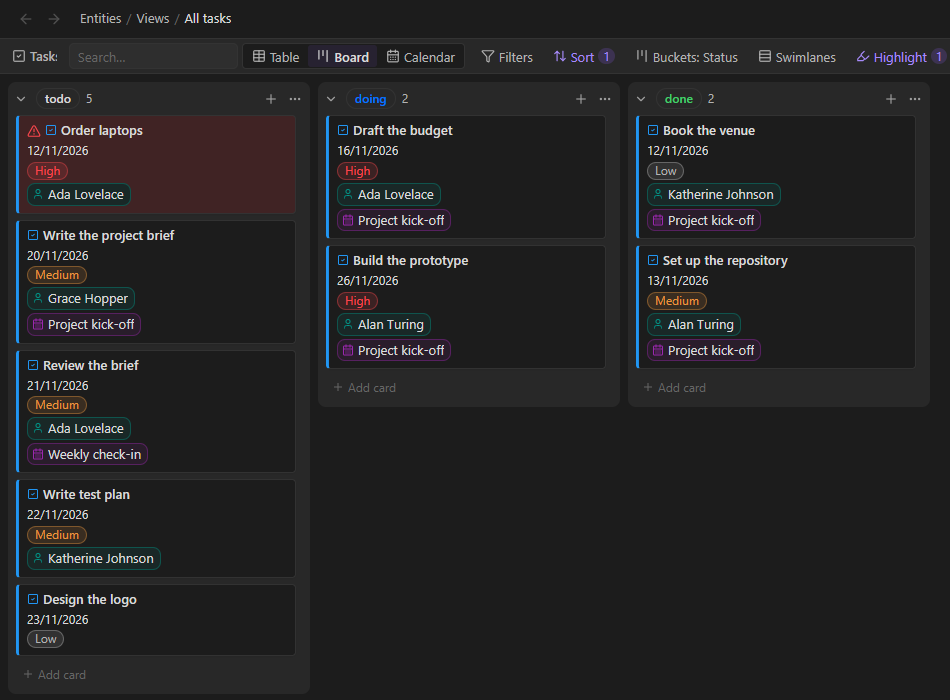

# Boards

A board shows a view's entities as cards in columns called **buckets**, one per value of a field, like a kanban board by status.



Any view can be shown as a board: click **Board** in the **Table | Board | Calendar** toggle next to the search box. The note keeps every layout's settings, so switching back and forth loses nothing, and it opens in whichever layout you used last. To start with a board, choose the **Board** layout in **New view**, or **New board of …** on a type or group heading in the Entity Browser.

Filters, search, sorting and highlight rules are the view's own and work the same as in a [table](/reference/tables). See [Filters, sorting and highlights](/reference/filters).

## The toolbar

| Button | What it does |
|---|---|
| **Filters**, **Sort**, **Highlight** | As in a table. Sorting orders the cards within each bucket. |
| **Buckets** | The field the buckets come from. |
| **Swimlanes** | Splits the board into rows by another field. |
| **Card fields** | What each card shows. |
| **⋯** | **Save as…**, **Rename**, **Edit definition**, **Copy block**, **Show workflow toolbar**, card size, **Show subtitles**, **Show field names**, **Hide empty buckets**, **Hidden buckets…** |

## Buckets

Click **Buckets** to choose the field. You can use:

| Field | Buckets | Dragging a card |
|---|---|---|
| **Status** | One per status, in your status order, even when empty. | Sets the status. |
| A **choice** field | One per option, in option order, even when empty. | Sets the choice. |
| A **checkbox** field | **No** and **Yes**. | Ticks or unticks it. |
| A **single link** field, e.g. Assignee or Project | One per linked note, A to Z. | Links to that note. |

Values that are in use but aren't one of the defined statuses or options get a bucket too. Cards without a value go in a "No …" bucket, which is always last. Choice and link boards always have it, and dropping a card there clears the field; a status board shows it only when some card has no status. A board starts with **Status** when the types have statuses.

Lists, multiple choices, links to several notes, roll-ups, formulas and incoming links can't be buckets.

### Read-only buckets

These built-ins can be buckets too, listed under **Built-in (read-only)**:

- **Type**
- **Folder**
- **Created** and **Modified** (by month, newest first)
- **Parent**, **Top-level parent** and **Ancestors**

The board can't change these values, so cards can't be dragged to another bucket; you can still reorder them within one. Only values in use get a bucket. The **Buckets** button warns you when the board is read-only. **Add card** is offered in **Type** buckets (the new note is of that type), not in the others.

### Bucket headers

Each header shows the value and the number of cards. Right-click a header, or click its **⋯**, for:

| Item | What it does |
|---|---|
| **Add card** | Creates an entity with the bucket's value. |
| **Move left**, **Move right** | Moves the bucket. You can also drag its header. |
| **Reset bucket order** | Goes back to the field's own order. Shown once you've moved a bucket. |
| **Collapse** / **Expand** | Shrinks the bucket to a narrow strip, which still takes drops. |
| **Set card limit…** | The most cards the bucket should hold. Over the limit, the count turns red ("6 / 5"). Leave it empty for no limit. |
| **Hide bucket** | Hides it. **⋯ → Hidden buckets…** brings it back. |
| **Summaries…** | Shows a summary of a card field for the bucket's cards, e.g. "Sum 34 h". |

Moving buckets only changes this board; your statuses and options keep their own order elsewhere. The "No …" bucket always stays last.

**⋯ → Hide empty buckets** leaves out buckets with no cards.

Changing the bucket field resets the collapsed and hidden buckets, the card limits, the bucket order and the card order, since they belong to the old values.

## Swimlanes

**Swimlanes** (where **Group** is in a table) adds rows across the board, one per value of a field: for example buckets by status and swimlanes by assignee. You get one level, and any column other than the bucket field can be used. For dates, choose **by day**, **by month** or **by year**.

Dragging a card into another swimlane changes that field too, when it's a field a bucket could change (status, a choice, a checkbox or a single link, and not grouped by date). Otherwise cards stay in their own swimlane.

The **Show field names in swimlane headers** and **Show summaries in swimlane headers** options work like a table's group headers. Right-click a swimlane header to collapse or expand all swimlanes.

## Cards

Each card shows the type's icon and the note's name (click to open it; Ctrl/Cmd-click for a new tab), and then its card fields. Empty values are left out.

- **Card fields:** click **Card fields** and tick the fields to show. Any column works, including the bucket field and roll-up or formula columns. Drag the handles under **On cards** to change their order. Until you choose, cards show the table's first four columns after the name (leaving out the bucket and swimlane fields).
- **Formats:** the **#** or calendar button next to a number or date field sets its format, as **Format…** does in a table.
- **⋯ → Small cards**, **Medium cards** or **Large cards** sets the card width.
- **⋯ → Show subtitles** adds the type's subtitle under the name.
- **⋯ → Show field names** labels each card field.
- **Highlights:** row rules colour whole cards, and cell rules, data bars and colour scales show on their field. See [Highlights](/reference/filters#highlights).

Cards are read-only: open the note, or use the table or bulk actions, to edit other fields. Right-click a card for the entity menu.

A big bucket shows 50 cards at a time, with **Show 50 more…** at the bottom.

## Dragging cards

- **Move a card** to another bucket to change its field. On touch screens, press and hold a card to pick it up. **Esc** cancels a drag.
- **Move several:** select cards (tick the checkbox that appears on hover, or Ctrl/Cmd-click), then drag one of them.
- **Order:** with a sort, cards follow it. Without one, drop a card between others to put it there. The order is saved in the view, and new cards go to the bottom.
- **Undo:** **Ctrl/Cmd+Z** undoes a move.

A status the card's type doesn't use is refused, and cards whose type lacks the field stay where they are.

### Keyboard

| Key | Action |
|---|---|
| Arrow keys | Move between cards |
| **Enter** | Open the card's note |
| **Space** | Select the card |
| **Ctrl/Cmd+Shift+←/→** | Move the card (or the selection) to the next bucket |
| **Ctrl/Cmd+Shift+Alt+←/→** | Move the card's whole bucket |

**Ctrl/Cmd+A**, **Delete**, **Esc** and **Ctrl/Cmd+Z** work as in a table.

## New cards

**Add card** (in a bucket's menu, or the **+** in its header or at its foot) creates an entity with the bucket's value, and the swimlane's when it has swimlanes. Like **+ New**, it also fills in values from the view's simple filters, so the new card lands where you expect.

## The view block

A board's own settings go under `board:` in the view's `entity-view` block. Everything else (`types`, `filters`, `sort`, `highlight`, `formats`, `summary` and the roll-up and formula definitions in `columns`) is shared with the table. See [Tables](/reference/tables#the-view-block) for those keys.

````markdown
```entity-view
kind: board
types: [task]
columns: [name, status, assignee, due, priority, estimate]
summary: { estimate: sum }
board:
  buckets: status
  swimlanes: assignee
  cardFields: [assignee, due, priority, estimate]
  cardSize: large
  cardSubtitle: true
  cardLabels: true
  hideEmpty: true
  collapsedBuckets: [done]
  hiddenBuckets: [cancelled]
  limits: { doing: 5 }
```
````

`kind: board` makes the view open as a board.

| `board:` key | Meaning |
|---|---|
| `buckets` | The bucket field's column id: `status`, a choice, checkbox or single-link field, or one of the read-only built-ins `type`, `folder`, `created`, `modified`, `tree-parent`, `tree-root`, `tree-path`. |
| `swimlanes` | One column id, or `{ by: <column id>, date: month \| year }`. |
| `cardFields` | Column ids shown on cards, in order. Unset: the table's first four columns after the name. |
| `cardSize` | `small`, `medium` (the default) or `large`. |
| `cardSubtitle` | `true` shows the type's subtitle on cards. |
| `cardLabels` | `true` labels card fields with their names. |
| `hideEmpty` | `true` leaves out empty buckets. |
| `collapsedBuckets` | Bucket keys shown collapsed. |
| `hiddenBuckets` | Bucket keys not shown. |
| `limits` | Bucket key → card limit. |
| `order` | Bucket key → note paths in manual order, used when the view isn't sorted. Written when you drop cards. |
| `bucketOrder` | Bucket keys in the order they're shown. Unset: the field's order. |

**Bucket keys** are:

- the value, for a status or choice (e.g. `doing`);
- `yes` or `no`, for a checkbox;
- the linked note's path, for a link (e.g. `People/Ada Lovelace.md`);
- `(none)`, for the "No …" bucket.

To embed a board in another note, embed its view note: `![[Sprint board]]`. See [Views inside notes](/guides/views-in-notes).
