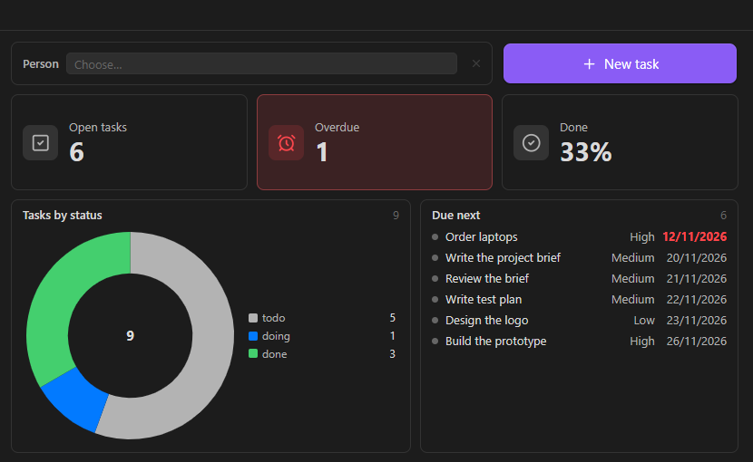
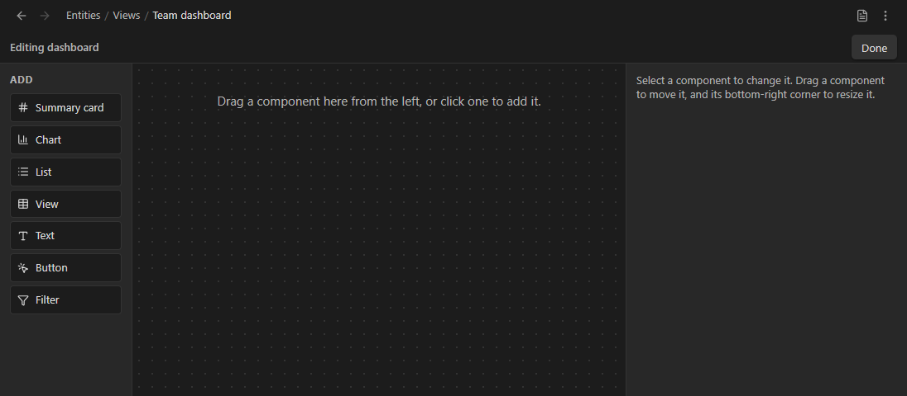
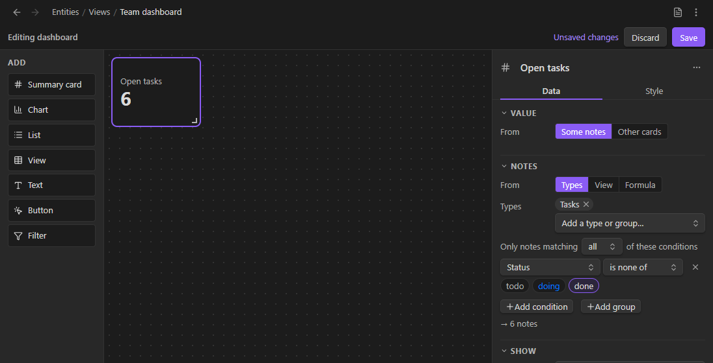
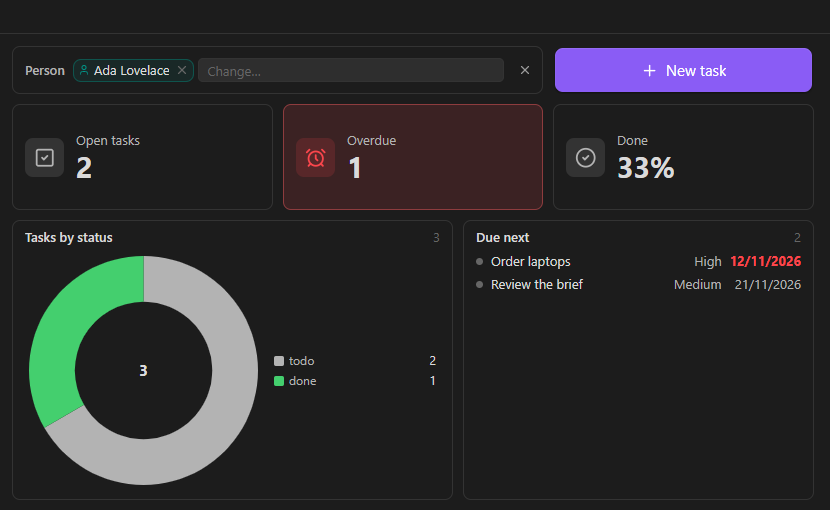

# Dashboards

Grid dashboards of cards, charts, lists, views, text, buttons and filters.



A dashboard is a view note whose block says `kind: dashboard`. Like a view, it lives in the views folder (default `Entities/Views`), syncs with your vault, opens in a tab and can be embedded in any note with `![[Team dashboard]]`. The Entity Browser marks it **DASHBOARD**.

## Creating a dashboard

In the Entity Browser's **Entities** tab, click **+** and choose **New dashboard**. Name it, and it opens in edit mode, ready for its first component.

## View mode and edit mode

A dashboard opens in **view mode**. It just shows the components:

- Lists and views are live. Click a note to open it, and edit an embedded view as usual.
- Click a summary card, or a bar, slice or point in a chart, to open the notes behind it (see [Opening the notes behind a component](#opening-the-notes-behind-a-component)).
- Pick values in filters, and the components that use them follow.

Click **Edit** (top right) to switch to **edit mode**. It has three panels:



- **Add** (left) lists the components. Drag one onto the grid, or click it to add it at the bottom.
- **The grid** (middle). Drag a component to move it, and drag its bottom-right corner to resize it. Click one to select it.
- **Settings** (right) shows the selected component. At the top are its title (click to edit it) and a **⋯** menu with **Duplicate**, **Delete** and the component's id. Below are two tabs:
  - **Data:** where its notes come from and what it shows. Each part shows its live result as you go, such as "→ 13 notes" or "= 5".
  - **Style:** how it looks.

Components don't take clicks while you edit. Text and button components have no title, so their settings header just names the kind.

An embedded dashboard has an **Edit** button too. It opens the dashboard in a new tab, where you can edit it.

### Saving your changes

Your changes are a **draft** until you save them. The bar at the top says **Unsaved changes** while there are any.

- **Save** writes the dashboard to its note and leaves edit mode.
- **Discard** throws the changes away and leaves edit mode. With no changes, the button reads **Done**.
- If you close the dashboard without saving, the draft is kept until you close Obsidian. The dashboard opens in edit mode with it when you come back.

## The grid

The grid is 12 columns wide, and each row is 48 pixels high. A component's place is its column, its row, its width in columns and its height in rows.

New components start at these sizes (width × height):

| Component | Size | Component | Size |
|---|---|---|---|
| **Summary card** | 3 × 2 | **Text** | 4 × 2 |
| **Chart** | 6 × 5 | **Button** | 2 × 1 |
| **List** | 4 × 5 | **Filter** | 4 × 1 |
| **View** | 6 × 8 | | |

**Duplicate** puts the copy just below the original.

## Where the notes come from

Summary cards, charts and lists work on a set of notes. The **Notes** section of the **Data** tab chooses them, with **From**:

| From | What it uses |
|---|---|
| **Types** | The types or groups you add with **Add a type or group…** (none means every type), and the conditions under **Only notes matching**. The conditions work just as in a view: see [Filters, sorting and highlights](/reference/filters). |
| **View** | A saved view note: its types, filters and sort. When the view changes, the component follows. |
| **Formula** | A formula that gives notes, such as `filter(notes("task"), prop(item, "Status") = "doing")`. See [Formulas](/reference/formulas). |

The section ends with the number of notes that match, such as "→ 13 notes", or the problem if there is one.

Components that share the same notes only work them out once, so a busy dashboard stays quick.

## Summary cards

A summary card shows one value, with a title.



### The value

Under **Value**, **From** chooses how the card gets its value:

- **Some notes:** a summary of the card's notes. Choose the notes under **Notes**, then, under **Show**:
  - **Field:** **None: count the notes**, or a field to summarise.
  - **Summary:** what to work out from that field. Only the summaries that suit the field are offered.
- **Other cards:** a formula over the dashboard's other cards (see [Card formulas](#card-formulas)).

The summaries are the same as a table's summary row:

| Field | Summaries |
|---|---|
| None | **Count** of the notes |
| Number | **Sum**, **Average**, **Median**, **Min**, **Max**, **Range** |
| Date | **Earliest**, **Latest**, **Range** (such as "4 months") |
| Checkbox | **Checked**, **Unchecked**, **% checked** |
| Multiple choice, list or link | **Total values** |
| Any field | **Count** (notes where it's filled), **Empty**, **Filled** (8/12), **% filled**, **Unique** |

A choice field whose options have number values can also be summed and averaged. A status or choice field also offers the share of each value, such as **% done** (the share of notes whose status is *done*; `agg: "percent:done"` in the block).

**Display as** sets the **Format** of a number: **Automatic**, **Number**, **Whole number**, **One decimal place**, **Two decimal places**, **Currency**, **Percent**, **Compact (1.2K)**, or **Custom pattern…** such as `#,##0.00` or `#,##0 gp`. **Looks like** shows an example.

If a card has no title, it's labelled with what it shows, such as "Sum of Budget".

### Card formulas

With **From: Other cards**, the card's value is a formula. Refer to other cards by their title in square brackets:

```
[Done tasks] / [All tasks] * 100
```

- The settings list the titles you can use. A card without a title is known by its id.
- A [filter](#filters) can be named the same way, by its title: `[Person]`. If a card and a filter share a title, the card wins.
- `notes()` and every other formula function work here too.
- If a card it uses has a problem, this card says so: "[All tasks] has a problem: …".
- Cards can't refer to each other in a circle. That shows as "Circular reference: A → B → A."

### Card style

The **Card** section of the **Style** tab:

| Option | Choices |
|---|---|
| **Size** | The size of the value: **S**, **M** (default), **L**, **XL**, or **Fit** to fill the card. |
| **Align** | Left (default), centre or right. |
| **Label** | The title **Above** (default) or **Below** the value, or **Hidden**. |
| **Icon** | The icon **Before value** (default) or **At the side**, as a large tile. The icon itself is set in **Default style** or by a rule. |
| **Accent** | **None** (default), a coloured **Left edge** or **Top edge**. |
| **Caption** | A small line under the value. |

The side tile and the accent edge take the card's colour: a value rule's colour first, then the card's text colour, then its fill, then the accent colour.

### Captions

A caption can show values. In square brackets:

- `[Value]` is the card's own value;
- another card's title shows that card's value;
- a filter's title shows what's picked in it, or "All" when nothing is.

For example, "of [All tasks]" shows as "of 13". Names aren't case-sensitive. A name that matches nothing stays as you wrote it, and a card with a problem shows as "–".

## Charts

A chart shows its notes as a picture. Choose the kind under **Chart** on the **Data** tab:

| Chart | Shows |
|---|---|
| **Bar** | One bar per value of a field, such as Status or Priority. |
| **Horizontal bar** | The same, sideways, for long labels. |
| **Stacked bar** | Each bar split by a second field, such as priority split by status. |
| **Donut** | One slice per value of a field. |
| **Line over time** | The notes per week, month or year, by a date field. Empty periods show as zero. |
| **Progress** | How many of the notes are done, as a bar with "38%" and "5 of 13". |

Bars and slices come in the field's own order, with statuses and choices in their colours. Notes with no value go in a "No …" group, such as "No priority". A note with several values (a multiple choice or several links) counts once for each.

### Chart data

After **Notes**, the **Show** section has:

| Option | Charts | What it does |
|---|---|---|
| **Measure** | All | **Count** the notes, or the **Sum** or **Average** of a number field, chosen under **Of**. |
| **Bars by** / **Slices by** | Bar, horizontal bar, stacked bar, donut | The field to group by. Any field except a plain number. |
| **Split by** | Stacked bar | The field that splits each bar. |
| **By date** | Line over time | The date field. |
| **Every** | Line over time | **Week** (from Monday), **Month** (default) or **Year**. |
| **Sort** | Bar, horizontal bar, stacked bar, donut | **The field's order** (default), **Largest first**, **Smallest first** or **A–Z**. |
| **Show only the top** | Bar, horizontal bar, stacked bar, donut | Keep the biggest N (1 to 100). The rest become one grey "Other" bar or slice. Empty: show them all. |
| **Hide empty** | Bar, horizontal bar, stacked bar, donut | Leave out the notes with no value. The total then counts only the notes shown. |
| **Done when matching** | Progress | The conditions a done note meets, such as Status is done. |

The result line shows the total, such as "= 13 in 4 bars". **Display as** sets the number format, as for cards.

Hover over a bar, slice or point to see its numbers. The total is shown at the top right of the chart.

### Chart style

The **Chart** section of the **Style** tab shows only what the chosen chart uses:

| Option | Charts | Choices |
|---|---|---|
| **Colours** | Bar, horizontal bar, stacked bar, donut | **Field** (default: statuses and choices in their own colours), **One** colour, a **Palette** colour each, or **Shades** of one colour. |
| **Colour** | With One or Shades, and line and progress charts | A colour, or none for the accent colour. |
| **Value labels** | Bar, horizontal bar, stacked bar, line | Each value on the chart. On by default, except for lines. |
| **Values in legend** | Donut | Each slice's value in the legend. On by default. |
| **Gridlines** | Bar, stacked bar, line | Gridlines and the value axis. On by default. |
| **Legend** | Stacked bar, donut | On by default. |
| **Legend at** | Donut | **Auto** (whichever fits), **Right** or **Below**. |
| **Hole** | Donut | **Pie**, **Thick**, **Normal** (default) or **Thin**. |
| **Total in middle** | Donut with a hole | On by default. |
| **Smooth curve** | Line | Off by default. |
| **Shade under** | Line | On by default. |
| **Dots** | Line | On by default. Hidden dots can still be hovered and clicked. |
| **Show** | Progress | **Both** (default), the percentage (**38%**) or the count (**5 of 13**). |
| **Thickness** | Bar, horizontal bar, stacked bar, progress | **Thin**, **Normal** (default) or **Wide**. |
| **Rounded** | Bar, horizontal bar, stacked bar | Rounded bar corners. Off by default. |

Conditional styling doesn't change these. A chart's rules only style its box.

## Lists

A list shows its notes by name, with their status and some fields. Click a note to open it.

On the **Data** tab, after **Notes**, the **Show** section has:

- **Show up to** N **notes** (1 to 500; 10 by default). When there are more, the list ends with "+N more".
- **Sorted by:** a field, and the arrow for ascending or descending. With nothing chosen, notes come by name, or in the view's order when the notes come from a view.
- **With:** up to four fields after each note's name.

The result line shows how many are shown, such as "6 of 14 shown".

### List style

The **List** section of the **Style** tab:

| Option | Choices |
|---|---|
| **Spacing** | **Compact** (default), **Comfy** or **Spacious**. |
| **Show as** | Plain **Rows** (default), or **Cards**: each note in a small box. |
| **Dividers** | Lines between rows. Off by default. |
| **Stripes** | Every other row shaded. Off by default. |
| **Marker** | Before each name: the **Status** dot (default), the type's **Icon**, numbers (**1, 2, 3**) or **None**. |
| **Fields** | **At the right** (default), lined up in columns, or **Below the name** on a second line. |
| **Field names** | A row of field names above the list (at the right), or each field's name before it (below). Off by default. |
| **Title row** | The list's title. On by default. |
| **Count** | The number of notes, next to the title. On by default. |
| **+N more** | **Text** (default), a **Link** that opens all the list's notes as a table, or **Hidden**. |

Lists can also colour their rows: see [Row highlighting in lists](#row-highlighting-in-lists).

## Views

A view component shows a saved view note, with its own toolbar, scrolling inside its cell. Choose the view on the **Data** tab. Changes you make to it there (columns, sorting and so on) are saved into the view note.

See [Tables](/reference/tables).

## Text

A text component shows Markdown: headings, lists, links and embeds. Type it on the **Data** tab.

## Buttons

A button runs one action when you click it. On the **Data** tab:

- **Label:** the button's text.
- **On click:**

| On click | What happens |
|---|---|
| **Nothing yet** | Clicking it says it has no action. |
| **Create a note** | Opens the create dialog for the **Type** you choose. |
| **Run a workflow** | Runs the **Workflow** you choose. A form workflow opens its form. A workflow that runs on notes asks which note first. See [Workflows](/reference/workflows). |
| **Open a note or view** | Opens the **Note** you name, as you'd write it in a link. |

A workflow that's off, paused or has problems doesn't run, and you're told why.

### Button style

The **Button** section of the **Style** tab:

| Option | Choices |
|---|---|
| **Icon** | The button's icon, or none. |
| **Variant** | **Solid** (default: filled with its colour, white text), **Soft** (tinted), **Outline** or **Plain** (text only). |
| **Size** | **S**, **M** (default) or **L**. |
| **Width** | **Fill the cell** (default) or **Fit the label**. |
| **Align** | Left, centre (default) or right: where a fitted button sits, or where a filling button's contents sit. |
| **Icon** (position) | **Before** (default), **Above** or **After** the label, or the icon **Only**, with the label as its tooltip. |
| **Description** | A small second line under the label. Cards' and filters' `[Title]`s show their values, such as "[Open tasks] on the go". |

The button's colour is the **Default style** fill (or a rule's), else the accent colour.

### Disabling a button

A whole-button rule in **Conditional styling** can set **Button** to **Disabled**, for example when `[Open tasks] > 8`. A disabled button greys out, doesn't run, and its tooltip gives the rule's name. Only a rule can disable a button. See [Conditional styling](#conditional-styling).

## Filters

A filter is something to pick, such as a person, a status or a date range. Other components follow it once they're set up to use it.



### Filter controls

On the **Data** tab, the **Filter** section picks the control:

| Control | You pick | Settings |
|---|---|---|
| **Note** | One or more notes, such as a person or project. | **Notes of:** the types or groups to pick from (none: every type). **Pick: One** or **Several**. |
| **Choice** | One or more values of a field, such as statuses. | **From:** the types. **Field:** a status, choice or multiple-choice field. **Pick: One** or **Several**. |
| **Search** | Some text, typed in a search box. | None. |
| **Dates** | **Any time**, **Today**, **This week**, **This month**, **This year**, **Last 7 days**, **Last 30 days**, **Next 7 days**, **Next 30 days**, or **Custom…** with **From** and **To**. | None. |
| **Number** | A range, from and to. Either end can be left empty. | None. |
| **Yes / no** | **Yes**, **No**, or either. | None. |

A choice filter offers the field's own values, or the values the notes have if the field doesn't list them.

The **×** clears a filter. With nothing picked, a filter doesn't narrow anything, so everything shows.

### Using a filter

A filter does nothing until another component uses it. The filter's **Use it** section explains how and lists the components that use it now ("Used by Open tasks, Due next").

**In conditions.** In a component's conditions, choose the **filter button** next to a condition's value. The value becomes the filter, shown as a pill with its title. The filter button only appears where the filter fits:

| Filter | Fits a condition like |
|---|---|
| **Note** | Assignee **links to any of** / **links to none of** |
| **Choice** | Status **is any of** / **is none of**, Tags **has any of** |
| **Search** | Name **contains** |
| **Dates** | Due **is between** |
| **Number** | Budget **is between** |
| **Yes / no** | Billable **is** |

The condition then takes whatever is picked. While nothing is picked, the condition is **left out**, so clearing the filter shows everything again. The × on the pill stops using the filter.

This works wherever a dashboard has conditions: a source's **Only notes matching**, a progress chart's **Done when matching**, a list's row highlighting, and every component's conditional styling.

**In formulas and captions.** Card formulas, **Formula** sources, captions and button descriptions can name a filter by its title, like a card: `[Person]`.

- In formulas, it's the note (or a list of notes), the choice (or a list), the text, `[from, to]` dates, `[min, max]` numbers, or true / false. With nothing picked, it's empty.
- In captions and descriptions, it's what's picked, such as "Ada Lovelace" or "This week", or "All" when nothing is.

### What's remembered

What you pick is **remembered on this device**, for each dashboard. It isn't written into the note, so other devices and other people keep their own choices.

An embedded dashboard remembers separately for each note it's embedded in.

### Embedding in a note

Embed a dashboard in a note with `![[Team dashboard]]`. A **Note** filter whose **Notes of** includes that note's type (or its group) **starts on that note**. So one dashboard, embedded in each person's note (or in the Person template), shows each person's own work.

This only applies until you pick something else there. If you clear the filter on purpose, it stays cleared on that note.

See [A dashboard that follows a note](/guides/dashboard-filters).

### Filter style

The **Filter** section of the **Style** tab:

| Option | Choices |
|---|---|
| **Layout** | **Auto** (default: side by side when the filter is one row high, stacked when it's taller), **Side by side** (title, control and × on one line) or **Stacked** (title and × above, the control below). |
| **Values as** | Choice and yes / no filters: **Auto** (default: pills while they fit, else a drop-down), **Pills**, **Drop-down** or **List** (a tick box or radio button for each value). |
| **Size** | **S**, **M** (default) or **L**. |
| **Title** | The filter's title. On by default. |
| **Summary** | A line under the control saying what's picked, such as "2 of 4: active, completed". Off by default. |
| **Plain** | No box or border, like a toolbar. Off by default. |

The controls stretch to fill the filter as you resize it. Conditional styling doesn't change these.

## Styling

Every component's **Style** tab ends with **Default style** and **Conditional styling**.

### Default style

How the component looks when no rule applies: a fill colour, a text colour, **bold**, *italic* or strikethrough, and an icon (one of the quick choices, or **…** to search all of Obsidian's icons). Text, button and view components have no icon here; a button sets its icon under **Button**.

The colours come from the theme, so they work in light and dark mode. What a rule leaves unset comes from the default style.

### Conditional styling

Rules that change the component's look when **cards' values** meet conditions. They work like a view's highlight rules (see [Filters, sorting and highlights](/reference/filters)):

- **+ Rule** adds one. Each rule has an optional name, conditions under **Apply when**, and a style.
- Conditions test the dashboard's summary cards by title, such as `[Overdue] > 0`. A card can also test its own **Value**.
- A rule with no conditions always applies.
- **The first rule that applies wins.** Drag rules to reorder them, and use the tick box to switch one off without deleting it.
- Each rule says whether it **applies now**.
- Percentages compare as shown: a card showing 50% has the value 50.

A card's rule can style the **Whole card** or **Just part of it**: just the value, on top of the card's style. For example, "Value < 3" in red.

A dashboard needs at least one summary card before other components can have rules.

### Rules that change the layout

A whole-component rule on a card, button or list can also change that component's style options. Each option starts at **Unchanged**. For example:

- a card that turns red and **XL** when `Value < 3`;
- a list that shows as **Cards** with an orange fill when `[Open tasks] > 20`;
- a button that's **Disabled** when `[Open tasks] > 8`.

A rule's icon replaces a button's own icon.

### Row highlighting in lists

A list has two kinds of rules:

- **Conditional styling** rules are on cards' values and style the **whole list**, like any component's.
- **Row highlighting** rules are on the list's **notes**, like a view's highlight rules. Add one with **+ Highlight rule**. It colours the **Whole row**, or **A field** in it, when a note matches, such as overdue tasks in red. Each rule shows how many notes it matches. A row rule's icon shows before the name.

## Opening the notes behind a component

In view mode, you can click:

- a summary card whose value comes from notes;
- a bar, slice or point in a chart, including an "Other" bar or slice;
- a progress bar, for its done notes;
- **+N more** in a list, when it's set to **Link**.

The notes open as a table in a new tab. You can edit them there, or use **⋯ → Save as…** to keep the table as a view. Hover over a card to see how many notes it's over. Charts' bars, slices and points can also be reached with Tab and opened with Enter.

## Narrow widths

When a dashboard is less than 600 pixels wide, in a sidebar or on a phone, its components stack at full width in reading order: row by row, left to right. Each keeps its height. The editor always shows the grid.

## Where it's listed

A dashboard has no types, so the Entity Browser lists it under **Views**. To list it under a group or type instead, drag it onto that heading, or right-click it and choose **Show under…**. The choice is saved in the block as `place:`. See [Entity Browser](/reference/browser).

## The dashboard block

A dashboard note holds an `entity-view` code block. The editor writes it for you, but you can also edit it by hand: open the note as Markdown. Problems in the block are listed at the top of the dashboard, and a component with a problem is left out.

### An example

````markdown
```entity-view
kind: dashboard
components:
  # A filter. Its id ("person") is what conditions use: "{person}".
  - id: person
    kind: filter
    title: Person
    at: [0, 0, 4, 1]          # column, row, width, height
    control: note
    types: [person]
  # A card counting open tasks for the person picked.
  - id: open
    kind: card
    title: Open tasks
    at: [0, 1, 3, 2]
    source:
      types: [task]
      filters:
        all:
          - { field: status, op: none-of, value: [done] }
          - { field: assignee, op: links-any, value: ["{person}"] }
    value: { agg: count }
    layout: { size: xl, caption: "for [Person]" }
  # A card that turns red when anything is overdue.
  - id: overdue
    kind: card
    title: Overdue
    at: [3, 1, 3, 2]
    source:
      types: [task]
      filters:
        all:
          - { field: status, op: none-of, value: [done] }
          - { field: due, op: before, value: today }
    value: { agg: count }
    highlight:
      - name: Any overdue
        target: row           # the whole card; "value" styles just the value
        when: { all: [{ field: value, op: ">", value: 0 }] }
        style: { fill: red }
  # A formula over the other cards.
  - id: share
    kind: card
    title: Overdue share
    at: [6, 1, 3, 2]
    value: { formula: "[Overdue] / [Open tasks] * 100" }
    format: percent
  # A donut of tasks by status.
  - id: bystatus
    kind: chart
    title: Tasks by status
    at: [0, 3, 6, 5]
    chart: donut
    source: { types: [task] }
    by: status
    look: { hole: thin, legendAt: below }
  # The next tasks due, with overdue rows in red.
  - id: next
    kind: list
    title: Due next
    at: [6, 3, 6, 5]
    source: { view: Open tasks }
    fields: [priority, due]
    sort: [{ by: due, dir: asc }]
    limit: 6
    layout: { stripes: true, more: link }
    highlight:
      - target: row
        when: { all: [{ field: due, op: before, value: today }] }
        style: { text: red }
  # A button that creates a task.
  - id: newtask
    kind: button
    at: [9, 1, 3, 1]
    label: New task
    icon: plus
    action: { new: task }
place: "@work"
```
````

### The top level

| Key | What it is |
|---|---|
| `kind` | Always `dashboard`. |
| `components` | The list of components. |
| `place` | Optional. Where the Entity Browser lists it: `views`, a group as `"@key"`, or a type key. |

### Every component

| Key | What it is |
|---|---|
| `id` | Its id, unique in the dashboard. Missing ids are made up from the kind (`card1`). A filter can't be called `this`. |
| `kind` | `card`, `chart`, `list`, `view`, `text`, `button` or `filter`. |
| `title` | Optional. Cards, charts, lists and filters show it, and formulas and captions use it. |
| `at` | `[column, row, width, height]`. Columns run 0 to 11, and widths 1 to 12. Missing parts use the kind's default size. |
| `style` | The default style: `fill` and `text` (`red`, `orange`, `yellow`, `green`, `blue`, `purple`, `pink`, `grey`), `bold`, `italic`, `strike` (true) and `icon`. |
| `highlight` | Conditional styling rules (a list's are its row rules, see below). |

### Component keys

| Kind | Key | What it is |
|---|---|---|
| `card` | `source` | Where its notes come from (below). Not used with a formula. |
| | `value` | `{ agg, column }`: a summary of a column (no column: count the notes). Or `{ formula }`: a formula over other cards. |
| | `format` | Optional number format: `number`, `integer`, `decimal:2`, `currency` (or `currency:USD`), `compact`, `percent`, or a pattern such as `#,##0 gp`. |
| | `layout` | `size`, `align`, `label`, `icon`, `accent`, `caption`. |
| `chart` | `chart` | `bar` (default), `hbar`, `stacked`, `donut`, `line` or `progress`. |
| | `source` | Where its notes come from. |
| | `by` | The field to group by, or the date field for `line`. |
| | `split` | `stacked` only: the field that splits each bar. |
| | `every` | `line` only: `week`, `month` (default) or `year`. |
| | `measure` | `{ agg: count }` (default), or `{ agg: sum }` / `{ agg: avg }` with a number `column`. |
| | `done` | `progress` only: the conditions, as `{ all: [...] }` or `{ any: [...] }`. |
| | `format` | Optional number format, as for cards. |
| | `sort` | `field` (default), `desc`, `asc` or `az`. |
| | `top` | Keep the biggest N (1 to 100); the rest become "Other". |
| | `hideEmpty` | `true` leaves out the notes with no value. |
| | `look` | `colors`, `color`, `values`, `grid`, `legend`, `legendAt`, `hole`, `total`, `smooth`, `area`, `dots`, `show`, `thickness`, `rounded`. |
| `list` | `source` | Where its notes come from. |
| | `fields` | The fields after each name. |
| | `sort` | Levels like a view's: `[{ by: due, dir: asc }]`, or just `due`. |
| | `limit` | How many to show: 1 to 500, 10 by default. |
| | `layout` | `density`, `display`, `dividers`, `stripes`, `marker`, `fields`, `fieldNames`, `header`, `count`, `more`. |
| | `highlight` | Row highlighting rules, on the notes' fields. |
| | `boxHighlight` | Conditional styling rules for the whole list, on cards' values. |
| `view` | `view` | The view note's name. |
| `text` | `text` | Markdown. |
| `button` | `label` | Its text (default "Button"). |
| | `icon` | An icon name. |
| | `action` | `{ new: <type key> }`, `{ workflow: <workflow id> }` or `{ open: <note name> }`. |
| | `layout` | `variant`, `size`, `width`, `align`, `icon`, `description`. |
| `filter` | `control` | `note` (default), `choice`, `search`, `dates`, `number` or `toggle` (yes / no). |
| | `types` | `note` and `choice`: the types or groups (`"@key"`). |
| | `field` | `choice`: the field it offers the values of. |
| | `multiple` | `note` and `choice`: `true` to pick several. |
| | `layout` | `direction` (`auto`, `horizontal`, `vertical`), `choices` (`auto`, `pills`, `dropdown`, `list`), `size`, `label`, `summary`, `plain`. |

Columns (`column`, `by`, `split`, `fields`, `field`) are written as in a view: a field key such as `due`, a built-in such as `status`, or a roll-up or formula column. See [Tables](/reference/tables).

The `layout` and `look` values are those in the style tables above, in lower case: `size: xl`, `align: center`, `label: below`, `icon: side`, `accent: top`; `variant: soft`, `width: fit`, `icon: only`; `density: comfortable`, `display: cards`, `marker: number`, `fields: below`, `more: link`; `colors: palette`, `hole: pie`, `show: percent`, `thickness: wide`. On / off options are `true` or `false`. Leave an option out to use its default.

### Sources

| Source | Keys |
|---|---|
| Types | `{ types: [task, "@work"], filters: { all: [...] }, sort: [...] }`. Without `types`, every type. |
| View | `{ view: Open tasks }` |
| Formula | `{ formula: 'filter(notes("task"), prop(item, "Status") = "doing")' }` |

Conditions are written as in a view: `{ field: status, op: any-of, value: [doing] }`, inside `all:` or `any:`. To use a filter, put its id in braces as the value: `"{person}"`. For a **Note** or **Choice** filter, the editor writes it as a list, `["{person}"]`.

### Rules

Conditional styling and row highlighting rules are written like a view's highlight rules, with a few dashboard keys:

| Key | What it is |
|---|---|
| `name` | Optional. Shown in a disabled button's tooltip. |
| `target` | `row`: the whole component (or the whole row, in a list's row rules). `value`: just a card's value. In a list's row rules, a field's key styles just that field. |
| `when` | The conditions. On cards' values, a card's own is `value` and another card is `card:<id>`, such as `{ field: "card:open", op: ">", value: 20 }`. |
| `style` | As `style` above. |
| `layout` | Optional, on a whole-card, whole-button or whole-list rule: the layout options it changes. A button's can include `state: disabled`. |
| `off` | `true` switches the rule off. |
