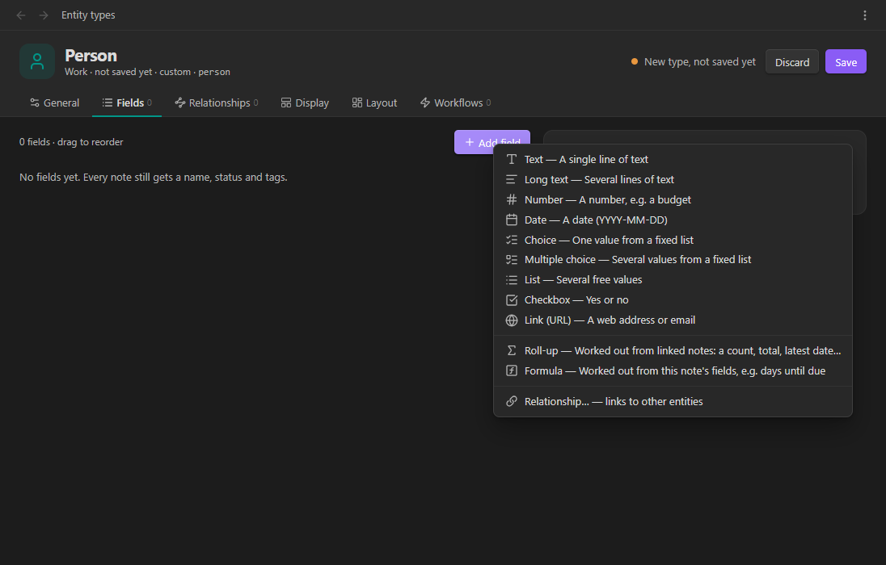
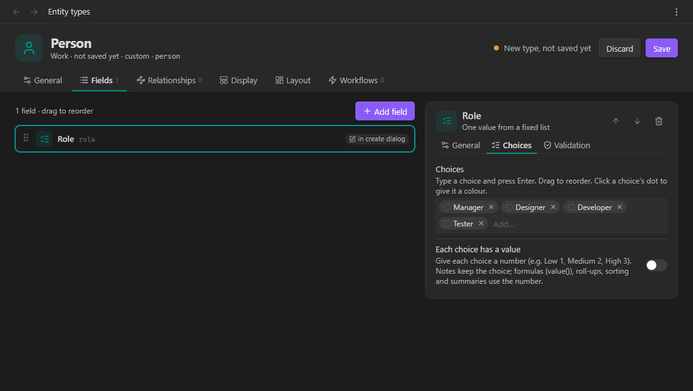
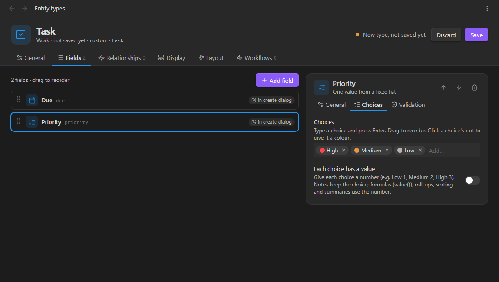

# Fields

Fields are the properties a type's notes have; this page covers every kind of field and every setting a field can have.

## Add a field

Open a type, go to its **Fields** tab and click **Add field**. A menu lists every kind, with a line saying what each is for. The new field opens in the panel on the right, ready for its label.



| Kind | What it's for |
|---|---|
| **Text** | A single line of text |
| **Long text** | Several lines of text |
| **Number** | A number, e.g. a budget |
| **Date** | A date |
| **Choice** | One value from a fixed list |
| **Multiple choice** | Several values from a fixed list |
| **List** | Several free values |
| **Checkbox** | Yes or no |
| **Link (URL)** | A web address or email |
| **Relationship…** | Links to other entities. Opens the guided **Add relationship** dialog; see [Relationships](/reference/relationships). |
| **Roll-up** | Worked out from linked notes: a count, total, latest date… See [Roll-ups](/reference/rollups). |
| **Formula** | Worked out from this note's fields, e.g. days until due. See [Formulas](/reference/formulas). |

Roll-ups and formulas are **calculated** fields: they're worked out whenever they're shown, and never written to the note.

### The field list

The list on the left shows each field's kind icon, label and key, with badges for what's special about it: the types a relation links to, **many**, **required**, **in create dialog** and **subtitle**. A field with a problem shows a red icon.

- **Reorder** fields by dragging them, or with the up and down arrows at the top of the field's panel. The order is the order of the properties form (unless the type has its own [layout](/reference/form-layouts)) and of new notes' frontmatter.
- **Delete** a field with the bin icon. Nothing happens to your notes until you save, and then you choose whether to remove the field's values from them (see [Types and groups](/reference/types#updating-existing-notes)).

### The field's tabs

The panel on the right has up to four tabs. A field always opens on **General**.

| Tab | Shown for | What's on it |
|---|---|---|
| **General** | every field | Kind, label, key, description, default and whether it's in the create dialog |
| **Choices**, **Relation**, **Roll-up** or **Formula** | those kinds | The kind's own settings |
| **Display** | numbers, dates, checkboxes, URLs, and calculated fields that give a number, a date or true / false | The display format |
| **Validation** | every stored field | Required, and the validation rules for the kind. The tab shows how many are set. |

A tab with a problem in it gets a red dot.

## General settings

| Option | What it does |
|---|---|
| **Kind** | The kind of field. You can change it later; settings that don't suit the new kind are dropped (see [Changing a field's kind](#changing-a-field-s-kind)). |
| **Label** | The field's name, shown in the create dialog, the properties form, views and formulas. |
| **Frontmatter key** | The property name in each note, such as `due_date`. It follows the label until you edit it. Keys start with a lowercase letter and use only lowercase letters, digits and underscores, and can't be `entity`, `status`, `tags`, `aliases`, `related` or `order`. After renaming a saved field's key, the line underneath shows its old key, and saving offers to update existing notes. |
| **Description** | Help text, shown under the field in the create dialog (and wherever a form layout asks for it). |
| **Default** | What new notes start with. See [Defaults](#defaults). |
| **Show in the create dialog** | Asks for the field when you create a note. Turned off, the field sits under **Show N more fields**. New fields start with it on. Calculated fields are never in the create dialog. |

## Field kinds

### Text and long text

**Text** is one line; **Long text** can have several. In a form layout, a long text field can be given a fixed height. In a subtitle, long text shows only its first line.

Validation: length and a pattern.

### Number

A number. You can type it as it's displayed: `$1,240.50`, `45%` or `32 h` are tidied up to the number when you leave the box. With the **Compact** format you can also type `1.2K`, `3M` or `2B`. Text that has no number in it isn't saved, and a notice says why.

Clicking into a number shows the plain number; the display format only changes how it looks.

Validation: a range, and whole numbers only.

### Date

A date, always stored as `YYYY-MM-DD`. Clicking the field opens a calendar under it; see [Entity notes](/reference/notes#dates) for the calendar and typing dates.

Validation: earliest and latest dates, and a comparison with another date field.

### Checkbox

Yes or no. An unticked checkbox is stored as `false`. In places where you can edit, it's always a checkbox; its display format changes how it reads elsewhere.

### Link (URL)

A web address or email. Click it to open it: a bare email (`ada@example.com`) opens your mail app, and a bare domain (`example.com`) opens as `https://`.

Validation: length and a pattern.

### Choice and multiple choice

One value (**Choice**) or several (**Multiple choice**) from a list you set on the field's **Choices** tab. See [Choices](#choices).

Validation: for multiple choice, how many items.

### List

Several free values, each shown as a chip. Type a value and press Enter to add it.

Validation: how many items.

### Relation

Links to other entities. Set up on the field's **Relation** tab, or with the guided **Add relationship** dialog. See [Relationships](/reference/relationships).

Validation: for relations with many links, how many items.

### Roll-up and formula

Calculated fields. A **roll-up** summarises linked notes; a **formula** works something out from this note's own fields. See [Roll-ups](/reference/rollups) and [Formulas](/reference/formulas).

- They have **General**, their own **Roll-up** or **Formula** tab, and **Display** when they give a number, a date or true / false.
- They have no default, aren't in the create dialog, and have no validation.
- They're read-only in the properties form and Reading view, can be part of the subtitle, and are columns like any other in tables and boards.

## Choices

On a choice or multiple-choice field's **Choices** tab, type a choice and press Enter to add it. Drag choices to reorder them; the order is the order they're offered in, and the order a view sorts them in. Remove one with its **×**. A choice field needs at least one choice.



Choices are shown as pills everywhere: in the properties form, tables, board cards, group headings and the filter panels.

### Coloured choices

Click a choice's dot to give it a colour: red, orange, yellow, green, blue, purple, pink or grey. The colours follow your light or dark theme. **Default** goes back to the standard grey pill.



### Choices with values

Turn on **Each choice has a value** to give every choice a number, such as *Low* 1, *Medium* 2, *High* 3. A number box appears on each choice.

- Notes still store the choice (`High`), not the number. Changing a value needs no note changes.
- The number is used by formulas (`value([Priority])`), roll-ups (sum, average, smallest, largest), sorting (by value rather than by the choices' order) and summary rows. For multiple choice, the value is the total of the chosen values.
- Each pill's tooltip shows its value ("High = 3"). Turn on **Show values on pills** to make pills read "High: 3".

## Defaults

A field's **Default** fills in new notes. It never changes notes that already exist.

| Kind of default | For | What it gives |
|---|---|---|
| **A fixed value** | every stored kind except relations | The value you enter: text, a number, a date, a choice, a ticked checkbox… |
| **Relative to today** | dates | `today`, or today plus or minus days (`d`), weeks (`w`), months (`m`) or years (`y`): `today+14d`, `today-1w`, `today+1m`. The editor shows the date it gives today. |
| **From a linked note** | every stored kind, including relations | A value copied from the note linked through one of this type's relation fields: a task's *Client* from its *Project*'s *Client*. |
| **The next number** | text and numbers | One more than the highest number this type's notes already use in the field. Text fields put it in a pattern, such as `TASK-{n}` with 4 **Digits**, giving `TASK-0042`. |

- **From a linked note** needs a relation field on the type. Choose the relation, then the field to copy. The create dialog fills it in as soon as the link is set (and again if you change the link), unless you've typed in the field yourself.
- **The next number** is shown as the placeholder in the create dialog and taken when the note is created, so two notes created at once don't get the same number.
- Relation fields have **None** or **From a linked note**.

See [Smart defaults](/guides/defaults) for worked examples.

## Display formats

A display format, on the field's **Display** tab, changes how a value looks. The note always keeps the plain value. Each preset in the dropdown shows an example, using a value from one of your notes where it can.

Formats are used in the properties form, Reading view, the subtitle, link pickers and chips, and as the starting format of the field's column in tables and boards (a view can still choose its own; see [Tables](/reference/tables)).

### Numbers

| Format | Example |
|---|---|
| **Default** | The number as typed: `1240.5` |
| **Separators** | `1,240.5` |
| **Whole number** | `1,241` |
| **2 decimals** | `1,240.50` |
| **Currency** | `$1,240.50`, in the **Default currency** setting, or the three-letter code you type (such as `EUR`) |
| **Percent** | `45%` for 45 (the number isn't multiplied by 100) |
| **Compact** | `1.2K` |
| **Custom…** | A pattern: `#` and `0` are digits, `,` groups thousands, `.00` sets the decimals, and any other text is kept, as in `$#,##0` or `#,##0 h` |

### Dates

| Format | Example |
|---|---|
| **Default** | The **Date display format** setting (DD/MM/YYYY to start with) |
| `YYYY-MM-DD` | 2026-12-05 |
| `D MMM YYYY` | 5 Dec 2026 |
| `D MMMM YYYY` | 5 December 2026 |
| `ddd D MMM` | Sat 5 Dec |
| `dddd, D MMMM YYYY` | Saturday, 5 December 2026 |
| `DD/MM/YYYY` | 05/12/2026 |
| `MM/DD/YYYY` | 12/05/2026 |
| `MMMM YYYY` | December 2026 |
| **Relative** | today, tomorrow, in 3 days, 2 weeks ago… |
| **Custom…** | Any moment.js pattern: `D` day, `DD` 05, `ddd` Sat, `dddd` Saturday, `M` 12, `MMM` Dec, `MMMM` December, `YY` 26, `YYYY` 2026, and `[text]` as written |

When you click into a date, it's shown in its format if that format has a day, a month and a four-digit year, so you can type it back the same way. Otherwise it's shown as `YYYY-MM-DD`.

### Checkboxes

| Format | Reads |
|---|---|
| **Checkbox** | A checkbox (the default) |
| **Yes / No** | Yes or No |
| **✓ / blank** | ✓, or nothing |

### URLs

| Format | Reads |
|---|---|
| **Full address** | The address as stored (the default) |
| **Domain only** | Just the site, such as `github.com` |
| **Custom text…** | Your own text, such as *Website*. Clicking it still opens the address. |

## Validation

The **Validation** tab sets what a good value looks like. Breaking a rule **never stops a note being saved**: the value is flagged as a problem in the properties form, and with a marker in tables and boards. The create dialog is stricter: it shows problems as you type, and won't create the note until they're fixed.

| Rule | For | What it checks |
|---|---|---|
| **Required** | every stored field | The field must be filled in when you create a note. A note where it's empty shows a warning. |
| **Range** | numbers | At least, and at most. Leave a box empty for no limit. |
| **Whole numbers only** | numbers | No decimals. |
| **Length** | text, long text, URLs | How many characters, at least and at most. |
| **Pattern** | text, long text, URLs | A regular expression the value must match, such as `^[A-Z]{3}-\d+$`, with your own **Message when it doesn't match**. Type in **Test it** to try the pattern out. |
| **Dates allowed** | dates | From and to: a date, or relative to today (`today`, `today+14d`, `today-1y`). |
| **Compared with another date** | dates | **before**, **on or before**, **after** or **on or after** another date field, such as *End* on or after *Start*. Skipped while the other date is empty. |
| **How many items** | lists, multiple choice, relations with many links | At least, and at most. |
| **Unique** | every stored kind except checkboxes | No two notes of the type have the same value. Text is compared ignoring case. |
| **Required when…** | every stored field | Required only while a condition holds, such as *Lost reason* when the status is *lost*. Click **Add a condition…** to build it. The field gets a `*` while it's required, and the create dialog asks for it. |

- Empty values break no rules, except **Required** and **Required when…**.
- Bounds relative to today move with the date, so `today` always means the day the note is checked.
- The messages say what's wrong: "Must be between 1 and 20.", "Must be at most 80 characters (it has 92).", "Must be unique: “Apollo” has the same value."

See [Validate what goes in](/guides/validation) for worked examples.

## Changing a field's kind

You can change a field's **Kind** at any time. Settings that don't suit the new kind are dropped: its default and display format always, validation rules the new kind doesn't have, and choices' colours and values when it stops being a choice. Notes aren't changed: values that don't suit the new kind are flagged as problems, so you can fix them (see [Entity notes](/reference/notes#values-that-don-t-fit-the-type)).

## In a pack

In a [pack](/reference/packs), a type's fields are a list of objects:

```json
"fields": [
  { "key": "code", "label": "Code", "kind": "text", "inModal": true,
    "defaultFrom": { "kind": "auto", "pattern": "TASK-{n}", "pad": 4 },
    "rules": { "unique": true } },
  { "key": "due", "label": "Due", "kind": "date", "inModal": true, "format": "D MMM YYYY",
    "defaultFrom": { "kind": "relative", "spec": "today+7d" } },
  { "key": "priority", "label": "Priority", "kind": "select", "options": ["High", "Medium", "Low"],
    "default": "Medium", "colors": { "High": "red", "Medium": "orange" },
    "valued": true, "values": { "High": 3, "Medium": 2, "Low": 1 }, "showValues": true },
  { "key": "estimate", "label": "Estimate", "kind": "number", "format": "#,##0 h",
    "rules": { "min": 0, "max": 200 } },
  { "key": "client", "label": "Client", "kind": "relation", "targets": ["company"],
    "defaultFrom": { "kind": "linked", "via": "project", "field": "client" } }
]
```

| Property | Notes |
|---|---|
| `key`, `label` | The frontmatter key and the label. |
| `kind` | `text`, `textarea` (long text), `number`, `date`, `select` (choice), `multiselect` (multiple choice), `list`, `boolean` (checkbox), `url`, `relation`, `rollup` or `formula`. |
| `description` | Help text. |
| `inModal` | `true` to show the field in the create dialog. |
| `required` | `true` for a required field. |
| `default` | A fixed default: text, a number, `"YYYY-MM-DD"`, `true`, a choice, or a list for lists and multiple choice. |
| `defaultFrom` | A smarter default instead of `default`: `{ "kind": "relative", "spec": "today+14d" }`, `{ "kind": "linked", "via": "<relation key>", "field": "<key>" }` or `{ "kind": "auto", "pattern": "TASK-{n}", "pad": 4 }`. |
| `options` | The choices of a choice or multiple-choice field. |
| `colors` | A colour per choice: `red`, `orange`, `yellow`, `green`, `blue`, `purple`, `pink` or `grey`. |
| `valued`, `values`, `showValues` | Choices with values: turn them on, give the numbers by choice, and show them on pills. |
| `format` | The display format. Numbers: `number` (separators), `integer`, `decimal:2`, `currency` or `currency:EUR`, `percent`, `compact`, or a pattern. Dates: a moment.js pattern, or `relative`. Checkboxes: `checkbox`, `yesno` or `check`. URLs: `full`, `domain` or `text:Website`. |
| `rules` | Validation: `min`, `max`, `integer`, `minLength`, `maxLength`, `pattern`, `patternMessage`, `earliest`, `latest`, `compare` (`{ "op": "not-before", "field": "start" }`, with `before`, `not-after`, `after` or `not-before`), `minItems`, `maxItems`, `unique` and `requiredWhen`. |
| `targets`, `multiple`, `inverse`, `symmetric`, `labelled` | Relation settings. See [Relationships](/reference/relationships#in-a-pack). |
| `rollup`, `formula` | Calculated fields. See [Roll-ups](/reference/rollups) and [Formulas](/reference/formulas). |
