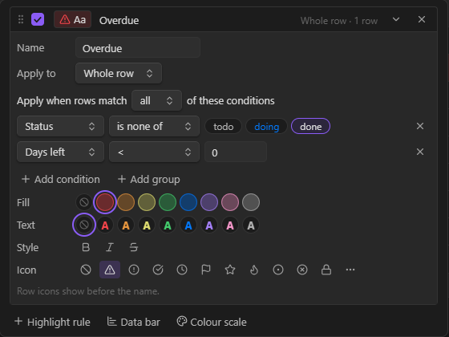

# Filters, sorting and highlights

Conditions pick out the entities you want, sort levels put them in order, and highlight rules make some of them stand out.

The same conditions are used throughout the plugin:

- a view's **Filters** (tables, [boards](/reference/boards) and [calendars](/reference/calendars));
- **highlight rules**, data bars and colour scales;
- a [roll-up](/reference/rollups)'s **Only include**, to count or total only some of the linked notes;
- [dashboard](/reference/dashboards) components, which can also take their values from the dashboard's filters (see [Dashboard filters](/guides/dashboard-filters));
- [workflows](/reference/workflows): a workflow's **Only if**, and [steps](/reference/steps) that test, find or loop over notes.

## Building conditions

Click **Filters** in a view's toolbar. The panel reads **Show entities that match all of these conditions**.

1. Click **Add condition**.
2. Pick the column, then the condition (such as **is any of** or **is before**), then the value.
3. Add more conditions as needed. Remove one with its **×**.

Choose **all** or **any** at the top: with **all**, an entity must meet every condition; with **any**, one is enough.

You can also right-click a column's header in a table and choose **Filter by …**.

Conditions can use any column of the view's types, whether it's shown or not: fields (including roll-up and formula fields), built-ins such as **Status**, **Folder** or **Created**, incoming links, and the view's own roll-up and formula columns.

### Groups

**Add group** adds a nested group with its own **all** or **any**. That lets you mix the two, for example:

> Status is any of *active* **and** (Owner links to any of *Ada* **or** Team links to any of *Ada*)

Here the top level matches **all**, and the group, **Where any of these conditions**, holds the two link conditions. Groups can only be nested one level deep.

## Operators

The conditions on offer depend on what kind of value a column holds.

### Text

Text, long text and URL fields, **Name**, **Ancestors**, and text formulas.

| Condition | `op` | Value |
|---|---|---|
| **contains** | `contains` | text |
| **does not contain** | `not-contains` | text |
| **is** | `is` | text |
| **is not** | `is-not` | text |
| **starts with** | `starts-with` | text |
| **is empty** | `empty` | none |
| **is not empty** | `not-empty` | none |

Text conditions ignore upper and lower case.

### Numbers

Number fields, number formulas, and roll-ups that count, total, average or find a minimum, maximum or % done.

| Condition | `op` | Value |
|---|---|---|
| **=** | `=` | a number |
| **≠** | `!=` | a number |
| **<** | `<` | a number |
| **≤** | `<=` | a number |
| **>** | `>` | a number |
| **≥** | `>=` | a number |
| **is between** | `between` | two numbers, from and to (inclusive) |
| **is empty** | `empty` | none |
| **is not empty** | `not-empty` | none |

### Dates

Date fields, **Created**, **Modified**, date formulas, and **earliest** or **latest** roll-ups.

| Condition | `op` | Value |
|---|---|---|
| **is** | `is` | a date |
| **is before** | `before` | a date |
| **is after** | `after` | a date |
| **is on or before** | `on-or-before` | a date |
| **is on or after** | `on-or-after` | a date |
| **is between** | `between` | two dates, from and to (inclusive) |
| **is empty** | `empty` | none |
| **is not empty** | `not-empty` | none |

Dates can be fixed (`2026-12-31`, in your vault's date format) or [relative to today](#relative-dates).

### Choices

**Status**, **Type** and choice fields.

| Condition | `op` | Value |
|---|---|---|
| **is any of** | `any-of` | one or more choices |
| **is none of** | `none-of` | one or more choices |
| **is empty** | `empty` | none |
| **is not empty** | `not-empty` | none |

For **Type**, the values are type keys, such as `task`.

### Lists

Multiple choice and list fields, **Tags**, **Aliases**, list formulas, and roll-ups that list names or unique values.

| Condition | `op` | Value |
|---|---|---|
| **has any of** | `has-any` | one or more values |
| **has all of** | `has-all` | one or more values |
| **has none of** | `has-none` | one or more values |
| **is empty** | `empty` | none |
| **is not empty** | `not-empty` | none |

### Checkboxes

Checkbox fields and true/false formulas.

| Condition | `op` | Value |
|---|---|---|
| **is checked** | `checked` | none |
| **is not checked** | `unchecked` | none |
| **is** | `is` | **Yes** or **No** (`true` or `false`) |

### Links

Relation fields, incoming links, **Related**, **Parent**, **Top-level parent**, and link formulas.

| Condition | `op` | Value |
|---|---|---|
| **links to any of** | `links-any` | one or more notes |
| **links to none of** | `links-none` | one or more notes |
| **is empty** | `empty` | none |
| **is not empty** | `not-empty` | none |
| **count =** | `count=` | a number |
| **count ≠** | `count!=` | a number |
| **count <** | `count<` | a number |
| **count >** | `count>` | a number |

You pick notes with the note picker, which offers the notes a link field can point to. In views, it offers **This note** first (see [This note](#this-note)).

### Folder

The **Folder** built-in.

| Condition | `op` | Value |
|---|---|---|
| **is in** | `in-folder` | a folder; its subfolders count too |
| **contains** | `contains` | text |
| **is** | `is` | a folder |
| **is not** | `is-not` | a folder |
| **is the vault root** | `empty` | none |

### Empty values

- Number and date comparisons never match an empty value: *Due is before today* leaves out tasks with no due date.
- Negative conditions do match empty values: **does not contain**, **is none of**, **has none of**, **links to none of** and **is not checked**.
- Choice and list values ignore upper and lower case.

## Relative dates

Wherever a condition takes a date, you can write one relative to today instead. The date box shows what it stands for today.

| Value | Means |
|---|---|
| `today` | Today |
| `-7d`, `+7d` | 7 days ago, 7 days from now |
| `-2w`, `+2w` | 2 weeks ago, 2 weeks from now |
| `-1m`, `+1m` | 1 month ago, 1 month from now |
| `-1y`, `+1y` | 1 year ago, 1 year from now |

- The units are `d` (days), `w` (weeks), `m` (months) and `y` (years).
- A number without a sign counts forwards: `1m` is the same as `+1m`.
- Months and years keep the day of the month where they can: a month from 31 January is the last day of February.

Relative dates move with the calendar, so *Due is between today and +7d* always means the coming week. They also work as the ends of [data bars and colour scales](#data-bars-and-colour-scales) on date columns.

## This note

For a link column, **links to any of** and **links to none of** can pick **This note**, written `{this}`. It stands for the note the view is shown on:

- for an `entity-view` block written in a note, that note;
- for an embedded view (`![[Project tasks]]`), the note it's embedded in.

So you can embed one Tasks view, filtered by *Project links to any of This note*, in every project note, and each shows its own tasks. **+ New** there links the new task to that project.

**This note** works in filters, highlight rules and roll-ups' **Only include**. When you open the view note on its own there's no "this note", so the condition is ignored. In a workflow, it's the note the workflow is running on.

See [Views inside notes](/guides/views-in-notes) for more on embedding views.

## Ignored conditions

A condition that can't be used is **ignored**, rather than hiding everything:

- it's still missing its value (no text, no choices or notes picked, or an empty number or date);
- its number or date can't be read ("soon");
- its column no longer exists, or the condition doesn't apply to it;
- it uses **This note** where there's no note.

The panel says why under each one, and the **Filters** button turns orange with a ⚠ to remind you. A group with no usable conditions is left out too.

In highlight rules, a rule whose conditions are all ignored matches nothing. A rule with no conditions at all matches every row.

## Condition YAML

In a view's `entity-view` block, filters go under `filters:`. Highlight rules use the same format under `when:`, and roll-ups under `where:`.

```yaml
filters:
  all:
    - { field: status, op: any-of, value: [active, review] }
    - { field: due, op: on-or-before, value: +2w }
    - any:
        - { field: owner, op: links-any, value: ["People/Ada Lovelace.md"] }
        - { field: team, op: links-any, value: ["{this}"] }
```

- The top level is `all:` or `any:`, followed by a list.
- Each item is a condition, or a nested group (`all:` or `any:` with its own list). Groups can only be nested one level.
- A condition has a `field`, an `op` and, for most operators, a `value`.

| Key | Meaning |
|---|---|
| `field` | The column's id: a field or built-in key (`due`, `status`, `folder`), `in:<type>.<field>` for incoming links, or the `id` of one of the view's roll-up or formula columns. See [column ids](/reference/tables#column-yaml). |
| `op` | The operator, from the tables above. |
| `value` | Left out for `empty`, `not-empty`, `checked` and `unchecked`. |

| Value | Written as |
|---|---|
| Text | `value: Smith` |
| A number | `value: 10` |
| A date | `value: "2026-12-31"` or `value: -7d` |
| Choices, list values | `value: [High, Critical]` |
| Notes | Note paths: `value: ["Projects/Apollo.md"]`. A note's name also works. `"{this}"` is [this note](#this-note). |
| A range (`between`) | `value: [today, +30d]` or `value: [10, 20]`. Leave one end empty for no limit: `value: ["", 100]`. |
| Yes or no (`is` on a checkbox) | `value: true` |

Quote values that YAML could misread: fixed dates, `"{this}"`, and operators such as `"!="`, `"<"` and `">="`.

## Sorting

Click **Sort**, then **Add sort level**, and pick a column and **ascending** or **descending**. Add more levels to break ties: the panel reads "Sort by … then by …". Drag levels to reorder them, and remove one with its **×**.

In a table you can also click a column's header to sort by it (ascending, then descending, then off), or Shift-click to add it as another level. The header menu has **Sort ascending**, **Sort descending** and **Clear sorting**.

How values sort:

- **Text** sorts naturally, ignoring case: "Chapter 2" comes before "Chapter 10".
- **Numbers** and **dates** sort by value.
- **Statuses** sort in your status order, and **choices** in their option order.
- **Links** sort by the first linked note's name.
- **Empty values always come last**, whichever the direction.
- Rows that tie on every level are in name order. With no sort, rows are in name order.

On a [board](/reference/boards), sorting orders the cards within each bucket; without a sort, you can drag cards into your own order. On a [calendar](/reference/calendars), it orders the entries within each day; without one, they're in status order.

### Sort YAML

```yaml
sort:
  - { by: due, dir: asc }
  - { by: priority, dir: desc }
```

`by` is a [column id](/reference/tables#column-yaml) and `dir` is `asc` or `desc`. A plain column id, as in `sort: [due]`, sorts ascending.

## Highlights

**Highlight** in the toolbar lists the view's rules. There are three kinds:

| Kind | What it does |
|---|---|
| **Highlight rule** | Colours the rows, or one column's cells, that match conditions. |
| **Data bar** | Draws a bar behind each value in a number or date column. |
| **Colour scale** | Shades each cell in a number or date column between two or three colours. |

Add one with the buttons at the bottom of the panel, or right-click a column's header and choose **Highlight cells…**, **Data bar…** or **Colour scale…**.

Each rule shows a sample, its name (or its first condition), what it applies to and how many rows it matches. Click a rule to edit it. Untick the box at its left to switch it off without deleting it, and drag rules to reorder them.

On a [board](/reference/boards) or [calendar](/reference/calendars), row rules colour whole cards, and cell rules, data bars and colour scales show on their card field. Dashboards have their own **Conditional styling**, built the same way; see [Dashboards](/reference/dashboards).

### Highlight rules



| Setting | What it does |
|---|---|
| **Name** | Optional, e.g. *Overdue*. |
| **Apply to** | **Whole row**, or one column under **Cells in column**. |
| Conditions | **Apply when rows match all / any of these conditions**, built like filters. They can use columns that aren't shown. |
| **Fill** | A background colour. |
| **Text** | A text colour. |
| **Style** | Bold, italic and strikethrough. |
| **Icon** | One of ten quick choices, or **…** to search all of Obsidian's icons. Row icons show before the name; cell icons before the value. |

The colours are red, orange, yellow, green, blue, purple, pink and grey. They come from your theme, so they work in light and dark mode.

**The first matching rule wins.** For each row, the first matching rule for **Whole row** applies. For each cell, the first matching rule for its column is laid over the row's style: what the cell rule sets wins, and what it leaves unset (no fill, say) comes from the row's rule. A cell rule's icon replaces the row's icon in that column.

A rule for a column that isn't shown has no effect; the panel says so.

### Data bars and colour scales

**Data bars** draw a bar behind each value: budgets, estimates, % done.

| Setting | What it does |
|---|---|
| **Column** | A number or date column. |
| **Colour** | The bar's colour (blue unless you change it). |
| **Negative** | The colour for negative numbers (red unless you change it). |
| **Minimum**, **Maximum** | Where the bar starts and ends (see below). |
| **Look** | **Gradient** fades the bar out; **Bar only (hide the value)** shows just the bar. |

Number bars start from zero. When the range spans zero, negative values draw leftwards from the zero line. Date bars span the earliest to the latest date. Values outside the range are clamped, and empty cells get no bar.

**Colour scales** shade each cell between colours, such as red for overdue through to green for plenty of time.

| Setting | What it does |
|---|---|
| **Column** | A number or date column. |
| **Preset** | **Red → Yellow → Green**, **Green → Yellow → Red**, **Grey → Blue** or **Red → Green**. |
| **Colours** | **2 colours** (low and high) or **3 colours** (low, middle and high), each of which you can change. |
| **Low at**, **Middle at**, **High at** | Which values get the low, middle and high colours. |

Each end of a bar or scale is one of:

- **Automatic**: the lowest or highest value among the rows shown (after filters and search) that the rule applies to. For a number bar, the automatic minimum is zero or the lowest value, whichever is lower. The middle of a scale is the median.
- **Number** or **Date**: a fixed value. For dates, a [relative date](#relative-dates) such as `today` or `+30d` works too.
- **Percentile**: e.g. the 90th percentile, to keep one huge value from squashing the rest.

The optional conditions, **Only rows that match**, limit which rows get a bar or colour.

A colour scale's fill replaces a row rule's fill in its column. A cell highlight rule with its own fill keeps it, if the rule comes before the scale in the list. A column can have both a bar and a scale; if it has several of one kind, the first wins. Summaries aren't affected.

### Highlight YAML

```yaml
highlight:
  - name: Overdue
    target: row
    when: { all: [{ field: due, op: before, value: today }, { field: status, op: none-of, value: [done] }] }
    style: { fill: red, icon: alert-triangle }
  - target: priority
    when: { all: [{ field: priority, op: any-of, value: [Critical] }] }
    style: { text: red, bold: true }
  - kind: bar
    target: budget
    bar: { color: blue, min: 0, max: p90, gradient: true }
  - kind: scale
    target: days_left
    when: { all: [{ field: status, op: none-of, value: [done] }] }
    scale: { colors: [red, yellow, green], min: 0, max: 30 }
    off: true
```

Rules are listed in priority order.

| Key | Meaning |
|---|---|
| `name` | Optional. |
| `kind` | `highlight` (the default), `bar` or `scale`. |
| `target` | `row` (the default) or a column id. Bars and scales need a number or date column. |
| `when` | Conditions, as in [Condition YAML](#condition-yaml). Left out: every row. |
| `style` | Highlight rules: `fill` and `text` (colours), `bold`, `italic` and `strike` (`true`), and `icon` (a Lucide icon name such as `alert-triangle`, `alert-circle`, `check-circle`, `clock`, `flag`, `star`, `flame`, `circle-dot`, `x-circle` or `lock`). |
| `bar` | Data bars: `color`, `negative`, `gradient` (`true`), `barOnly` (`true`), `min`, `max`. |
| `scale` | Colour scales: `colors` (a list of two or three colours, default `[red, yellow, green]`), `min`, `mid` (three colours only), `max`. |
| `off` | `true` switches the rule off but keeps it. |

Colours are `red`, `orange`, `yellow`, `green`, `blue`, `purple`, `pink` and `grey`.

The ends (`min`, `mid`, `max`) take `auto` (the default), a number, a percentile such as `p90`, or for date columns a date or relative date (`today`, `+30d`, `2026-12-31`).
