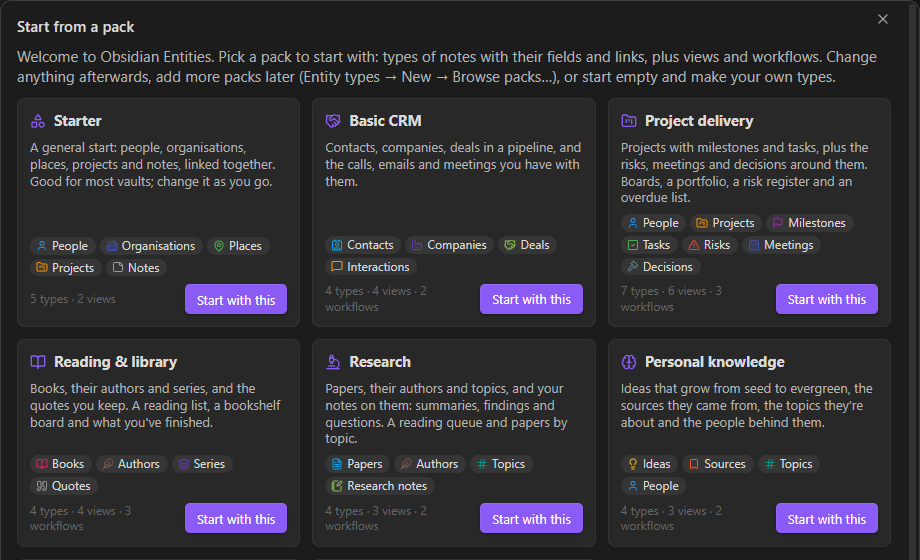

# Packs and apps

How packs and apps work: the gallery, what installing does, copying and importing, and the JSON format.

A **pack** is a set of types, with the groups they use and, optionally, their workflows, view notes, dashboards and templates, as JSON. An **app** is your whole configuration as one file. Neither ever includes your notes.

For a walk-through, see [Start from a pack](/guides/packs) and [Share your setup](/guides/sharing).

## Where to find everything

| What | Where |
|---|---|
| **Browse packs…** | The Entity Browser's **Types** tab: right-click the **Entities** heading. Also **Settings → Obsidian Entities → Entity types**, and the empty Entity types view. |
| **Import pack…** | Right-click the **Entities** heading. |
| **Import entity types…** | The command palette, or **Import types…** in **Settings → Obsidian Entities → Entity types**. |
| **Copy as JSON** | The type editor's **General** tab, under **More**. |
| **Copy group as a pack** | The group editor, under **More**. |
| **Copy all types as a pack** | Right-click the **Entities** heading. |
| **Export as an app…** and **Import app…** | Right-click the **Entities** heading, or **Settings → Obsidian Entities → Apps**. |

## The gallery

The gallery holds the packs that come with the plugin. Each pack is a card showing what it's for, its types, and how many views and workflows it has. Click **Install** to add it straight away. Once you've installed a pack, its button says **Installed**.

### The first-run picker

The first time the plugin runs in a vault, the gallery opens as **Start from a pack**.



- **Start with this** installs that pack, closes the window and opens the Entity Browser.
- **Start empty** (or closing the window) leaves you with one empty group, **Entities**, to make your own types in.

The picker only opens once. After that, use **Browse packs…**.

### The packs

| Pack | Types | Views | Workflows |
|---|---|---|---|
| **Starter** | Person, Organisation, Place, Project, Note | People, Projects (board) | – |
| **Basic CRM** | Contact, Company, Deal, Interaction | Pipeline (board), Contacts, Companies, Recent interactions | Deal won (field changes), Log a call (button) |
| **Project delivery** | Person, Project, Milestone, Task, Risk, Meeting, Decision | Project portfolio, Task board (board), Overdue, Risk register, Delivery calendar (calendar), Decision log | Record when a task is done (field changes), Tag overdue tasks (date), Log a meeting (form) |
| **Reading & library** | Book, Author, Series, Quote | Reading list, Bookshelf (board), Finished this year, Quotes | Started reading (field changes), Finished reading (field changes), Add a quote (button) |
| **Research** | Paper, Author, Topic, Research note | Reading queue, Papers by topic, Research notes | Record when a paper is read (field changes), Add a note (button) |
| **Personal knowledge** | Idea, Source, Topic, Person | Idea garden (board), Sources, Evergreen ideas | Date new ideas (note created), Make evergreen (button) |
| **Home & assets** | Item, Room, Warranty, Supplier | Inventory, Warranties, Warranty calendar (calendar) | Warranty about to expire (date), Warranty expired (date) |
| **TTRPG campaign** | Campaign, Session, Player character, NPC, Faction, Location, Quest, Item, Creature, Encounter, Lore | Party, Session log, Campaign calendar (calendar), Quest board (board), NPC directory, Factions, World atlas, Treasury, Bestiary, Encounter planner (board), Lore and secrets, Campaign dashboard (dashboard) | Log a session (form); Session wrap-up, Quest completed, Lay the fallen to rest (field changes); Date new NPCs, Date new lore (note created); Award XP, Level up, Long rest, Give a quest, Schedule for the next session, Drop it, Number the title (buttons); Prep reminder (schedule); Game day, Quest deadline near (date) |

Views without a layout in brackets are tables. The **TTRPG campaign** pack also brings templates for campaigns, locations and factions, with views inside them. It's the showcase pack: it uses most of what the plugin can do.

Some general types are **shared** between packs. If you already have one, installing another pack that has it reuses yours (see [Shared types](#shared-types)):

| Type | In |
|---|---|
| Person | Starter, Project delivery, Personal knowledge |
| Author | Reading & library, Research |
| Topic | Research, Personal knowledge |

Other types with the same key aren't shared. **Home & assets** and **TTRPG campaign** both have an Item, so whichever you install second gets the key `item_2`.

## What installing does

A pack is always added beside what you have. Nothing of yours is replaced. This is the same whether you install from the gallery, use **Import entity types…** or **Import pack…**, or import an app with **Add alongside the current configuration**.

### Keys already taken

A type whose key you already use gets a numbered key: `project` becomes `project_2`, then `project_3`. The notice after installing lists each one (`project → project_2`).

Everything in the pack that refers to the type follows its new key:

- **Types:** link fields' allowed types, roll-ups, and formulas (their columns and `notes("…")`).
- **Workflows:** **Applies to**, **Only if**, and the steps that name types, fields or filters (create, find, for each, linked notes, conditions), plus the formulas and `{…}` parts in their text. A form's link fields follow too.
- **Views:** the types they show, columns, filters, sorting, grouping, highlights, board and calendar settings.
- **Dashboards:** every component's source, columns and conditions, filter boxes, buttons that create notes, and where the dashboard is placed.

Template files are matched to the type's new key, but their text is written as it is. A view embedded in a template still names the old key, so check it after installing.

A workflow whose id is taken gets a new one. **Run another workflow** steps, workflow buttons on the pack's forms, and dashboard buttons all follow it.

A type with no key, or one that isn't valid, gets a key made from its name (`Research note` → `research_note`).

### Groups

- A group whose key you already have isn't added. The pack's types go into your group, with your statuses.
- A type whose group isn't in the pack or your vault goes into your first group.
- If you have no types yet, the pack's groups take the place of the empty **Entities** group a new vault starts with. This applies to the gallery only.

### Shared types

A pack can list general types as **shared** (people, authors, topics). If you already have a type with that key, it's used as it is: not added again, not renamed. The pack's links, views and workflows point at your type. A group that only the skipped types would have used isn't added.

### Search shortcuts

A type's search shortcuts (such as `p` for Person in **Find entity**) are left off if another type already uses them. One shortcut, one type.

### View notes and dashboards

The pack's views and dashboards are written as notes in your views folder. If a note with that name already exists, the new one is numbered: `Projects 2`. Dashboards that show one of the pack's views follow it to its new name, and so do workflows that are set to show on particular views.

### Templates

The pack's templates are written to your templates folder, for the types it adds:

- If the file doesn't exist, it's created.
- If it exists with the same text, it's left alone.
- If it exists with different text, the new one is numbered (`Book 2.md`) and the type uses that.

### Workflows come in switched off

Every workflow in a pack is added **switched off**, whatever it was when it was copied. Look each one over in the Workflows view, then turn it on. Apps can keep them as they were; see [Import an app](#import-an-app). See [Workflows](/reference/workflows).

### The Starter pack

The plugin remembers which Starter types you've deleted, so that an update doesn't add them back. Installing the Starter pack from the gallery clears that for the types it adds.

## Copying your types as a pack

Each of these copies JSON to the clipboard, ready to paste into **Import pack…** in another vault, or to save as a `.json` file.

| Button | What it copies | Views |
|---|---|---|
| **Copy as JSON** | One type, as it is in the editor (unsaved changes included), the group it's in, and its template file if there is one. | None |
| **Copy group as a pack** | The group's saved types, the group, and their templates. Named after the group. | Views and dashboards that only show those types, or the group |
| **Copy all types as a pack** | Every type and group, and every template. Named after the vault. | All of them |

The workflows that go with them:

- **Copy as JSON** and **Copy group as a pack** include the workflows that apply only to the copied types (or their group), and any workflow those run with a **Run another workflow** step.
- **Copy all types as a pack** includes every workflow.

**Copy group as a pack** is greyed out until the group has saved types. A notice says what was copied.

## Importing a pack

There are two ways to import a pack you've been given. Both accept a whole pack, a single type (as copied with **Copy as JSON**), or a list of types.

### Import pack… {#import-pack}

Right-click the **Entities** heading and choose **Import pack…**. The Entity types view opens **Import a pack**: paste the JSON, or choose a `.json` file, then click **Import**.

- Each type opens as a **draft** in the Entity types view, for you to review and save. Discard a draft and the type isn't added.
- New groups are added straight away.
- Workflows open as drafts in the Workflows view, switched off.
- View notes, dashboards and templates are written straight away.

### Import entity types… {#import-entity-types}

Run **Import entity types…**, or click **Import types…** in settings. Paste the JSON and click **Import**.

- Types, groups and workflows are added straight away, with workflows switched off.
- View notes, dashboards and templates are written.
- If a type has problems (a field key that isn't valid, a link to a type that doesn't exist), nothing is imported and the first few problems are shown.

**Load example: Basic CRM** fills the box with a small sample pack to try.

## Apps

An **app** is your whole configuration in one file: every group, type, workflow, view note, dashboard, template and saved layout component, with a name, version, author and description. Use it to set up another vault the same way, or to share a ready-made setup. Notes aren't included.

### Export an app {#export-an-app}

Choose **Export as an app…**. The window says what the app includes. Fill in:

| Field | Notes |
|---|---|
| **Name** | Required. Starts as your vault's name. |
| **Version** | Starts as `1.0`. Part of the file name; change it when you export changes. |
| **Author** | Optional. |
| **Description** | Optional. What it's for, what it holds. |

Click **Save…** and choose where to save it. The file is named from the name and version, for example `Project tracker 1.2.json`. The details are remembered for next time.

### Import an app {#import-an-app}

Choose **Import app…**, then **Choose a file…**. The window shows the app's name, version, author and description, and what it holds. A plain pack works too.

Under **How to import**, choose:

| Option | What happens |
|---|---|
| **Replace the current configuration** | The app's groups, types, workflows and saved components take the place of yours, with their keys as they are. View notes and templates with the same names as the app's are overwritten, and a copy of each changed one goes to the trash first. Other view notes and templates are left alone. Starter types the app doesn't have won't come back on update. |
| **Add alongside the current configuration** | Like installing a pack: keys already taken get a number (`task` → `task_2`), and everything in the app follows. Its saved components are added, skipping any you already have. View notes and templates are numbered when a name is taken. |

Before you replace, the window warns you:

- how many of your notes use types the app doesn't have (they're left as they are, but aren't entities until a type with their key exists);
- how many unsaved changes in the Entity types and Workflows views will be discarded.

**Switch on its workflows** appears if any of the app's workflows were on when it was exported. Leave it off to check them first; turn it on to keep each one on or off as it was.

Click **Replace configuration** or **Add to configuration**.

## The pack format

A pack is a JSON object. This is what the copy buttons and **Export as an app…** write, and what the importers read.

### Top-level keys

| Key | What it holds |
|---|---|
| `obsEntitiesPack` | Always `1`. Marks the JSON as a pack. Every export writes it. |
| `id` | The pack's id. Types installed from it remember it, which is how the gallery knows a pack is installed. Read by the gallery and **Import entity types…** only. |
| `name` | The pack's name, shown in notices. |
| `description` | What the pack is for. Shown in the gallery. |
| `icon` | A [Lucide](https://lucide.dev/icons/) icon name. Shown in the gallery. |
| `groups` | The groups the types use: `key`, `name`, `icon`, `statuses`, and optionally `statusColors`. |
| `types` | **Required.** A list of types, as the type editor saves them. See [Types and groups](/reference/types). |
| `workflows` | A list of workflows. Each needs a `steps` list. See [Workflows](/reference/workflows). |
| `views` | View notes and dashboards: a list of `{ "name": …, "view": … }`. |
| `templates` | Template text by type key: `{ "book": "## Summary\n" }`. |
| `components` | Saved layout components (**My components** on the Layout tab). Read by **Import app…** only. |
| `shared` | Keys of general types to reuse when you already have them: `["person"]`. |
| `app` | Makes the pack an app: `name` (required), and optionally `version`, `author` and `description`. |

Instead of a pack, the importers also accept a single type object, or a list of types.

### Types and groups

Each type needs a `name` and a `fields` list, and each field needs a `key`, a `label` and a `kind`:

| `kind` | Field |
|---|---|
| `text`, `textarea` | Text, long text |
| `number`, `date`, `boolean`, `url` | Number, date, checkbox, URL |
| `select`, `multiselect`, `list` | Choice, multiple choice, list |
| `relation` | Link to other entities |
| `rollup`, `formula` | Roll-up, formula |

Anything else is filled in when it's missing:

| Missing | Becomes |
|---|---|
| `key` | Made from the name |
| `plural` | The name plus `s` |
| `icon` | `file` |
| `color` | `#9e9e9e` (grey) |
| `template` | The name plus `.md` |
| `group` (or a group that doesn't exist) | Your first group |
| A group's `icon` | `folder` |
| A group's `statuses` | `draft`, `active`, `done` |

### Views and dashboards

Each entry in `views` has:

- `name`: the note's name.
- `view`: the view's definition, as it's written in the view note's code block, in JSON. A definition with `"kind": "dashboard"` is a dashboard. See [Dashboards](/reference/dashboards).
- `path` (optional): where the note was in the vault it came from. Workflows that show on particular views name them by path, so this lets them follow.

### Templates

`templates` maps a type's key to the text of its template: the note body new notes start with. Only templates for types the pack adds are written.

### An example pack

A small pack with two types, a group, a workflow, a board and a template:

```json
{
  "obsEntitiesPack": 1,
  "id": "reading-lite",
  "name": "Reading lite",
  "description": "Books, who wrote them, and what you thought.",
  "icon": "book-open",
  "shared": ["author"],
  "groups": [
    { "key": "library", "name": "Library", "icon": "library", "statuses": ["active", "archived"] }
  ],
  "types": [
    {
      "key": "book",
      "name": "Book",
      "plural": "Books",
      "icon": "book-open",
      "color": "#e91e63",
      "group": "library",
      "template": "Book.md",
      "shortcuts": ["b"],
      "statuses": ["to-read", "reading", "finished"],
      "card": { "subtitle": ["rating"] },
      "fields": [
        { "key": "authors", "label": "Authors", "kind": "relation", "targets": ["author"], "multiple": true, "inverse": "Books", "inModal": true },
        { "key": "rating", "label": "Rating", "kind": "select", "options": ["1", "2", "3", "4", "5"] },
        { "key": "finished", "label": "Finished", "kind": "date" }
      ]
    },
    {
      "key": "author",
      "name": "Author",
      "plural": "Authors",
      "icon": "feather",
      "color": "#795548",
      "group": "library",
      "template": "Author.md",
      "fields": [
        { "key": "website", "label": "Website", "kind": "url" }
      ]
    }
  ],
  "workflows": [
    {
      "id": "wf-finished",
      "name": "Finished reading",
      "on": false,
      "scope": ["book"],
      "trigger": { "kind": "changed", "field": "status", "to": ["finished"] },
      "when": { "mode": "all", "items": [] },
      "steps": [
        { "kind": "set", "field": "finished", "value": "", "fixed": "today" }
      ]
    }
  ],
  "views": [
    {
      "name": "Bookshelf",
      "view": {
        "kind": "board",
        "types": ["book"],
        "columns": ["name", "status", "authors", "rating"],
        "board": { "buckets": "status", "cardFields": ["authors", "rating"] }
      }
    }
  ],
  "templates": {
    "book": "## Summary\n\n## Thoughts\n"
  }
}
```

In a vault that already has a `book` type and an `author` type, this adds the Book type as `book_2`, without the `b` shortcut if your Book uses it. **Finished reading** applies to `book_2`, and the **Bookshelf** board shows `book_2`. Author is shared, so your Author is used and **Authors** links to it.

::: tip Start from a real pack
The easiest way to write a pack is to build the types in a vault, then use **Copy group as a pack** and edit the JSON.
:::

### Import errors

If the JSON can't be read, the importer says why and nothing is added:

| Message | Meaning |
|---|---|
| *Not valid JSON: …* | The text isn't JSON. Check for a missing comma or quote. |
| *Expected a pack ({ types: [...] }), a type, or a list of types.* | There's no `types` list, and it isn't a type either. |
| *The pack has no types.* | `types` is empty, and there are no workflows or views. |
| *Type … has no name.* / *has no field list.* | Each type needs `name` and `fields`. |
| *Type … has a field without a key or label.* | Each field needs `key` and `label`. |
| *Field … has an unknown kind …* | `kind` isn't one of those listed above. |
| *A group needs a valid key and a name.* | Group keys start with a lower-case letter and use only `a–z`, `0–9` and `_`. |
| *Workflow … has no steps list.* | Each workflow needs `steps`, even if it's empty. |
| *View … has no name.* / *has no definition.* | Each view needs `name` and `view`. |
| *“workflows” should be a list.* (and the same for `views` and `components`) | These keys hold lists. |
| *“templates” should map type keys to template text.* | `templates` is an object of strings. |
| *The app's details need a name.* | `app` needs a `name`. |
