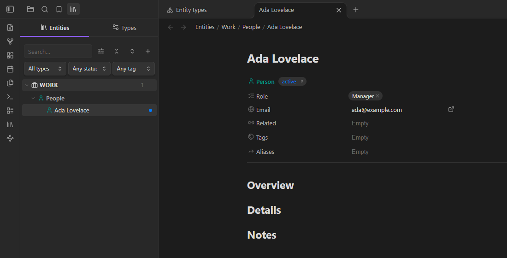

# Properties form

The form that replaces Obsidian's Properties block on entity notes, built from the note's type.

## Where it shows

| Mode | What you see |
|---|---|
| Live Preview | The form, ready to edit. |
| Reading view | The form, read-only. Click the pencil (**Edit properties**) to edit; click the tick (**Done editing**) when you've finished. |
| Source mode | The raw YAML. The form isn't shown. |

The form only appears on entity notes: notes whose `entity` property names one of your [types](/reference/types). Other notes keep Obsidian's Properties block.

To go back to Obsidian's Properties block everywhere, turn off **Use the entity properties form** in [Settings](/reference/settings). Hover previews and the File properties sidebar always use Obsidian's own editor.

## The top row

The row along the top of the form holds:

| Item | What it does |
|---|---|
| Type | The note's type, with its icon and colour. |
| Status | A dropdown of the statuses this type allows (its own, or its group's), tinted in the current status's colour. A status that isn't on the list is shown as "*name* (not a status here)". |
| Subtitle | The values of the type's subtitle fields, e.g. a person's role. |
| **N problems** | Shown when some values don't fit the type. Click it to jump to the first one (see [Problems and Fix](#problems-and-fix)). |
| Pencil | Reading view only: switches editing on and off. |
| **Open connections panel** | Opens the [side panel](/reference/side-panel) with this note's connections. |
| **⋯** (More options) | The form's menu (below). |
| Chevron | **Hide properties** / **Show properties**. Collapses the form to its top row. This is remembered, and applies to every note. |

A [custom layout](/reference/form-layouts) can place the type, status and subtitle inside the form instead; they then leave the top row.

### Workflow buttons

If any [workflows](/reference/workflows) that are switched on are started from notes of this type (**Run on notes** workflows, and form workflows that apply to the type), their buttons appear in a strip under the top row. Click one to run it on this note. A layout can place a button elsewhere in the form instead.

### The ⋯ menu

| Item | What it does |
|---|---|
| **Change type…** | Pick another type for the note. See [Changing type](#changing-type). |
| **Add other property…** | Opens **Other properties** with a name box ready, to add a key the type doesn't define. |
| **Configure the *Type* type** | Opens the type in the Entity types view. |
| Workflow buttons | Each of those workflows, to run it on the note. |

## The fields

Without a custom layout, the form lists one row per field, in the type's field order, followed by:

- **Order**, for types with parent fields (it sorts the note among its siblings in the [Entity Browser](/reference/browser));
- **Related**, links to any entity, shown on both notes;
- **Tags**;
- **Aliases**.

Each row has the field's icon and label. Hover over the label to see the field's description.

- **Required** fields have a `*`. A field that's only required when a condition holds gets its `*` while the condition holds.
- **Empty** fields show a faint "Empty".
- **Calculated fields** (roll-ups and formulas) are read-only. A value that can't be worked out shows "—"; hover over it for the reason.

### Hiding empty fields

Turn on **Hide empty fields** on the type's **Display** tab to leave empty fields out. The form then ends with **Show N empty fields**; click it to see them, and **Hide empty fields** to hide them again. A field with a problem is always shown.

### Custom layouts

A type can arrange its form in frames, columns and tabs, with headings and text between them. See [Form layouts](/reference/form-layouts) for every option, and [Design a form](/guides/form-layouts) for a walkthrough.

## Entering values

Only valid values go in. Each kind of field has its own control:

| Field kind | How you edit it |
|---|---|
| Text, URL, number | Type, then press <kbd>Enter</kbd> or leave the box to save. <kbd>Esc</kbd> cancels. |
| Long text | Type; <kbd>Ctrl/Cmd</kbd>+<kbd>Enter</kbd> or leaving the box saves. <kbd>Enter</kbd> starts a new line. |
| Date | Click in to open a calendar under the field, or type a date. Saves like text. |
| Checkbox | Click it. Saves straight away. |
| Choice | The value is a pill. Click it to pick another, or **×** to clear it. An empty field has a **Choose…** box. |
| Multiple choice | Pills for the chosen values, and an **Add…** box offering the rest. |
| List, Tags, Aliases | Chips, and an **Add…** box. <kbd>Enter</kbd> or a comma adds an item. |
| Link | Coloured chips for the linked notes, and a box to pick more. See [Link fields](#link-fields). |

Text, numbers and dates are checked before they're saved. A number that isn't a number, or a date that doesn't exist, isn't saved: a notice says why, and the old value stays.

Numbers, dates, checkboxes and URLs show in the field's **display format** (for example *5 Dec 2026* or *$1,240.50*). Click into a number or date to edit it: a number shows as a plain number, and a date in its format when it can be typed back, otherwise as `YYYY-MM-DD`. You can always type an ISO date. Typing `$1,240.50` or `45%` into a number is tidied up to the number.

### Choices

Choice boxes open the choices as pills. Type to filter them, use <kbd>↑</kbd>/<kbd>↓</kbd> and <kbd>Enter</kbd> to pick one, or click. Coloured choices show in their colour. A value that isn't one of the choices shows as an invalid pill.

### Link fields

- Each linked note is a **chip** in its type's colour, with a **×** inside to remove it. Click a chip to open the note; right-click it for more (see [Chips](/reference/side-panel#chips)).
- The picker only offers entities of the types the field links to. When you type a name that doesn't exist, it offers **Create "…"**.
- A **single-link** field that's set shows just its link. Remove it (its **×**, or <kbd>Delete</kbd> on the focused chip) and the picker appears, ready to type in.
- **Labelled** fields ask for a label (optional, e.g. *mentor*) after you pick a note.
- Fields that **read both ways** also show links set on the other note, with a dotted border. Removing one of those edits the other note.
- A link to a note that doesn't exist yet shows as a dashed chip; click it to create the note.

See [Relationships](/reference/relationships) for how links and their inverses work.

### Keyboard

| Keys | What they do |
|---|---|
| <kbd>←</kbd> / <kbd>→</kbd> | Move between chips and pills in a row. |
| <kbd>Backspace</kbd> or <kbd>Delete</kbd> | Remove the focused chip or pill. In an empty **Add…** box, <kbd>Backspace</kbd> removes the last one. |
| <kbd>Enter</kbd> on a choice pill | Pick another choice. |
| <kbd>Alt</kbd>+<kbd>↓</kbd> | Open a date field's calendar. |
| <kbd>Esc</kbd> | Close the calendar, or cancel your typing. |
| <kbd>Ctrl/Cmd</kbd>+<kbd>Z</kbd> | Undo the last form edit (see [Undo](#undo)). |

## Problems and Fix

Values set outside the form, in Source mode, by sync or by other plugins, are never changed without asking. Instead, the form checks them and flags anything that doesn't fit the type:

- the wrong kind of value, such as a number written as text;
- a choice or status that isn't allowed;
- a single value where a list is expected, or a list where one value is expected;
- a link to the wrong type of entity, or to a note that isn't an entity;
- a link written as plain text, which Obsidian won't track;
- an empty required field;
- a value that breaks one of the field's [validation rules](/guides/validation).

A problem outlines its row in red (an error) or orange (a warning). Hover over the icon to read it. Where there's an obvious fix, a **Fix** button sits beside it, for example:

| Problem | Fix |
|---|---|
| A number written as text | **Make it a number** |
| A yes/no value written as text | **Make it yes** / **Make it no** |
| A single value written as a list | **Use a single value** or **Use a single link** |
| One link expected, but several set | **Keep the first** |
| A list written as one value | **Make it a list** |
| A link written as plain text | **Make it a link** |
| A link to the wrong type, or to a note that isn't an entity | **Remove the link** |
| A choice that isn't one of the options | **Remove** |

Fix buttons only show while you can edit, so in Reading view click the pencil first.

The **N problems** button in the top row takes you to the first problem: it opens the form if it's collapsed, shows hidden empty fields, opens collapsed frames and the right tab, and puts the cursor in the field. If the problem is in a part of a layout that's hidden by **Show only when…**, that part is shown too, marked "Normally hidden", until the problem is fixed.

To list every note with problems, run the **Check entities** [command](/reference/commands).

## Other properties

Keys in the note that the type doesn't define are listed in a collapsed **Other properties** section at the end of the form, with a count. It's only shown when the note has some.

- Each key is edited according to its Obsidian property type: text, number, checkbox, date or list.
- **Add property** in the section, or **Add other property…** in the form's **⋯** menu, adds a key. Type its name and press <kbd>Enter</kbd>.
- Each key has its own **⋯** menu:
  - **Add to the *Type* type** opens the type editor with a new field drafted from the key, ready to check and save.
  - **Remove** deletes the key from the note, with **Undo** in the notice.

## Changing type

**Change type…** in the **⋯** menu (or clicking a placed **Type** item) lets you pick another type. Every value is kept:

- Fields the new type doesn't use move to **Other properties**.
- The status is reset if the new type doesn't allow it.
- If the new type's folder is elsewhere, the notice offers to move the note.

## Undo

<kbd>Ctrl/Cmd</kbd>+<kbd>Z</kbd> in the form undoes the last edit made in the form on that note, up to 20 steps. If a workflow ran because of that edit, its run is one more step.

While you're still typing in a box, <kbd>Ctrl/Cmd</kbd>+<kbd>Z</kbd> undoes your typing instead.

Removing a link or an other property also shows a notice with **Undo**.

## Technical details

- The form writes ordinary frontmatter. Switch to Source mode to see it.
- Dates are stored as `YYYY-MM-DD`, whatever their display format.
- Links are stored as wikilinks, e.g. `assignee: "[[Grace Hopper]]"`. Labelled links put the label in the alias: `"[[Grace Hopper|mentor]]"`.
- Calculated fields are never written to the note.
- Whether the form is collapsed is saved in the plugin's settings. Which tab is open in a layout is remembered per type on this device.
