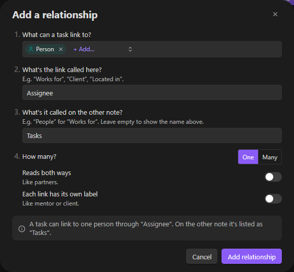
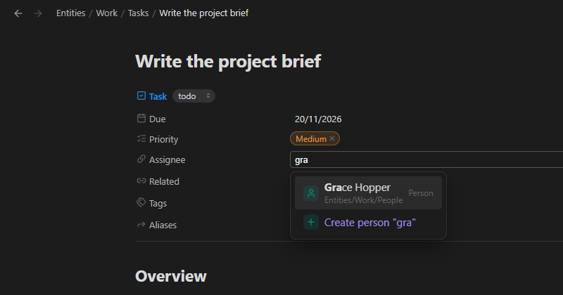
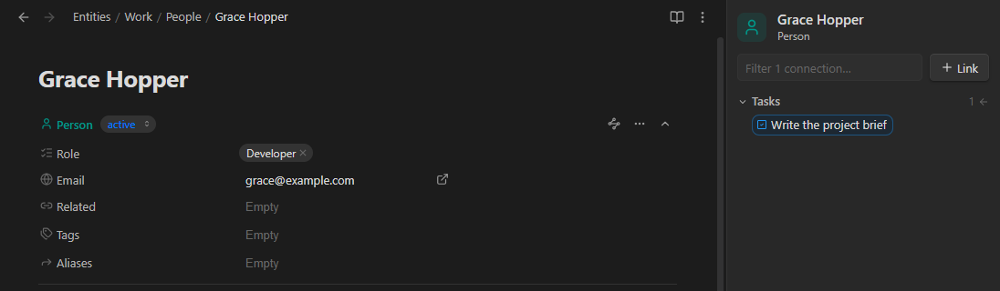

# Relationships

A relationship is a link field between entities; this page covers what a link can point at, how it shows on the other note, two-way and labelled links, and where you see and edit links.

## How links work

A relationship is a **relation field** on a type, such as a task's **Assignee**. Its value is one or more wikilinks to other notes:

```yaml
assignee: "[[Grace Hopper]]"
```

Only the note that holds the link stores it. The other note shows it anyway, worked out from the link, under the field's **inverse** label: Grace's note lists the task under *Tasks*, even though nothing is written in Grace's note. So:

- you only ever set a link in one place, and the two ends can't disagree;
- renaming either note keeps the link working, because it's an ordinary wikilink (backlinks and the graph view see it too);
- deleting the link from the task removes it from Grace's side as well.

## Add a relationship

Open a type, go to its **Relationships** tab (or **Fields → Add field → Relationship…**) and click **Add relationship**. A short dialog asks:



| Question | What it sets |
|---|---|
| **What can a *task* link to?** | The [targets](#what-a-link-can-point-at): one or more types, a whole group, or any entity. |
| **What's the link called here?** | The field's label on this type, such as *Assignee* or *Works for*. Its key is made from it. |
| **What's it called on the other note?** | The [inverse label](#inverse-labels), such as *Tasks* or *People*. Leave it empty to use the name above. |
| **How many?** | **One** or **Many**. |
| **Reads both ways** | A [two-way link](#two-way-links), like partners. |
| **Each link has its own label** | [Labelled links](#labelled-links), like *mentor* or *client*. |

A sentence at the bottom says, in plain English, what you've set up. Click **Add relationship**: the new field opens on the **Fields** tab, where you can change any of this later. Save the type to keep it.

## Relation settings

A relation field's settings are on its **Relation** tab (**Fields**, then select the field).

| Option | What it does |
|---|---|
| **Links to** | Which entities the field can point at. **+ Add…** offers **Any entity**, **Any *Group* entity** for each group, and every type, listed by group. Remove one with its **×**. |
| **Shown on the other note as** | The inverse label: what the link is called on the note it points at. |
| **How many links** | **One** stores a single link; **Many** stores a list. Fixed at **Many** for labelled links. |
| **Reads both ways** | The link means the same from either end, like *partner* or *allies*. |
| **Each link has its own label** | Each link carries a word of its own, like *mentor* or *technical lead*. |

Like other fields, a relation has **General** settings (label, key, description, default, **Show in the create dialog**) and **Validation**: required, how many items (for **Many**), unique and required when. Its only kind of default is **From a linked note**. See [Fields](/reference/fields).

## What a link can point at

| Target | Links to | Example |
|---|---|---|
| A type | Notes of that type | *Assignee* links to **Person** |
| Several types | Notes of any of them | *Owner* links to **Person** or **Team** |
| **Any *Group* entity** | Notes of every type in that group, including types you add to it later | *Located in* links to any **Places** entity |
| **Any entity** | Every entity | *See also* |

- Choosing **Any entity** replaces the specific targets, and choosing a type replaces **Any entity**.
- Link pickers only offer notes the field can link to. If a field that links to particular types or groups points at something else (set in Source mode, say), it's flagged on the note: an entity of the wrong type is an error, and a note that isn't an entity is a warning. Both have a **Remove the link** fix.
- A field with no targets at all links to any entity.

## One or many

| Choice | In the note | In the form |
|---|---|---|
| **One** | `owner: "[[Ada Lovelace]]"` | One chip. Remove it with its **×** (or Delete) and the picker appears. |
| **Many** | a list of links | A chip per link, plus an **Add…** box |

Changing **One** to **Many** (or back) doesn't change existing notes: a single link where a list is expected, or several links where one is expected, is flagged with a one-click fix (**Make it a list**, **Use a single link**, **Keep the first**).

## Inverse labels

The inverse label is what a link is called on the note it points at. A person's *Works for* link to Acme shows on Acme under *People*.

- **Without one,** the other note shows the field's label and where it came from: *Works for (from Person)*.
- **Inverse labels merge across types.** If a Person's *Member of* and a Team's *Member of* both have the inverse label *Members*, a group lists them together under *Members*.
- The inverse is shown in the [Connections panel](#the-connections-panel), the Entity Browser's tooltips, and the type editor's **Relationships** tab. It isn't stored on the other note, but roll-ups can still count and total the notes linking there (see [Using links elsewhere](#using-links-elsewhere)).

## Two-way links

Turn on **Reads both ways** for links that mean the same from either end: partners, allies, siblings, *related to*.

- Both notes show the link under the same name: the inverse label if there is one, otherwise the field's label.
- Only one note stores the link, but both show it. When both notes have the field (allies between two factions, say), each note's field in the properties form also shows the links set on the other, with a dotted border. Removing one of those edits the note that holds it.
- For a two-way link the inverse label is optional.

## Labelled links

Turn on **Each link has its own label** when each link needs a word of its own: a deal's contacts might be Ada (*economic buyer*) and Grace (*technical lead*).

- When you add a link, the plugin asks for its label.
- The label is stored as the link's alias, so it's still a real link: `"[[Grace Hopper|technical lead]]"`.
- On the note that holds the link, links are grouped by label (*Technical lead*). On the note it points at, they show as *Technical lead of*.
- Labelled fields always hold **Many** links. The same note can be linked more than once with different labels.

## Related links

Every entity also has a built-in `related` property: general links to any notes, with no field to set up.

- They read both ways, and show under **Related** on both notes.
- They aren't limited to any type, so they're never flagged for pointing at the wrong kind of note.
- Edit them in the properties form's **Related** row, or with **+ Link** in the Connections panel.

## Linking notes

### In the properties form

Click in a relation field and start typing. Only notes the field can link to are offered, with each note's subtitle underneath.

- Choose one to link it. It shows as a chip in the linked type's colour: click it to open the note, Ctrl/Cmd-click to open it in a new tab, or hold Ctrl and hover for a preview.
- If nothing matches, the picker offers to create the note: **Create *person* "Ada"** for each type the field links to, or **Create "Ada" as…** to pick a type when it links to more than three.
- Remove a link with the **×** on its chip, or Backspace / Delete on a focused chip. ←/→ move between chips. **Ctrl/Cmd+Z** undoes.



### In the create dialog

The create dialog has the same pickers. With the **Prefill links from the active note** setting on, a new note is linked to the note you're on when one of its fields can link to it (parent fields first): a new task created from a project links to that project.

### Links that don't exist yet

A link to a note that doesn't exist shows as a dashed chip. Click it to create the note. That isn't a problem: it's how you plan things you haven't written yet.

### Removing links

Right-click a chip for **Open in new tab**, **Open to the right**, **Remove link**, and the usual file menu.

- Removing a link that's stored on the other note edits that note, and the menu says so: **Remove link (edits Ada Lovelace)**.
- Every removal shows a notice with **Undo**.

## The Connections panel

The side panel shows the open note's **Connections**: every link to and from it. Open it with the **Connections** button at the top of the properties form, the **Side panel** ribbon icon or the **Open side panel (connections, preview)** command. See [Side panel](/reference/side-panel).



- **Groups:** one per relationship, collapsible, with a count and an arrow for the direction: **→** set on this note, **←** set on the other note, **⇄** both ways. The note's own fields come first, in field order, then the links from other notes, then **Related**.
- **Mentioned in:** notes that link to this one in their text, rather than through a relationship. It starts collapsed.
- **Filter** narrows the list by name or group.
- **+ Link** adds a link: choose the **Relationship** (one of this type's relation fields, or *related*), then the note to **Link to** (or create it), then a **Label** if the field has labels.
- On a note that isn't an entity, the panel offers **Convert to entity**.

## The Relationships tab

The type editor's **Relationships** tab shows how a type connects to the others.

| Section | What it shows |
|---|---|
| **Connections** | A diagram: this type in the middle, types that link to it on the left, types it links to on the right. Arrows point from the note that holds the link. Click a type to open it. |
| **Links from *Types*** | This type's relation fields, with their targets, their inverse label, and one, many or labelled. Click one to open it on the **Fields** tab. |
| **Links to *Types*** | Relation fields on other types that link here, and the name they show under. Click one to open that type with the field selected. Fields that reach this type only through **Any entity** or **Any *Group* entity** are in a collapsed list underneath. |

## Using links elsewhere

- **Hierarchies:** pick a type's [parent fields](/reference/types#parent-fields) on its **Display** tab, and the Entity Browser nests notes under their parents. The **Inside its parent** folder rule files them there too.
- **Roll-ups** summarise linked notes: count a person's open tasks, total a project's spend. They can follow this type's relation fields, or links from another type "linking here". See [Roll-ups](/reference/rollups).
- **Defaults:** **From a linked note** copies a value from a linked note into a new one, such as a task's client from its project. See [Fields](/reference/fields#defaults).
- **Views** can show, filter, sort and group by relation fields. See [Tables](/reference/tables) and [Filters, sorting and highlights](/reference/filters).

## In the note

```yaml
assignee: "[[Grace Hopper]]"          # one link
attendees:                            # many links
  - "[[Ada Lovelace]]"
  - "[[Grace Hopper]]"
contacts:                             # labelled links: the label is the alias
  - "[[Ada Lovelace|economic buyer]]"
  - "[[Grace Hopper|technical lead]]"
related:
  - "[[Apollo programme]]"
```

An empty single link is written as `null`, and an empty list as `[]`. See [Entity notes](/reference/notes#links).

## In a pack

```json
{ "key": "works_for", "label": "Works for", "kind": "relation", "targets": ["company"], "inverse": "People", "inModal": true },
{ "key": "located_in", "label": "Located in", "kind": "relation", "targets": ["@places"] },
{ "key": "allies", "label": "Allies", "kind": "relation", "targets": ["faction"], "multiple": true, "symmetric": true },
{ "key": "contacts", "label": "Contacts", "kind": "relation", "targets": ["person"], "multiple": true, "labelled": true, "inverse": "Deals" }
```

| Property | Notes |
|---|---|
| `targets` | Type keys, `"@<group key>"` for any type in a group, or `"*"` for any entity. Empty or missing means any entity. |
| `multiple` | `true` stores a list of links. |
| `inverse` | The label on the other note. Without it, the other note shows `<label> (from <type name>)`. |
| `symmetric` | `true` for a link that reads both ways. |
| `labelled` | `true` for a label per link, stored as the link's alias. Implies `multiple`. |
