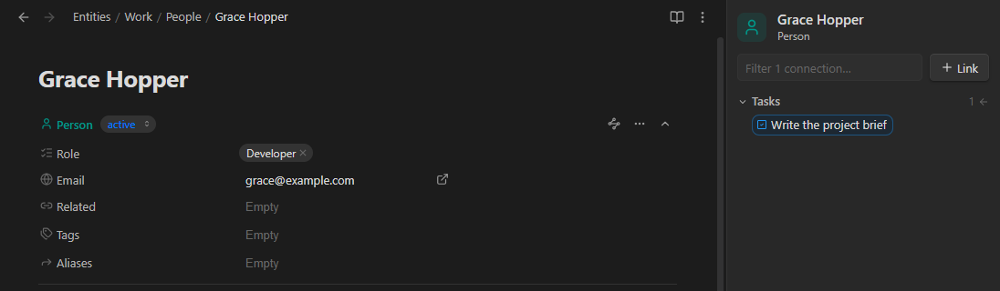

# Side panel

The panel beside a note: its connections and linked notes.

The plugin has one panel in the right sidebar. Open it with:

- the **Side panel** icon in the ribbon;
- the **Open side panel (connections, preview)** [command](/reference/commands);
- the **Open connections panel** button at the top right of the [properties form](/reference/properties-form);
- **Show connections** when you right-click a note in the [Entity Browser](/reference/browser).

## What it shows

The panel follows the last tab you used in the main area. Clicking in a sidebar doesn't change it. Its tab icon and name change to match:

| Main area tab | The panel shows |
|---|---|
| A note | The note's **Connections** (below). |
| The Entity types view | A **Preview** of the selected type. With a group selected, it asks you to select a type. |
| The Workflows view | A **Preview** of the open form workflow's form. Otherwise it asks you to open one. |
| Anything else (views, dashboards, other plugins' tabs, images…) | "Nothing to show here." |

### Type preview

While you edit a type, the preview shows how it will look, before you save. Switch between:

| Mode | What it shows |
|---|---|
| **Dialog** | The create dialog. Nothing is created. |
| **Picker** | The type's row in the link picker, with its subtitle. |
| **Form** | The properties form, with its [layout](/reference/form-layouts). |

It uses the type's note with the most values, or made-up values if there are no notes yet. See [Types and groups](/reference/types).

## Connections

The Connections panel is the main place to see a note's links: the links it stores, and the links other notes store to it.

### The header

The header shows the type's icon, the note's name and its type. Click the name to open the note. Field values aren't shown here; they're in the properties form.

For a note that isn't an entity, the header says **Not an entity**, and a **Convert to entity** button takes the place of **+ Link**.

### Filter

The box under the header ("Filter N connections…") narrows the list as you type. It matches the linked notes' names, group names and link labels.

### Groups

Links are grouped by relationship. Each group has a count and an arrow saying where the link is stored:

| Arrow | Meaning |
|---|---|
| → | **Set on this note**: a link field on this note. |
| ← | **Set on the linked notes**: their link fields point here. |
| ⇄ | **Works both ways**: a two-way field, or **Related**. |

Hover over an arrow to see its meaning. Click a group's heading to fold it.

| Group | Named after |
|---|---|
| Links this note stores | The field's label, e.g. *Works for*. |
| Links other notes store | The field's **inverse** label, e.g. *People*. Without one: *Field (from Type)*, e.g. *Works for (from Person)*. |
| Two-way fields | The inverse label, or else the field's label. Links from both notes are in the one group. |
| **Related** | Links in `related`, from either note. Always last. |
| Labelled links | The label: *Mentor* on the note that stores the link, *Mentor of* on the other. |
| **Mentioned in** | Notes that link here in their text, or anywhere else that isn't a relationship. This group starts folded. |

The groups for this note's own fields come first, in field order. See [Relationships](/reference/relationships) for inverse labels, two-way fields and labels.

## Adding links

Click **+ Link** to add a link from this note. The **Link from *Name*** dialog asks:

1. **Relationship**: one of the type's link fields, or **Related**. A single-link field that's already set says *(replaces current)*.
2. **Link to**: search for the note. Only entities of the types the field allows are offered, and you can create a new one.
3. **Label**: only for labelled fields, e.g. *mentor*, *friend* or *rival*. It's optional.

Picking a note adds the link straight away, unless the field asks for a label. Then press <kbd>Enter</kbd> or click **Add link**.

You can also add links in the note's [properties form](/reference/properties-form#link-fields).

## Removing links

Right-click a chip and choose **Remove link**.

- If the link is stored on the other note, removing it edits that note, and the menu says so, e.g. **Remove link (edits Ada Lovelace)**.
- Every removal shows a notice with **Undo**.
- Links under **Mentioned in** aren't relationships, so there's no **Remove link** for them. Edit the note that contains them instead.

In the properties form, each link chip also has a **×** to remove it.

## Chips

A **chip** stands for a linked note, in the panel and in the properties form's link fields. It shows the note's type icon and name, in the type's colour. A labelled link shows its label after the name, unless the group is already named after the label.

| Action | What it does |
|---|---|
| Hover | Shows the note's subtitle. |
| Click | Opens the note. |
| <kbd>Ctrl/Cmd</kbd>-click or middle-click | Opens it in a new tab. |
| <kbd>Ctrl</kbd> + hover | Shows a preview. |
| Right-click | **Open in new tab**, **Open to the right**, **Remove link**, then Obsidian's usual file menu. |

### Notes that don't exist yet

A link to a note that doesn't exist yet shows as a dashed chip. Click it to create the note, or right-click and choose **Create "*name*"**.
