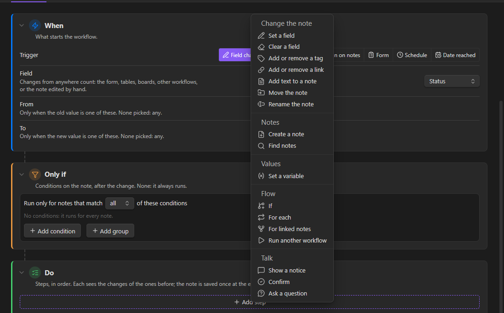

# Steps

Everything a workflow can do.

## Adding and arranging steps

The **Do** section holds a workflow's steps, which run in order. Each step sees the changes made by the ones before it. Every note is saved once, at the end. If a step fails, nothing is saved.

Click **Add step** for a menu of every step, grouped by what it does:

| Group | Steps |
|---|---|
| **Change the note** | [Set a field](#set-a-field), [Clear a field](#clear-a-field), [Add or remove a tag](#add-or-remove-a-tag), [Add or remove a link](#add-or-remove-a-link), [Add text to a note](#add-text-to-a-note), [Move the note](#move-the-note), [Rename the note](#rename-the-note) |
| **Notes** | [Create a note](#create-a-note), [Find notes](#find-notes) |
| **Values** | [Set a variable](#set-a-variable) |
| **Flow** | [If](#if), [For each](#for-each), [For linked notes](#for-linked-notes), [Run another workflow](#run-another-workflow) |
| **Talk** | [Show a notice](#show-a-notice), [Confirm](#confirm), [Ask a question](#ask-a-question) |



Each step is a card with its number and a drag handle on the left. Drag that strip to reorder steps, or use the up and down arrows. The bin removes the step.

Loops and **If** hold steps of their own, indented inside them, with **Add a step inside**. They're numbered *2.1*, *2.2* and so on (an If's **Otherwise** steps carry on from its **Then** steps), and *2.1.1* inside those. Loops and Ifs can go inside each other, to any depth. **Confirm** and **Ask a question** aren't offered inside a loop.

A step with a problem shows it in red under the card. See [Problems](/reference/workflows#problems).

## Which note a step acts on

Steps that change a note act on **this note** (the note the workflow runs on) unless you say otherwise. Inside a loop of notes, they act on **each** note of the loop instead.

These steps have an **On** picker to choose another note: Set a field, Clear a field, Add or remove a tag, Add or remove a link, Add text to a note, Move the note, Rename the note, Run another workflow, and an If that tests conditions. It offers:

| Choice | The note |
|---|---|
| **This note** (or **Each task** in a loop) | The default. |
| **This note** inside a loop | The note the workflow runs on, rather than the loop's note. |
| **Loops this is inside** | An outer loop's note, by its name. |
| **Picked on the form** | A note a form's link field picked (one note only). |
| **Found by earlier steps** | The note a **Find notes** step found, when it keeps **The first one**. |
| **Created by earlier steps** | A note a **Create a note** step made. |

Some limits:

- A note this workflow creates can't be moved or renamed: its **Create a note** step names and places it.
- A plain note (one created with no type) has no fields: you can only tag it or add text to it.
- If a **Find notes** step found nothing, or a form's link field was left empty, steps on that note are skipped.

Choosing another note for Set, Clear or Link starts the step afresh, as the other note may have other fields.

## Names

Steps give names to notes and values, so later steps can use them in formulas, in square brackets.

| Name | What it is | Where you can use it |
|---|---|---|
| `[This note]` | A link to the note the workflow runs on. Most useful inside loops, where the other columns read each loop note. | Everywhere, except runs with [no single note](#runs-with-no-single-note). |
| `[Selected notes]` | The selected notes, as a list of links. | Buttons that run once for the selection. |
| A loop's **Call each**, such as `[Task]` | The loop's current note (a link), or its current value. | Inside the loop, and loops inside it. |
| A created note's **Call it**, such as `[New meeting]` | A link to the note. | Steps after it in the same list, and inside them. Not after the loop it's in: that makes one per item. |
| A **Find notes** result, such as `[Overdue tasks]` | A list of links. | Every step after it, for the rest of the run. |
| An answer's **Call it**, such as `[Summary]` | The answer to **Ask a question**, as text. | Every step after it. |
| A form field's label, such as `[Date]` | The form's answer. See [the answers](/reference/triggers#the-answers). | Every step. |
| A variable, such as `[Total]` | A value from **Set a variable**. | Every step after the first that sets it, after loops too. |

The **[ ]** button by every value and formula box lists the names available at that step, under headings: **This note**, **The selection**, **Loop items**, **Created notes**, **Found notes**, **The form's answers**, **Answers** and **Variables**. Then come the note's columns, under **Built-in** and **Fields** (*of each task* inside a loop of notes).

Names must be unique in the workflow, and can't be a field's name, *This note* or *Selected notes*. Variable names can't contain brackets or braces.

A created or found note is a link, so you can read its fields with formulas such as `prop([New meeting], "Date")` or `name(first([New session]))`. See [Formulas](/reference/formulas).

## Values, formulas and text

### Picked values

**Set a field** and the fields of **Create a note** start with a value picked to suit the field:

- status and choices: the coloured pill, with a dropdown of the choices;
- dates: typed, picked from the calendar button, or relative: `today`, `+7d`, `-1m`, `+2w`, `+1y`. Relative dates are worked out when it runs;
- numbers, and a tick for checkboxes;
- links: notes from the picker, shown as chips;
- lists: values separated by commas;
- text.

### Formulas

Anywhere a value can be picked, you can use a formula instead:

- **[ ]** puts a field or name in. In a picked value, it turns the value into that formula (Due → `[Start]`, say).
- **ƒx** turns the value into a formula and opens the formula editor, with autocomplete, the function list, `old` and `new`, and a preview of what the first notes would get.
- **↺** goes back to a picked value.

Formulas are the same language as views and calculated fields, checked as you type: `[Estimate] * 2`, `dateAdd([Start], 2, "weeks")`, `list("a", "b")` for a multiple-choice or list field. See [Formulas](/reference/formulas).

Some boxes only take formulas: **Set a variable**, the list of **For each**, an **If** formula, and the notes of **Add or remove a link** when they aren't picked.

The result must suit the field: a status the type has, one of a choice field's choices (whatever the case), a number, a date, or the name of a note that exists. If it doesn't, the step fails and nothing is saved.

### Text with formulas

::: v-pre

Text boxes can hold formulas in braces, worked out when it runs: `{[Name]} is done` or `- {format(today(), "D MMM")}: {[Summary]}`. These are notices, Confirm questions, Ask a question's question and default answer, note names, folders, new names, text to add, headings, and a plain note's body. Write `{{` and `}}` for a brace of your own.

:::

In a text box, **ƒx** opens the formula editor on the `{…}` part the cursor is in, or adds a new one at the cursor.

### old() and new()

On a **When a field changes** workflow, `old([Field])` is a field's value before the change, and `new([Field])` its value after (the same as `[Field]`). For example, `new([Estimate]) - old([Estimate])`, or an If on `old([Status]) = "blocked"`. On other triggers, both give the current value. They read the note the workflow runs on.

## Change the note

### Set a field

Sets one of the note's fields to a value: picked, or a formula.

| Option | What it is |
|---|---|
| **On** | The note. See [Which note a step acts on](#which-note-a-step-acts-on). |
| **Field** | **Status**, or any stored field of the note's types. |
| **to** | The value. See [Values, formulas and text](#values-formulas-and-text). |

Calculated fields can't be set, and tags have their own step. In a workflow for several types, a note whose type doesn't have the field is left alone. A link field with labelled links can only be changed with [Add or remove a link](#add-or-remove-a-link).

### Clear a field

Empties a field. Pick the **Field** (and **On**, for another note).

### Add or remove a tag

**Add** or **Remove** a **Tag**, with or without its `#`.

### Add or remove a link

Adds notes to a link field, or takes them out.

| Option | What it is |
|---|---|
| **Add** / **Remove** | Which to do. |
| **Field** | One of the note's link fields. |
| The notes | Picked, or a formula: `[Project]`, `"Apollo"`, or a name such as `[New quest]`. |

Adding a name that isn't a note fails.

### Add text to a note

Adds text to the note's body.

| Option | Choices |
|---|---|
| **Text** | Several lines, with `{formula}` parts: `- {format(today(), "D MMM")}: {[Status]}`. |
| **Where** | **At the end**; **At the start** (after the note's properties); or **Under a heading**, at the end of that heading's section. |
| **Heading** | Under a heading: `## Log` only matches a level 2 heading, `Log` any level. A note without it gets the heading added at the end. |
| **Spacing** | **On its own line**, or **With a blank line** between it and what's before it (or after it, at the start). |

If the text works out empty, nothing is added. Adding text doesn't change any fields, so it doesn't set off **When a field changes** workflows. Undo takes the text out again.

### Move the note

Moves the note to another folder.

- **A folder**: typed, with `{formula}` parts such as `Archive/{year(today())}`, or picked with the folder button. `/` is the vault's top folder.
- **Its type's folder**: where its type's folder rules put it now. For example, into its new project's folder after an earlier step changes its Project.

Links to it are updated, as Obsidian's **Automatically update internal links** setting says. A note already there with the same name gets " 2" added. Moves happen last, once the notes are saved. Undo moves it back.

### Rename the note

Gives the note a **New name**, from text with `{formula}` parts: `{[Code]} {[Name]}`. It stays in its folder, and links to it are updated. Characters a file name can't have are left out.

## Notes

### Create a note

Creates a new note.

| Option | What it is |
|---|---|
| **Type** | An entity type, or **Plain note (no type)**. |
| **Name** | Text with `{formula}` parts: `{[Name]} kick-off`. Empty: *New meeting*. |
| **Fields** | The values it starts with: **+ Add a field**, then pick a value or write a formula. Formulas read this note (each note, in a loop). |
| **Link** | How it links to this note (or each note, in a loop): the new note's field pointing here (a meeting's **Project**), or this note's field pointing at it (a campaign's **Current session**). Or **Don't link it to this note**. |
| **Body** | **Use the type's template**, or start empty. |
| **Open it** | **No**, **New tab** or **This tab**. |
| **If it exists** | **Create another** (its name gets " 2", " 3"…), **Use the existing one**, or **Stop the run**. |
| **Call it** | The name later steps use: **On** *New meeting*, and `[New meeting]` in formulas. |

It's created where its type's folder rules put it, using any parent link it's given. "Exists" means a note of this type with the same name, where it would be created. With **Use the existing one**, no note is created: the link is still made, but its fields are left as they are. With **Stop the run**, nothing is saved.

The new note's own **When a note is created** workflows run too, unless **Set off other workflows** is off.

Inside a loop, it makes one note per item, and **Link** links each one to that item's note.

**Plain notes** have no type, so no fields, link or type template. Instead:

::: v-pre

| Option | What it is |
|---|---|
| **Folder** | Text with `{formula}` parts, such as `Inbox/{year(today())}`, or picked. `/` is the vault's top folder. Empty: where Obsidian puts new notes (**Settings → Files and links**). |
| **Body** | **Empty**; **A template note**, its text with `{{title}}`, `{{date}}` and `{{time}}` filled in; or **Text**, typed in the step (several lines, with `{formula}` parts). |

:::

For a plain note, **If it exists** means a note with that name in that folder. Later steps can tag it or add text to it.

### Find notes

Finds notes, so later steps can use them.

| Option | What it is |
|---|---|
| **Notes** | The types (or groups) to look in. Empty: any note. |
| **That match** | Conditions, built like a view's filters. They can compare with *This note*, the note the workflow runs on: tasks whose Project is this note, say. |
| **Sorted by** | A column, **Ascending** or **Descending**. By name to start with. |
| **Keep** | **All of them** (optionally **at most** a number), or **The first one**. |
| **Call them** / **Call it** | The name later steps use: `[Overdue tasks]`. |

The result is a list of links for the rest of the run: loop over it with **For each**, or count it with `count([Overdue tasks])`. With **The first one**, steps can also act on it (**On**). For example: find the project's biggest task, then tag it.

When nothing matches, the list is empty, steps on the first one are skipped, and an If on it is false. It sees notes as the run has them so far, including notes it created.

## Values

### Set a variable

Gives a value a name for the rest of the run.

| Option | What it is |
|---|---|
| Name | Such as `Total`. |
| **to** | A formula: `0`, `[Estimate] * 2`, `[Total] + 1`. |

Later steps use it as `[Total]`, in formulas and `{…}` text, even after loops. Set it again to change it. For example: set **Total** to `0`, then inside **For linked notes** set it to `[Total] + [Estimate]`, then after the loop show `{[Total]} hours in all`.

Until a step sets it (say, inside a loop with nothing to go through), it's empty. A workflow run by **Run another workflow** has its own variables.

## Flow

### If

Runs the steps under **Then** when its test is true, and those under **Otherwise** when it's false. Either can be empty, but not both.

The test is one of:

- **Conditions**: on a note, built like **Only if**. It's this note by default (each note, in a loop), and **On** can choose another.
- **A formula**: `[Estimate] > 5` or `[Total] = 0`. True when it gives true, a number other than 0, or text or a list that isn't empty.

Ifs can go inside loops and other Ifs, and loops inside them. A question can be asked inside an If (but not inside a loop). Notes created inside are only for the steps after them, inside.

### For each

Runs its steps once for each item in a list.

| Option | What it is |
|---|---|
| **List** | A formula that gives a list: `[Labels]`, `[Team]`, `filter([Team], prop(item, "Role") = "Dev")`, `[Selected notes]`. |
| **Items are** | **Values (text, numbers, dates)**, **Notes (any type)**, or notes of one type. Set from the formula as you type it. |
| **Only if** | Loops of notes: only the notes that match. |
| **Call each** | The name of the current item: `[Item]`, `[Hero]`. |

In a loop of **notes**, steps act on each note and formulas read it, just like **For linked notes**. Notes of other types than the one chosen are skipped. A name that isn't a note makes the step fail.

In a loop of **values**, `[Item]` is the value, and steps act on the same note as outside the loop. Use it to create a note per label, say. Empty items are skipped.

### For linked notes

Runs its steps once for each linked note.

| Option | What it is |
|---|---|
| **Notes** | One of this note's link fields (**This note's links**), or the notes of another type that link here (**Notes linking here**, such as *Tasks (Project)* on a project). |
| **Only if** | Only the linked notes that match. |
| **Call each** | The name of the current note, such as `[Task]`. |

Inside, steps act on each note, and formulas read it: `[Estimate] + 1` is each task's estimate, `[Task]` is the current task, and `[This note]` is the note the workflow runs on. The **On** picker can switch back to **This note**, an outer loop's note or a created note.

Inside another loop, it goes through each of that loop's notes' links.

Loops go through at most 200 items per run, in all. Past that, the run fails and nothing is saved.

### Run another workflow

Runs another workflow's steps on this note (or another, with **On**), as part of the same run. Use it for shared steps, such as a *Close out task* used by several workflows.

The picker lists the workflows **For these notes** first, then **Other workflows**. That workflow's types and **Only if** are checked first; if the note doesn't match, it's skipped. Its changes are part of this run, with one undo. It runs even if it's switched off, so a workflow kept off can hold shared steps.

It can't run:

- itself, directly or through others;
- more than 3 deep (a workflow running one that runs one…);
- a workflow that asks something (**Confirm** or **Ask a question**), or a form;
- a workflow that doesn't apply to these notes, or has problems.

## Talk

### Show a notice

Shows an Obsidian notice when it runs, with `{formula}` parts: `{[Name]} is done`. Notices are shown once the run is ready to save, and kept in the run log.

### Confirm

Stops to ask Yes or No, such as `Also close its {count([Tasks])} tasks?`. **Yes** carries on with the next steps. **No** (or closing it) stops the run, and nothing is saved. Empty: *Carry on?*.

On several selected notes, it offers **Same answer for the other N notes**. After you answer, the run starts again from the notes as they are now, with your answer.

It can't be inside a loop: confirm before the loop. Scheduled and date workflows can't confirm, and a workflow that confirms can't be run by **Run another workflow**.

### Ask a question

Stops to ask for an answer.

| Option | What it is |
|---|---|
| **Question** | With `{formula}` parts: `What's the summary for {[Name]}?`. |
| **Answer** | **One line** or **Several lines**. |
| **Default** | What the answer box starts with, with `{formula}` parts. A test run takes it as the answer. |
| **Call it** | The name later steps use: `[Summary]`. |

The answer is text. To use it as a number, write `number([Gained])`. **Cancel** stops the run, and nothing is saved. On several selected notes, it offers **Same answer for the other N notes**.

The same limits as **Confirm** apply: not inside a loop, not in scheduled or date workflows, and not in a workflow run by another.

## Runs with no single note

A button set to run **once for the selection**, and a form that **starts on its own**, have no single "this note". In those workflows:

- Steps that change a note need **On** set to a note that a form picks, or an earlier step creates or finds. To change the selected notes, use **For each** over `[Selected notes]`.
- Formulas can't read a note's fields. Use `[Selected notes]` (such as `count([Selected notes])`), the form's answers, or named notes.
- **For linked notes** isn't available: use **For each** over `[Selected notes]`, or over a note the form picks, such as `[Campaign]`.
- **Create a note** can't link to "this note". Set its link fields under **Fields** instead (to `[Campaign]`, say), or link the selected notes to it inside a For each.
- A new **If** tests a formula. In a run once for the selection, a new **For each** starts as a loop over `[Selected notes]`.
- The formula editor's preview shows one *When it runs* row.

The editor flags any step that needs a single note.

## How steps are stored

In a [pack](/reference/packs), a workflow's `steps` is a list of objects, each with a `kind`. Steps that hold steps have `steps` (and an If, `otherwise`) lists of their own. See [How workflows are stored](/reference/workflows#how-workflows-are-stored) for the rest.

| `kind` | Step | Keys |
|---|---|---|
| `"set"` | Set a field | `field`, `value` (a formula) or `fixed` (a picked value), `on` |
| `"clear"` | Clear a field | `field`, `on` |
| `"tag"` | Add or remove a tag | `op`: `"add"` or `"remove"`, `tag`, `on` |
| `"link"` | Add or remove a link | `op`, `field`, `target` (a formula) or `fixed` (note paths), `on` |
| `"append"` | Add text to a note | `text`, `where`: `"end"`, `"start"` or `"heading"`, `heading`, `blank`: `true`, `on` |
| `"move"` | Move the note | `to`: `"folder"` or `"type"`, `folder`, `on` |
| `"rename"` | Rename the note | `name`, `on` |
| `"create"` | Create a note | `type` (`""` for a plain note), `name`, `fields`, `link`, `template`, `open`, `exists`, `as`, and for plain notes `folder` and `body` |
| `"find"` | Find notes | `types`, `when`, `sort`: `{ "by", "dir" }`, `limit`, `keep`: `"all"` or `"first"`, `as` |
| `"var"` | Set a variable | `name`, `value` |
| `"if"` | If | `test`: `"filter"` or `"formula"`, `when`, `formula`, `on`, `steps`, `otherwise` |
| `"each"` | For each | `formula`, `items`: `"notes"` or `"values"`, `itemType`, `when`, `as`, `steps` |
| `"linked"` | For linked notes | `source`, `when`, `as`, `steps` |
| `"run"` | Run another workflow | `workflow` (its id), `on` |
| `"notice"` | Show a notice | `text` |
| `"ask"` | Confirm | `text` |
| `"input"` | Ask a question | `text`, `as`, `default`, `multiline`: `true` |

Some keys in more detail:

- `on` is the note a step acts on. Leave it out for the default, use `"@this"` for **This note** inside a loop, or give the name a step called a note: `"on": "New quest"`.
- `when` is a filter group, as in views: `{ "mode": "all", "items": [{ "field": "status", "op": "any-of", "value": ["planned"] }] }`. See [Filters, sorting and highlights](/reference/filters).
- `fixed` is a picked value: text, a number, `true` or `false`, or a list. Dates are `"2026-01-31"`, `"today"` or relative, such as `"+7d"`. When `fixed` is there, it's used instead of `value`. A formula that's just a value, such as `"High"` or `today() + 7`, is read as a picked value.
- `fields` on **Create a note** is a list of `{ "field": "…", "value": "…" }` (or `"fixed"` instead of `"value"`).
- `link` is `{ "dir": "from-new", "field": "giver" }` (the new note's field points here) or `{ "dir": "to-new", "field": "…" }` (this note's field points at it).
- `template` is `true` to use the type's template. `open` is `"no"`, `"tab"` or `"current"`. `exists` is `"new"`, `"use"` or `"stop"`.
- `body` is `{ "from": "template", "path": "Templates/Meeting" }` or `{ "from": "text", "text": "…" }`.
- `source` is `{ "dir": "out", "field": "npcs" }` (this note's link field) or `{ "dir": "in", "type": "task", "field": "project" }` (tasks whose Project links here).
- `itemType` is a type key, or `""` for notes of any type.

For example, a button that creates a quest given by an NPC, then tags the new quest:

```json
[
  {
    "kind": "create",
    "type": "quest",
    "name": "{[Name]}'s request",
    "fields": [{ "field": "status", "value": "", "fixed": "rumoured" }],
    "link": { "dir": "from-new", "field": "giver" },
    "template": true,
    "open": "tab",
    "exists": "new",
    "as": "New quest"
  },
  { "kind": "tag", "op": "add", "tag": "lead", "on": "New quest" }
]
```

And one that adds up the hours of a project's tasks, using a variable and a loop over the tasks that link to it:

```json
[
  { "kind": "var", "name": "Total", "value": "0" },
  {
    "kind": "linked",
    "source": { "dir": "in", "type": "task", "field": "project" },
    "when": { "mode": "all", "items": [] },
    "as": "Task",
    "steps": [{ "kind": "var", "name": "Total", "value": "[Total] + [Estimate]" }]
  },
  { "kind": "notice", "text": "{[Total]} hours in all" }
]
```

[Workflow recipes](/guides/workflow-recipes) has more worked examples.
