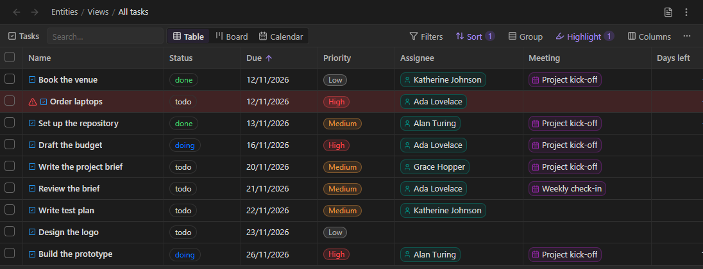
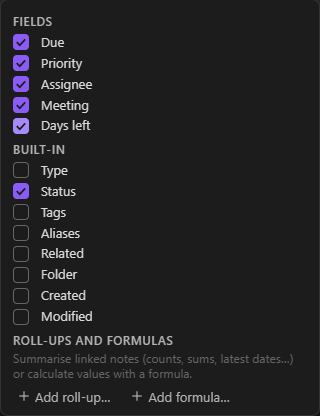

# Tables

A table view lists entities one per row, with a column for each field you choose, and lets you edit them in place.



A view is a note (in `Entities/Views/` unless you change the **views folder** setting) holding an `entity-view` code block. The same view can also be shown as a [board](/reference/boards) or a [calendar](/reference/calendars): the **Table | Board | Calendar** toggle switches between them, and the note keeps every layout's settings.

## Creating a table

- In the Entity Browser, click **+** and choose **New view**, or run the **New entity view** command. Pick what it **Shows**, choose the **Table** layout and give it a name.
- On a type or group heading in the browser, choose **New table view of …**.
- **Save as…** in a view's **⋯** menu copies it to a new view note.

Changes you make to columns, filters, sorting, grouping and so on are saved into the block automatically.

## The toolbar

| Button | What it does |
|---|---|
| **Search…** | A quick filter on the name, aliases and subtitle. It isn't saved. |
| **Table \| Board \| Calendar** | Switches the layout. |
| **Filters** | Conditions a row must meet. See [Filters, sorting and highlights](/reference/filters). |
| **Sort** | Sort levels. See [Sorting](/reference/filters#sorting). |
| **Group** | Splits the rows into sections. See [Grouping](#grouping). |
| **Highlight** | Colours rows or cells, and draws data bars and colour scales. See [Highlights](/reference/filters#highlights). |
| **Columns** | Chooses which columns show, and adds roll-ups and formulas. |
| **⋯** | **Save as…**, **Rename**, **Edit definition**, **Copy block**, **Show workflow toolbar**, row height and wrapped lines. |

The numbers on the buttons count the filters, sort levels and highlight rules in use. The **Filters** button turns orange when a condition is being ignored (see [Ignored conditions](/reference/filters#ignored-conditions)).

**Show workflow toolbar** shows the workflows offered on this view as a row of buttons under the toolbar, instead of in a **Workflows** menu. See [Workflows](/reference/workflows).

## Columns

Click **Columns** to tick the columns you want. The panel has four sections:

- **Fields**: the fields of the types the view shows, including their roll-up and formula fields.
- **Built-in**: values every entity has (see below).
- **Incoming links**: links pointing at each row from another type's relation field, such as "People" on organisations.
- **Roll-ups and formulas**: columns that belong to this view only. See [Roll-up and formula columns](#roll-up-and-formula-columns).



The **Name** column is always first and can't be hidden.

### Built-in columns

| Column | Shows | Editable |
|---|---|---|
| **Name** | The note's name. Click it to open the note. | No |
| **Type** | The entity's type. | No |
| **Status** | The entity's status. | Yes |
| **Tags** | The note's tags. | Yes |
| **Aliases** | The note's aliases. | No |
| **Related** | The `related` links every entity has. | No |
| **Folder** | The folder the note is in. | No |
| **Created**, **Modified** | The file's dates. | No |
| **Parent** | The first of the type's parent fields that links to an entity. | No |
| **Top-level parent** | The top of that chain of parents. | No |
| **Ancestors** | The whole chain, e.g. "Mobile Banking App › Customer Portal Rebuild › Portal beta release". | No |

**Parent**, **Top-level parent** and **Ancestors** are offered when a type has parent fields. To change them, change the parent field itself.

### Arranging columns

- **Reorder:** drag a column's header.
- **Resize:** drag a header's right edge.
- **Auto-fit:** double-click a header's edge, or right-click the header and choose **Auto-fit width**. **Auto-fit all columns** fits every column.
- **Fill available width:** right-click a header. The column stretches to use the spare width, and its width becomes a minimum. Good for a long Description column. In a narrow pane it stays at its minimum and the table scrolls.
- **Freeze:** right-click a header. That column and every column to its left stay in view when you scroll sideways. Choose it again to unfreeze.
- **Wrap text:** right-click a header. Long values wrap onto more lines and the row grows to fit. Longer text ends in "…" and shows in full when you hover over it.
- **Row height:** **⋯ → Compact rows**, **Normal rows** or **Comfortable rows**.
- **Wrapped lines:** **⋯ → Wrapped text: up to N lines…** sets how many lines a wrapped cell shows: 2, 3, 5 (the default), 10 or **Unlimited**.

### The header menu

Right-click a column's header for:

| Item | What it does |
|---|---|
| **Sort ascending**, **Sort descending**, **Clear sorting** | Sorts by this column alone, or removes sorting. |
| **Group by …** | Adds this column as the innermost grouping level. |
| **Filter by …** | Adds a filter condition on this column. |
| **Summarise…** | Picks the column's summary. |
| **Auto-fit width**, **Auto-fit all columns** | Fits columns to their contents. |
| **Freeze**, **Fill available width**, **Wrap text** | See above. |
| **Format…** | Number and date columns: how values are shown. |
| **Highlight cells…** | Adds a highlight rule for this column's cells. |
| **Data bar…**, **Colour scale…** | Number and date columns: adds a data bar or colour scale. |
| **Edit roll-up…**, **Show as % of total** | Roll-up columns. |
| **Edit formula…** | Formula columns. |
| **Hide column** | Removes the column from the table. |

Clicking a header sorts by it: ascending, then descending, then off. Shift-click adds it as another sort level.

## Formats

Number and date columns use their field's display format, and dates without one use the **Date display format** setting. To change it for this view, right-click the header and choose **Format…**. **Default** goes back to the field's format.

| Kind | Presets | Custom |
|---|---|---|
| Dates | **ISO** (2026-12-15), **Day month year** (15 Dec 2026), **Day month name year**, **Weekday** (Tue 15 Dec), **Long**, **Day first** (15/12/2026), **Month first**, **Month** (December 2026), **Relative** ("in 6 weeks") | Any moment.js pattern, e.g. `D MMM YYYY` |
| Numbers | **Number** (320,000), **Integer**, **2 decimals**, **Currency**, **Compact** (320K), **Percent (0–100)** | A pattern such as `$#,##0.00` or `#,##0 h` |

**Currency** uses the **Default currency** setting; for another currency, use a custom format like `currency:USD`.

Formats only change what's shown. Sorting, filtering and editing use the real value.

## Editing in place

- **Edit a cell:** double-click it, or press **Enter** on it. You get the same control, and the same checks, as the [properties form](/reference/properties-form).
- **Checkboxes** toggle with one click.
- **Move around** with the arrow keys. **Esc** cancels an edit.
- **Undo:** **Ctrl/Cmd+Z** undoes the last cell edit or bulk action.
- **Open a note:** click its name. Ctrl/Cmd-click opens it in a new tab; hold Ctrl and hover for a preview. Right-click a row for the entity menu.

Read-only cells: the name, built-ins other than **Status** and **Tags**, incoming links, roll-ups and formulas. Double-clicking a formula cell opens the formula editor.

### New entities

**+ New**, under the table, creates an entity of the view's type (it asks which type when the view shows several). It's prefilled from simple filters, so the new note shows up in the view: for example, a view filtered to *Status is any of active* creates an active entity. Only top-level conditions combined with **all** that pick one value count: a status or choice, a text that **is** something, a checked checkbox, or one linked note.

## Bulk edits

Tick rows to select them:

- Click a row's checkbox; Shift-click selects a range.
- A group header's checkbox selects the whole group.
- **Space** selects the focused row, and **Ctrl/Cmd+A** selects every row.

While rows are selected, the toolbar shows what you can do with them:

| Action | What it does |
|---|---|
| **Set field…** | Sets status, tags or any field the selected types have. **Clear** empties it. Entities without the field are skipped. |
| **Links…** | **Add link…** or **Remove link…** in a relation field. |
| **Tags…** | Adds tags, or removes existing ones. |
| **Change type…** | Changes the entities' type. |
| **Delete…** | Moves the notes to the trash, after confirming. |
| **⋯** | **Move to folder…**, **Duplicate**, **Open in new tabs**, **Copy as list of links**. |

Right-click a selected row for the same actions. **Esc** clears the selection, and **Delete** deletes it (after confirming). Each action is one undo step: press **Ctrl/Cmd+Z** in the table, or click **Undo** on the notice. Deleted notes can be restored from the trash.

## Summaries

A summary row stays at the bottom of the table. Click a column's summary cell, or right-click its header and choose **Summarise…**, to pick an aggregation. Choose **None**, or click the ticked one again, to turn it off.

| Column | Summaries |
|---|---|
| Every column but checkboxes | **Count**, **Empty**, **Filled** (8/12), **% filled**, **Unique** |
| Numbers | **Sum**, **Average**, **Median**, **Min**, **Max**, **Range** |
| Dates | **Earliest**, **Latest**, **Range** (e.g. "4 months") |
| Checkboxes | **Checked**, **Unchecked**, **% checked**, **Count** |
| Status and choices | **Count each value** ("3 todo · 2 done"), **% *value*** (the share of one value) |
| Lists and links | **Total values** |
| Name | **Count** (the number of rows) only |

Choice fields whose options have values also get the number summaries. Number and date summaries use the column's format, so a currency column sums to "$1,240.00".

Summaries cover the rows the view shows, after filters and search.

## Grouping

**Group** splits the rows into sections, each with a collapsible header, its row count and its own summaries.

1. Click **Group → Add level** and pick a column. For dates, choose **by day**, **by month** or **by year**.
2. Add more levels to group within groups, e.g. by status, then by assignee, then by due month. Drag levels to reorder them.

You can group by status, type, a choice, a link, a list or a date. A row with several values (a list, or several links) appears in each of its groups.

- **Grouped columns are hidden** from the table, as their value is in the group header. Remove the level to bring the column back.
- Headers read "Field: value", e.g. "Status: todo". Untick **Show field names in group headers** to show the value alone.
- Untick **Show summaries in group headers** to leave the summaries out.
- Groups are ordered by their column, following its sort direction when the view is sorted by it. Empty values come last.
- Right-click a group header for **Collapse all at this level**, **Expand all at this level** and **Expand all**.

## Roll-up and formula columns

A column can calculate something for this view alone, without adding a field to the type. In **Columns**, under **Roll-ups and formulas**:

- **Add roll-up…** summarises the notes linked to each row: count them, total a number field, find the latest date, work out % done, and so on. Counts and sums can be **shown as a share**: **% of total** or **% of group total**. See [Roll-ups](/reference/rollups).
- **Add formula…** calculates a value from the row's own fields, e.g. `[Due] - today()` for the days left. See [Formulas](/reference/formulas).

Roll-up and formula columns sort, filter, group, highlight, summarise and format like any other column. A type's own roll-up and formula fields are ready-made columns already, so you only need a view's own for something specific to it.

## The view block

You rarely need to edit the YAML yourself, but you can: choose **⋯ → Edit definition** (or **Open as Markdown** in a full tab). **Copy block** copies it to paste into another note.

````markdown
```entity-view
kind: table
types: [task]
columns:
  - name
  - status
  - assignee
  - due
  - priority
  - description
  - { formula: "[Due] - today()", label: Days left, id: days_left, type: number }
  - { rollup: { via: "in:note.task", agg: count }, label: Notes, id: notes }
widths: { assignee: 160 }
fill: description
freeze: name
density: compact
wrap: [description]
formats: { due: "D MMM YYYY" }
summary: { name: count, days_left: avg }
sort: [{ by: due, dir: asc }]
group: [{ by: assignee }, { by: due, date: month }]
filters: { all: [{ field: status, op: none-of, value: [done] }] }
highlight:
  - { name: Overdue, target: row, when: { all: [{ field: days_left, op: "<", value: 0 }] }, style: { fill: red, icon: alert-triangle } }
```
````

### Keys

| Key | Meaning |
|---|---|
| `kind` | The layout the view opens in: `table`, `board` or `calendar`. Default `table`. |
| `types` | What the view shows: type keys, `@group` for a whole group, or `*` for every entity. Default `*`. |
| `columns` | The columns, in order (see below). `name` is always first, and is added if missing. |
| `widths` | Column id → width in pixels. For fill columns, the minimum width. |
| `fill` | A column id, or a list of them, that grows to fill the spare width. |
| `freeze` | The last frozen column's id. |
| `density` | Row height: `compact`, `normal` or `comfortable`. |
| `wrap` | Column ids whose text wraps. |
| `wrapLines` | The most lines a wrapped cell shows: a number, or `unlimited`. Default 5. |
| `formats` | Column id → display format (number and date columns). |
| `summary` | Column id → summary (see below). |
| `sort` | Sort levels. See [Sorting](/reference/filters#sorting). |
| `group` | Grouping levels, outermost first: a list of column ids or `{ by: <column id>, date: month \| year }`. Leave out `date` to group dates by day. |
| `groupSummaries` | `false` hides summaries in group headers. |
| `groupFieldNames` | `false` shows the value alone in group headers. |
| `filters` | Conditions. See [Condition YAML](/reference/filters#condition-yaml). |
| `highlight` | Highlight rules, data bars and colour scales. See [Highlight YAML](/reference/filters#highlight-yaml). |
| `board` | The board layout's settings. See [Boards](/reference/boards#the-view-block). |
| `calendar` | The calendar layout's settings. See [Calendars](/reference/calendars#the-view-block). |
| `workflowBar` | `true` shows the view's workflows as a row of buttons. |
| `place` | Where the Entity Browser lists the view: a type key, `@group`, or `views`. Unset, it's worked out from `types`. Set when you drag the view in the browser or use **Show under…**. |

Keys left at their default aren't written.

### Column YAML

A plain string is a built-in or a field key:

| Built-in key | Column |
|---|---|
| `name`, `type`, `status`, `tags`, `aliases`, `related`, `folder`, `created`, `modified` | As named |
| `tree-parent`, `tree-root`, `tree-path` | **Parent**, **Top-level parent**, **Ancestors** |

An object is one of:

| Form | Column |
|---|---|
| `{ field: due, label: Deadline }` | A field, with an optional label. |
| `{ builtin: status, label: Stage }` | A built-in, with an optional label. |
| `{ incoming: "person.works_for" }` | Links from another type's relation field: `<type>.<field>`. |
| `{ rollup: { via, agg, field, show, where }, label, id }` | A roll-up. See [Roll-ups](/reference/rollups). |
| `{ formula: "…", label, id, type }` | A formula. `type` is optional: `number`, `text`, `bool`, `date`, `list` or `links`. See [Formulas](/reference/formulas). |

In a roll-up, `via` is `field:<key>` (a relation field of the row) or `in:<type>.<field>` (links pointing at the row). `agg` is one of `count`, `list`, `unique`, `sum`, `avg`, `min`, `max`, `earliest`, `latest`, `percent-done` or `count-by-status`; all but `count`, `list`, `percent-done` and `count-by-status` need a `field`. `show` is `total` or `group` (counts and sums only), and `where` takes [conditions](/reference/filters#condition-yaml) on the linked notes.

**Column ids** are what other keys (`widths`, `sort`, `filters`, `summary`…) use to refer to a column:

- a built-in's or field's key, e.g. `due`;
- `in:<type>.<field>` for incoming links;
- the `id` you give a roll-up or formula;
- `f:<key>` for a field whose key is also a built-in name (a field called `type`, say), written `{ field: type }`.

### Summary keys

| Column | Keys |
|---|---|
| Every column but checkboxes | `count`, `empty`, `filled`, `percent-filled`, `unique` |
| Numbers | `sum`, `avg`, `median`, `min`, `max`, `range` |
| Dates | `earliest`, `latest`, `range` |
| Checkboxes | `checked`, `unchecked`, `percent-checked`, `count` |
| Status and choices | `values`, `"percent:<value>"` (e.g. `"percent:done"`) |
| Lists and links | `links` |

### Format values

| Kind | Values |
|---|---|
| Dates | `YYYY-MM-DD`, `D MMM YYYY`, `relative` or any moment.js pattern |
| Numbers | `number`, `integer`, `decimal:2`, `currency`, `currency:USD`, `compact`, `percent`, or a pattern such as `$#,##0.00` |

## Views in notes

A view doesn't have to live in its own note. Embed a saved view in any note with `![[Active projects]]`, or paste an `entity-view` block straight into a note. Add `|bare` to hide the toolbar and footer (`![[Active projects|bare]]`), or `|wide` to use the pane's full width.

In a view inside a note, the filter value **This note** (`{this}`) stands for that note, so a project's note can show just its own tasks. See [Views inside notes](/guides/views-in-notes) and [This note](/reference/filters#this-note).
