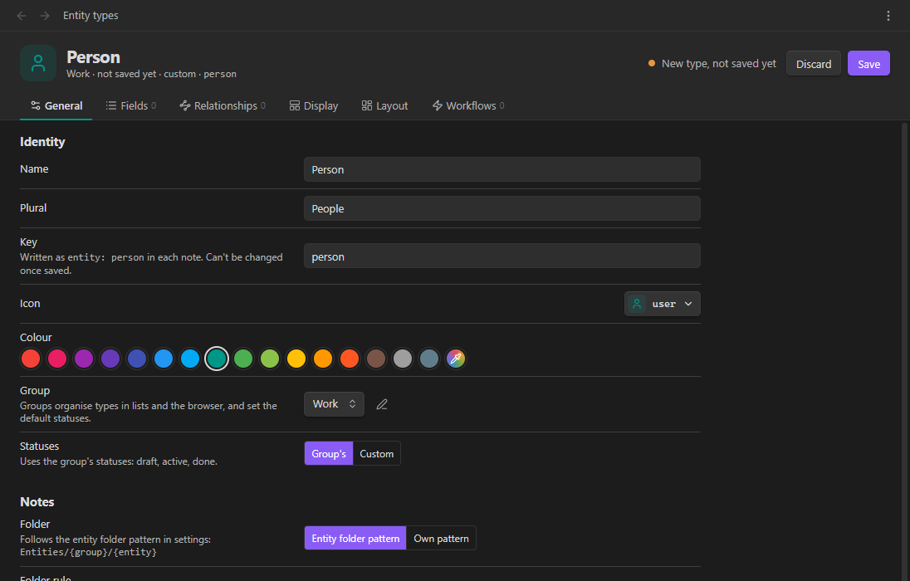
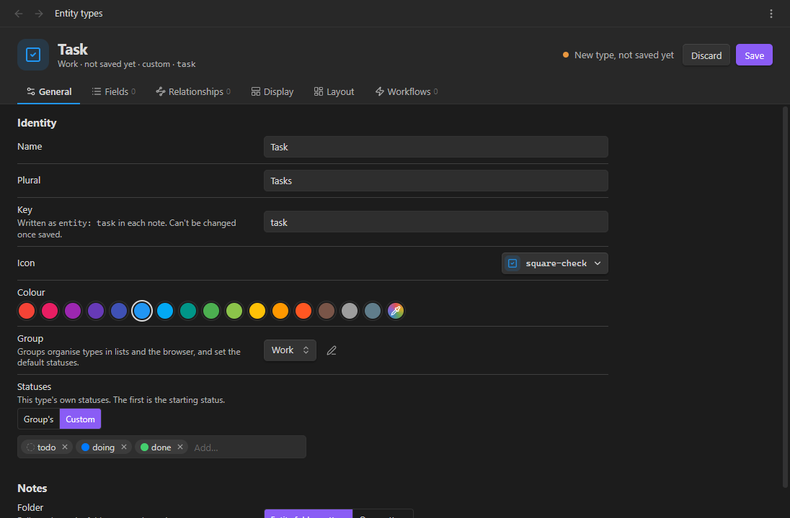
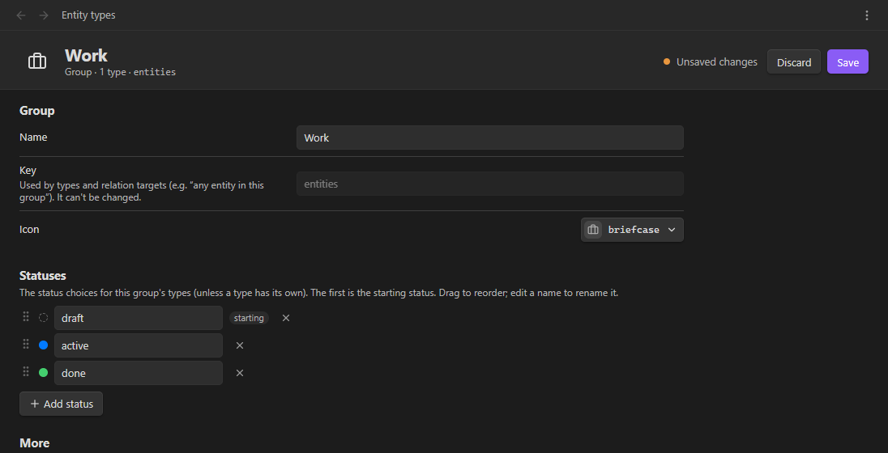

# Types and groups

A type describes one kind of entity, and a group gathers types together; this page covers every setting on the type editor's **General** and **Display** tabs, and the group editor.

## Open the type editor

Types and groups are edited in the **Entity types** view. Open it from any of these:

- the **Types** tab of the [Entity Browser](/reference/browser): click a type or a group under **Entities**;
- **+** on the **Types** tab, then **New entity type** or **New group**;
- the **Entity types** ribbon icon, or the **Configure entity types** command (it opens the type of the note you're on);
- **Configure the *Type* type** in an entity's file menu, or in the properties form's **⋯** menu.

In the Entity Browser, right-click a type for **New *note***, **New table view**, **New workflow** and **Duplicate type**, or right-click a group for **New entity type in this group**.



### The editor at a glance

The header shows the type's icon and name, then its group, how many notes use it, whether it came from the starter pack, and its key. The tabs below it are:

| Tab | What's on it |
|---|---|
| **General** | Name, key, icon, colour, group, statuses, folder, template and search shortcuts (this page). |
| **Fields** | The type's fields. See [Fields](/reference/fields). |
| **Relationships** | A diagram of what links to and from the type, and **Add relationship**. See [Relationships](/reference/relationships). |
| **Display** | Parent fields, subtitle fields and the properties form's options (this page). |
| **Layout** | How the properties form and create dialog are arranged. See [Form layouts](/reference/form-layouts). |
| **Workflows** | The workflows that apply to this type. See [Workflows](/reference/workflows). |

Tabs show how many fields, relationships or workflows they hold, and a red dot when something on them needs fixing.

While the editor is the active tab, the [side panel](/reference/side-panel) shows a **Preview** of the type as you edit it: the create dialog, a link-picker row, or the properties form.

## General tab

### Identity

| Option | What it does |
|---|---|
| **Name** | The type's name, such as *Person*. |
| **Plural** | Used in headings, folder names and messages, such as *People*. Leave it empty for the name plus "s". |
| **Key** | What's written in each note as `entity: person`. For a new type it follows the name until you edit it. It must start with a lowercase letter and use only lowercase letters, digits and underscores. **It can't be changed once the type is saved**, because every note would have to change; to rename a type, change its name and plural instead. |
| **Icon** | Click the box to search the icons, such as *user* or *briefcase*. Press Enter to pick the first match. |
| **Colour** | Pick a swatch, or the last box for a colour of your own. The colour tints the type's chips, icons and form. |
| **Group** | The group the type belongs to. The pencil button next to it opens that group. Any type can move to another group. |
| **Statuses** | **Group's** uses the group's statuses; **Custom** gives the type a list of its own (below). |

### Statuses

Every entity has a status. A type uses its group's statuses unless you choose **Custom**.

1. Choose **Custom**. The list starts as a copy of the group's statuses, with their colours.
2. Remove a status with its **×**; type a new one and press Enter to add it.
3. Click a status's dot to give it a colour.

Switching back to **Group's** drops the type's own statuses and their colours.

- **The first status** is where new notes start.
- **The last status** counts as done when the plugin works out progress (a roll-up's **% done**, a dashboard's progress bar). Keep your finished state last, with states like *cancelled* before it.
- **Colours:** without one, a status is coloured by its name: *done*, *complete* and *won* green, *active*, *open* and *in-progress* blue, *on-hold* and *blocked* orange, *archived* and *lost* faint. Click a status's dot to pick another colour (red, orange, yellow, green, blue, purple, pink or grey), or **Default** to go back. A type's own colours win over its group's. Colours show wherever statuses do: pills in tables and on boards, the properties form, and the dots in the Entity Browser.



::: warning Renaming a type's own status
Renaming one of a type's own statuses doesn't update the notes that use it; they're flagged as having a status that isn't in the list. Renaming a **group's** status does offer to update them (see [Groups](#groups)).
:::

### Notes

| Option | What it does |
|---|---|
| **Folder** | **Entity folder pattern** files the type's notes using the **Entity folder** setting (`Entities/{group}/{entity}` to start with). **Own pattern** gives this type a pattern of its own, with the same placeholders: `{group}` is the group's name and `{entity}` the type's plural. |
| **Folder rule** | **In the folder** puts every note in the folder above. **Own folder each** gives each note a folder of its own (`…/Projects/Apollo/Apollo.md`). **Inside its parent** puts the note in a folder inside its parent's folder (`…/Apollo/Notes/`), using the type's parent fields. The line underneath shows where new notes will go. |
| **Template** | The file in your templates folder that new notes start from. **Open template** opens it, creating it from the built-in template if it doesn't exist yet. |
| **Search shortcuts** | Short words to type before a name in **Find entity**, such as `p` so that `p ada` searches only people. |

See [Organise notes in folders](/guides/folders) for worked examples of folder patterns and rules.

#### Template

Until the template file exists, a built-in template is used: a few `##` headings (*Overview*, *Details*, *Notes*, or the type's own sections if it came from a pack). There's no `#` title, because Obsidian already shows the note's name.

A template can use these placeholders:

::: v-pre

| Placeholder | Becomes |
|---|---|
| `{{name}}` or `{{title}}` | The note's name |
| `{{type}}` | The type's name |
| `{{date}}`, `{{date:D MMM YYYY}}` | Today's date, as `YYYY-MM-DD` or in the format you give |
| `{{time}}` | The time now, as `HH:mm` |
| `{{field_key}}` | The value of that field, using the field's key, such as `{{role}}` |

:::

Placeholders the plugin doesn't know are left as they are, so Templater and other plugins can still fill them in. **Generate template files** (a command) writes the built-in template for every type that doesn't have a file yet.

### More

| Button | What it does |
|---|---|
| **Duplicate** | Starts a new type that's a copy of this one, named *Person copy*, with a new key. |
| **Copy as JSON** | Copies the type as a pack: the type, its group, the workflows that apply only to it, and its template. Paste it into **Import pack…** in another vault. See [Packs and apps](/reference/packs). |
| **Reset to starter** | Only for types from the starter pack: brings back the starter definition. It's a draft until you save. |
| **Delete type** | Asks first, saying how many notes use the type. See [Deleting a type](#deleting-a-type). |

## Display tab

### Parent fields

Pick the relation fields that point at a note's **parent**, such as a sub-project's *Parent project* or a place's *Part of*.

- The Entity Browser nests notes under their parents, building trees from these fields.
- The **Inside its parent** folder rule uses them to decide where notes go.
- With several parent fields, put them in order: the first one that's filled in wins.
- Types with parent fields can use the `order` property to sort siblings.

### Subtitle fields

A one-line description shown under a note's name in link pickers, **Find entity**, chip tooltips, the Entity Browser and the properties form's top row. A person might show their role and email: *CTO · ada@example.com*.

- Pick one or more fields. Their values are joined with " · ", and empty ones are skipped.
- Any field except a relation can be used, including roll-ups and formulas. Long text contributes only its first line.
- Values are shown in their [display formats](/reference/fields#display-formats).

### Properties form

| Option | What it does |
|---|---|
| **Hide empty fields** | Lists only the fields that have a value, with a **Show N empty fields** link for the rest. Fields with a problem are always shown. |
| **Layout** | **Design a layout** (or **Edit layout**) opens the **Layout** tab, to arrange the form in frames, columns and tabs. See [Form layouts](/reference/form-layouts). |

## Groups

A group gathers types together. It gives them:

- a section and heading in the Entity Browser;
- a shared list of **statuses**, which a type can replace with its own;
- the `{group}` part of the folder pattern;
- a target for relation fields: **Any *Group* entity** links to any type in the group.

There's always at least one group. Click a group in the Entity Browser to open the group editor.



| Option | What it does |
|---|---|
| **Name** | The group's name, shown in the browser and used for `{group}` in folders. |
| **Key** | Used by types and by relation targets. It follows the name for a new group, and can't be changed once saved. |
| **Icon** | Shown on the group's heading. |
| **Statuses** | One row per status. Drag rows to reorder them; the first is marked **starting**. Edit a name to rename it, **Add status** for another, **×** to remove one. Click a status's dot to colour it. |

A group needs at least one status, and each status can only be listed once.

### More

- **Copy group as a pack** copies the group's types with their workflows, the views that show only those types (or the group), and their templates. See [Packs and apps](/reference/packs).
- **Delete group** is only possible once the group has no types: move them to another group first (**General → Group**). Relation fields that linked to "any entity in this group" lose that target (one with no other targets can then link to any entity).

## Saving changes

Everything you change in the editor is a **draft** until you save it. Drafts survive switching to another type and back.

- While there are unsaved changes, the top right of the editor shows **Unsaved changes**, with **Discard** and **Save**. The Entity Browser marks the type with a dot.
- If something needs fixing, **Save** says so and takes you to the problem. The control with the problem is outlined, and its tab gets a red dot.
- **Subtitle fields, parent fields, the form layout, formulas, roll-ups, defaults and validation rules** follow a field when you change its key, so they keep working.

### Updating existing notes

Changing a type can leave existing notes behind. When it would, **Save** opens a short dialog first:

| Change | What the dialog offers |
|---|---|
| A field's key renamed | **Also update N notes: old → new**, on to start with. Each note's value moves to the new key. |
| A field deleted | **Remove the values of deleted fields (…) from N notes**, off to start with. Leave it off to keep the values in the notes, under Other properties. |
| A group's status renamed | **Also update N notes: archived → retired**, on to start with. This covers the notes of the group's types that don't have their own statuses. |

The dialog only appears when notes would be affected. Calculated fields (roll-ups and formulas) aren't stored in notes, so renaming or deleting them changes no notes.

### Deleting a type

**Delete type** (on the General tab) asks first, and says how many notes use the type.

- The notes are left untouched. They keep their content and frontmatter, including `entity: <key>`, but aren't treated as entities until a type with that key exists again.
- The type is taken out of other types' relation fields. A field that could only link to the deleted type can then link to any entity, so check it.
- A deleted starter type doesn't come back when the plugin updates.

## Creating a type from a note

On a note that isn't an entity but has properties, **Create entity type from this note…** (in the file menu or the note's **⋯** menu) works out a type from it, and opens it as a new draft on its **Fields** tab.

- Each property becomes a field: dates, numbers, checkboxes and web addresses become those kinds, long text becomes long text, links to entities become relations, and anything else is text.
- If the note's `entity` names a type that doesn't exist, every note with the same `entity` is used too, giving better guesses (choices with their options, the statuses in use).
- The type's name comes from that `entity` value, or else from the note's folder.
- **Saving** the type makes those notes its entities, renaming their properties to the fields' keys. **Discarding** the draft changes nothing.

## In a pack

Types and groups are stored in the plugin's settings, and travel between vaults as JSON in [packs and apps](/reference/packs). A type in a pack looks like this:

```json
{
  "key": "project",
  "name": "Project",
  "plural": "Projects",
  "icon": "rocket",
  "color": "#2196f3",
  "group": "work",
  "folderMode": "own",
  "template": "Project.md",
  "sections": ["Overview", "Plan", "Notes"],
  "shortcuts": ["pr"],
  "statuses": ["idea", "active", "on-hold", "done"],
  "statusColors": { "on-hold": "orange" },
  "parentFields": ["parent_project"],
  "card": { "subtitle": ["owner_role", "due"] },
  "form": { "hideEmpty": true },
  "fields": []
}
```

| Property | Notes |
|---|---|
| `key`, `name`, `plural` | As on the General tab. `plural` defaults to the name plus "s". |
| `icon` | A Lucide icon name. |
| `color` | `#rrggbb`. |
| `group` | The group's key. |
| `folderPattern` | Optional: the type's own folder pattern. Leave it out to use the **Entity folder** setting; `""` means the vault root. |
| `folderMode` | `"type"` (in the folder; the default), `"own"` (own folder each) or `"parent"` (inside its parent). |
| `template` | The template's file name. Defaults to `<name>.md`. |
| `sections` | Optional `##` headings for the built-in template. |
| `shortcuts` | Search shortcuts. |
| `statuses`, `statusColors` | Optional: the type's own statuses, and a colour for any of them (`red`, `orange`, `yellow`, `green`, `blue`, `purple`, `pink` or `grey`). |
| `parentFields` | Relation field keys pointing at the parent, first one first. |
| `card.subtitle` | Field keys for the subtitle. |
| `form` | `hideEmpty`, and `layout` (see [Form layouts](/reference/form-layouts)). |
| `fields` | The fields. See [Fields](/reference/fields#in-a-pack). |

A group looks like this:

```json
{ "key": "work", "name": "Work", "icon": "briefcase", "statuses": ["idea", "active", "on-hold", "done"], "statusColors": { "idea": "purple" } }
```
