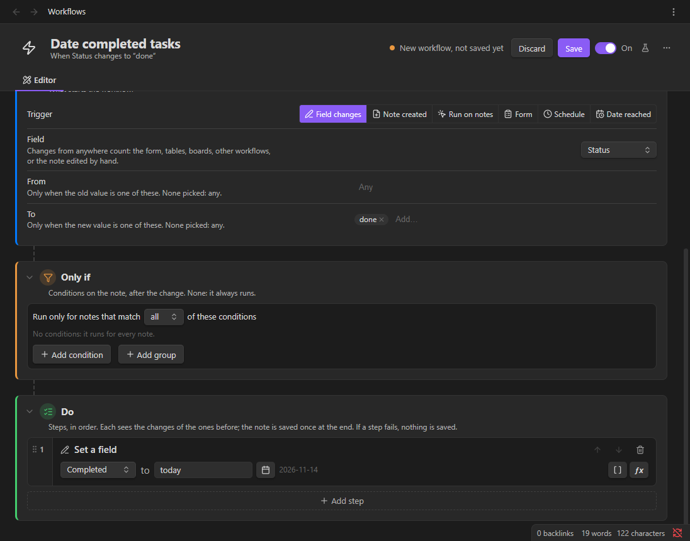

# Workflows

Automation for your notes: what a workflow is, the Workflows view, testing, the run log and undo.

## What a workflow is

A **workflow** does something for you when something happens. It has three parts:

| Part | What it is | Reference |
|---|---|---|
| **When** | The trigger: what starts it. A note being created, a field changing, a button, a form, a schedule or a date. | [Triggers](/reference/triggers) |
| **Only if** | Optional conditions the note must match, built like a view's filters. None: it always runs. | [Filters, sorting and highlights](/reference/filters) |
| **Do** | The steps it takes, in order: set a field, add a tag, create a note, loop over linked notes, ask a question, and more. | [Steps](/reference/steps) |

Most workflows run on one note at a time, called **this note**: the note that was created or changed, the note you pressed the button on, or each note a schedule picks. Each run works on copies of the notes, step by step, and saves every note once at the end. If a step fails, nothing is saved.

Two kinds of workflow have no single "this note": a button set to run **once for the selection**, and a form that **starts on its own**. See [Runs with no single note](/reference/steps#runs-with-no-single-note).

## The Workflows view

The Workflows view is where you make and edit workflows. Open it from:

- the **Workflows** ribbon icon (a lightning bolt);
- the **Open workflows** command;
- **Open workflows** in **Settings → Obsidian Entities**;
- clicking a workflow in the Entity Browser;
- a type's **Workflows** tab in the Entity types view, which lists the workflows for that type (and those for every note), with **New workflow for this type**.

With nothing open, the view offers **New workflow**.

### Your workflows in the Entity Browser

Your workflows are listed in the Entity Browser, on its **Types** tab, under **Workflows**. They're sorted by what starts them:

| Heading | Triggers |
|---|---|
| **When created** | When a note is created |
| **When changed** | When a field changes |
| **Run on notes** | Buttons |
| **Forms** | Fill in a form |
| **Scheduled** | On a schedule, and on a date |

Click a workflow to open it. Right-click it for **Open**, **Recent runs**, **Run on a note…** (buttons) or **Fill in the form…** (forms that start on their own), **Try on a note…**, **Enable** or **Disable**, **Duplicate** and **Delete…**.

Right-click the **Workflows** heading for **New workflow**, **Recent runs** (every workflow's runs) and **Disable all workflows**.

To make a workflow for a type straight away, right-click the type (or its group) and choose **New workflow for…**. **Applies to** starts filled in.

### The editor

The editor's header shows the workflow's name and its trigger in words, such as *When Status changes to "done"*. On the right are:

- **Save** and **Discard**, while you have unsaved changes;
- the **On** / **Off** switch;
- the flask, **Try on a note…**, which shows what it would do without saving anything (see [Test runs](#test-runs));
- **⋯**, with **Try on a note…**, **Duplicate** and **Delete…**.

Under the header are tabs:

| Tab | What's on it |
|---|---|
| **Editor** | The workflow itself. A red mark means it has a problem. |
| **Form fields** and **Form layout** | Form workflows only: the form's fields and how they're laid out. See [Fill in a form](/reference/triggers#fill-in-a-form). |
| **Views** | Buttons and forms only: the views whose toolbars offer it. See [Buttons and forms](#buttons-and-forms). |
| **Recent runs** | This workflow's runs, with **Undo**. Not shown until it's saved. |

The **Editor** tab reads top to bottom, in coloured panels joined by a line:

1. **Workflow**: its **Name**, what it **Applies to**, and whether it can **Set off other workflows**.
2. **When**: the trigger and its options.
3. **Only if**: the conditions.
4. **Do**: the steps.



Click the heading of **When**, **Only if** or **Do** to fold it to one line: the trigger in words, "2 conditions, all must match", or "3 steps: Set a field → Move the note → Show a notice". Folded sections stay folded for every workflow, on this device. A folded section with a problem in it shows a red mark, and opens when you press **Save**.

### Saving

Edits are a draft until you press **Save**; **Discard** throws them away. You can open another workflow and come back: the draft is kept until you save or discard it.

A workflow with problems can still be saved, but it's saved **switched off**, and it can't be switched on until the problems are fixed. See [Problems](#problems).

## Applies to

**Applies to** picks the types (or groups) of note the workflow is for. What it means depends on the trigger:

| Trigger | Applies to |
|---|---|
| When a note is created, When a field changes, On a schedule, On a date | The types it watches. Required. |
| Run on notes (buttons) | The types it can be run on. Empty: any note. |
| Fill in a form | With types, the form is a button on those notes. Empty: the form starts on its own, with no note. |

A workflow for several types (or any note) can set, clear and link any of their fields. A note whose type doesn't have the field is left alone.

## Only if

**Only if** holds conditions on the note, built exactly like a view's filters: pick a column, a test and a value, and combine them with **all** or **any**. See [Filters, sorting and highlights](/reference/filters).

When the conditions are checked depends on the trigger:

- **When a field changes**: on the note after the change. To test the old value, use an [If](/reference/steps#if) step with `old()`.
- **Buttons and forms with types**: on each note you run it on. A note that doesn't match is skipped.
- **Once for the selection**: on each selected note. Those that don't match are left out of `[Selected notes]`.
- **On a schedule** and **On a date**: on each note when it runs.

A form that starts on its own has no note to check, so it can't have Only if conditions. Use an [If](/reference/steps#if) step to test the answers instead.

## Set off other workflows

The notes a workflow changes or creates can start other workflows: a status it sets can set off a **When a field changes** workflow, and a note it creates can set off a **When a note is created** workflow. Those runs can set off more, up to **5** in a row. A workflow never runs twice on the same note in one chain.

Turn **Set off other workflows** off to stop that. The notes this workflow changes or creates then don't start other workflows (When created, When changed, and dates). Its own **Run another workflow** steps still run, because they're part of the same run.

Changes made by undo never set off workflows.

## Switching workflows on and off

### One workflow

The **On** / **Off** switch in the editor's header acts straight away: you don't need to save. Other unsaved edits stay unsaved. On a new workflow, the switch takes effect when you save it. You can also choose **Enable** or **Disable** from a workflow's right-click menu in the Entity Browser.

A workflow with problems can't be switched on. The switch is greyed out until you fix them.

Workflows that come with a pack start switched off, so you can look them over first.

### Pausing every workflow

To stop every workflow at once, use any of these:

- the **Pause or resume workflows** command;
- **Pause all workflows** in **Settings → Obsidian Entities**;
- **Disable all workflows** on the Entity Browser's **Workflows** heading (right-click). The heading then reads *Workflows (all disabled)*, and the same menu offers **Enable all workflows**.

While paused, nothing runs: not automatically, and not from buttons or forms. When you resume, scheduled and date workflows start again from now, rather than catching up on what they missed.

### Scheduled workflows on each device

Scheduled and date workflows run on their own while Obsidian is open, on devices where **Run scheduled workflows on this device** is on (in **Settings → Obsidian Entities**). Each device keeps its own choice: it starts on for desktops and off for phones and tablets.

With a synced vault, keep it on for one device only, or each device would run them. When you turn it on, the device starts from now rather than catching up.

On a device where it's off, the Entity Browser's **Scheduled** heading shows *not here*, and the editor says so too. See [On a schedule](/reference/triggers#on-a-schedule) and [On a date](/reference/triggers#on-a-date).

## Buttons and forms

**Run on notes** workflows are buttons. Forms with types work like buttons that ask first. You'll find them:

- on the note's properties form: a strip at the top (or wherever the type's [form layout](/reference/form-layouts) places them), and its **⋯** menu;
- in the right-click menu of table rows, board cards and calendar entries;
- in a view's selection bar, under **Run…**;
- through the **Run workflow on this note…** command;
- on view toolbars and dashboard buttons, if you add them.

Forms that start on their own have no note, so they're found elsewhere: the **Fill in a form…** command, the views you pick, dashboard buttons, and **Fill in the form…** in the Entity Browser.

Under **When**, buttons and forms also have:

| Option | What it does |
|---|---|
| **Command** | Gives it a command of its own, **Workflow:** plus its label, such as **Workflow: Log a session**, so it can have a hotkey. A button runs on the open note; a form with no types opens its form. See [Commands](/reference/commands). |
| **Ribbon icon** | Forms that start on their own: an icon of its own in the left ribbon, which opens the form. |
| **On views** | Opens the **Views** tab. |

### On views

On the **Views** tab, tick the views whose toolbars should offer the workflow, or tick **All views** to include every view, even ones made later. Dashboards aren't listed: they have button components instead (see [Dashboards](/reference/dashboards)).

Each view shows its workflows in a **Workflows** menu after its Table / Board / Calendar buttons. Choose **⋯ → Show workflow toolbar** on the view to show them as a row of buttons under the toolbar instead; that's saved with the view.

A form that starts on its own opens its form. Other workflows run on the view's selected notes that they apply to, and are greyed out until you select some. Renamed views are followed, and deleted ones drop off the list.

## Running on several notes

When you run a button on several selected notes, it runs **once for each note**: each run has its own note as "this note", and each is logged on its own. A button set to **Once for the selection** runs once for them all instead. See [Run on notes](/reference/triggers#run-on-notes).

If a step asks something (**Confirm** or **Ask a question**), you're asked for each note, with **Same answer for the other N notes** to answer once for the rest.

When it's done, a notice says what changed, such as *"Close task" changed 6 notes.*, with an **Undo** link.

## Big runs

A run that would change or create **more than 20 notes** (a loop over a project's tasks, say) asks first, saying how many: *On Apollo, it would change 24 notes and create 3. You can undo it afterwards.* Nothing is written until you agree.

Running a button on **more than 20 selected notes** asks once, up front. Agreeing to one big run in a selection agrees to the rest.

Scheduled and date workflows can't ask, so their **At most** limit decides instead. See [Scheduled and date workflows](/reference/triggers#scheduled-and-date-workflows).

## Test runs

**Try on a note…** (the flask in the editor's header) shows what a workflow would do, without saving anything. Pick a note it applies to, and it shows:

- the workflow's problems, if it has any (then nothing else);
- a warning if the note doesn't match **Only if**, and what would happen if it did;
- each note's fields before → after, text it would add, and where notes would be moved or renamed;
- the notes it would create, marked **new**, and what they'd start with;
- its notices, and the other workflows it would run;
- or the step that would fail, and why;
- a summary: *It would change 3 notes and create 1.* If that's a big run, it says it would ask first.

It works on your unsaved edits, so you can try a change before you save it. **Try another note…** picks again.

A test run can't stop to ask, so:

- **Confirm** steps are taken as Yes;
- **Ask a question** steps take their default answer;
- a form uses its fields' default answers. A form that starts on its own is tried with **Try it…**, on no note.

For **When a field changes**, it runs as if the field had just changed to what it is now, so `old()` and `new()` both give the note as it is. For a button that runs once for the selection, it runs as if the note you picked were the only one selected.

## When a run fails or stops

If a step fails (a value that isn't one of a field's choices, say), the run stops and **nothing is saved**. A notice names the workflow, the note and the problem, and the run log records it as *Step 3: …*. Scheduled and date workflows don't show a notice for each failure: their summary notice says how many didn't run.

A run can also stop without failing:

- you answered **No** to a **Confirm** step, or cancelled a question or form;
- a **Create a note** step set to **Stop the run** found its note already exists;
- the note no longer matched **Only if** by the time you answered a question;
- it reached a [limit](#limits).

These are recorded in the run log too, with the reason.

## The run log

Every run is recorded: the last **200**, kept in `workflow-log.json` in the plugin's folder, so the log survives restarts.

- **Recent runs** on the Entity Browser's **Workflows** heading (right-click) shows every workflow's runs, newest first.
- A workflow's own **Recent runs** tab, or **Recent runs** on its right-click menu, shows just that workflow's.

Each entry shows when it ran, the workflow, and the note (a link: a note it moved is linked where it went). Then what happened:

- the fields it changed, from → to, and the text it added;
- the notes it created, and the other notes it changed, moved or renamed;
- the confirmations answered Yes and the questions answered (a form's answers too);
- or the error, or why it stopped.

A run once for the selection is one entry, such as *3 selected notes*. A form that starts on its own is listed under its title.

## Undo

You can undo a run in several ways:

- the **Undo** link on the notice after a button, form, scheduled or date run;
- **Undo** next to the run in **Recent runs**;
- the **Undo last workflow run** command, which undoes the newest run that can still be undone;
- **Ctrl/Cmd+Z** in the properties form or table where you made the edit that set the run off. The run is one more undo step there.

Undoing a run:

- puts back the fields it changed, where they haven't changed since. Fields edited since are left as they are, and the notice says so;
- takes out the text it added;
- moves and renames notes back;
- deletes the notes it created (to the trash). If one has been edited since, it asks first;
- also undoes the runs it set off.

Undone runs stay in the log, marked *undone*. What's needed to undo a run is only kept while Obsidian is open: after a restart, older runs are still in the log, but without **Undo**. Changes made by undo never set off workflows.

## Limits

| Limit | Value | What happens |
|---|---|---|
| Workflows setting each other off | 5 in a row | The chain stops. The log says *Stopped after 5 workflows set each other off.* |
| The same workflow on the same note | Once per chain | It doesn't run again. The log says it already ran on this note. |
| **Run another workflow** inside another | 3 deep | The run fails. A workflow can never run itself, directly or through others. |
| Items in loops | 200 per run, in all | The run fails, and nothing is saved. |
| Notes a run changes or creates | More than 20 | It asks first (see [Big runs](#big-runs)). |
| Selected notes | More than 20 | It asks once, up front. |
| Scheduled and date runs | **At most** (50 to start with) | When more notes match, it doesn't run at all. |
| Run log | 200 runs | The oldest drop off. |

## Problems

The editor checks the workflow as you build it. A problem is shown in red next to the part it's about (under a step, or under the trigger), and the **Editor** tab gets a red mark. A saved workflow with problems shows a banner: *This workflow doesn't run until its problem is fixed.*

A new workflow isn't nagged about what it hasn't got yet (a name, types, steps) until you first press **Save**.

Common problems:

| Problem | What to do |
|---|---|
| *Give the workflow a name.* | Fill in **Name**. |
| *Choose the types this workflow watches.* | Created, changed, scheduled and date workflows need **Applies to**. |
| *Add a step.* | **Do** is empty. |
| *None of the types has a "…" field.* | A field it watches or sets isn't on these types (maybe it was renamed or deleted). |
| *… is calculated, so it never changes in the note* | Roll-ups and formulas can't be watched or set. Watch the fields they're worked out from. |
| *A condition uses "…", which isn't a column of these types.* | An **Only if** condition (or a loop's, an If's, a Find's) refers to a column that's gone. |
| *Another step already uses the name "…"* | Names that steps give notes, loop items and variables must be unique, and can't be a field's name. |
| *No earlier step creates or finds "…".* | A step acts **On** a note no earlier step makes. Move it after that step. |
| *A workflow that runs on its own can't confirm* | Scheduled and date workflows can't stop to ask. |
| *It can't confirm inside a loop* | Ask before the loop. |
| *"…" stops to ask you something, so it can't be run from another workflow.* | **Run another workflow** can't run one that asks a question, or a form. |
| *It runs itself: A → B → A.* | Workflows that run each other in a circle. |

Formulas are checked too, with the same messages as the [formula](/reference/formulas) editor.

## How workflows are stored

Your workflows are saved with the plugin's settings. In a [pack](/reference/packs) they're a `workflows` list, one JSON object each. You rarely need to touch this, but it helps when you write or read a pack by hand.

| Key | What it holds |
|---|---|
| `id` | A unique id, such as `"wf-tt-quest-done"`. **Run another workflow** steps refer to it. |
| `name` | The workflow's name. |
| `on` | `true` or `false`. A pack's workflows are always added switched off. |
| `scope` | **Applies to**: type keys, or `"@group"` for a group's types. `[]` is any note (buttons) or no note (forms). |
| `trigger` | **When**. See [Triggers](/reference/triggers#how-triggers-are-stored). |
| `when` | **Only if**: a filter group, as in views: `{ "mode": "all", "items": [] }`. |
| `steps` | **Do**: a list of steps. See [Steps](/reference/steps#how-steps-are-stored). |
| `isolated` | `true` when **Set off other workflows** is off. |
| `command` | `true` for **Command**: a command of its own. |
| `ribbon` | `true` for **Ribbon icon** (forms that start on their own). |
| `views` | The view notes whose toolbars offer it, by path: `["Views/Party.md"]`. |
| `allViews` | `true` for **All views**. |

Keys that aren't set can be left out. For example, a workflow that tags overdue tasks the day after they're due, unless they're done:

```json
{
  "id": "wf-dl-overdue",
  "name": "Tag overdue tasks",
  "on": false,
  "scope": ["task"],
  "trigger": { "kind": "date", "field": "due", "offset": 1, "at": "09:00", "limit": 50 },
  "when": { "mode": "all", "items": [{ "field": "status", "op": "none-of", "value": ["done"] }] },
  "steps": [{ "kind": "tag", "op": "add", "tag": "overdue" }]
}
```

When a pack is imported, workflows whose ids are already taken get new ones (and the steps that run them follow), renamed type keys are followed, and each workflow's `views` point at the view notes the pack wrote. Exporting a type as a pack includes the workflows that apply only to its types, and any workflows those run.

[Workflow recipes](/guides/workflow-recipes) has worked examples to copy.
